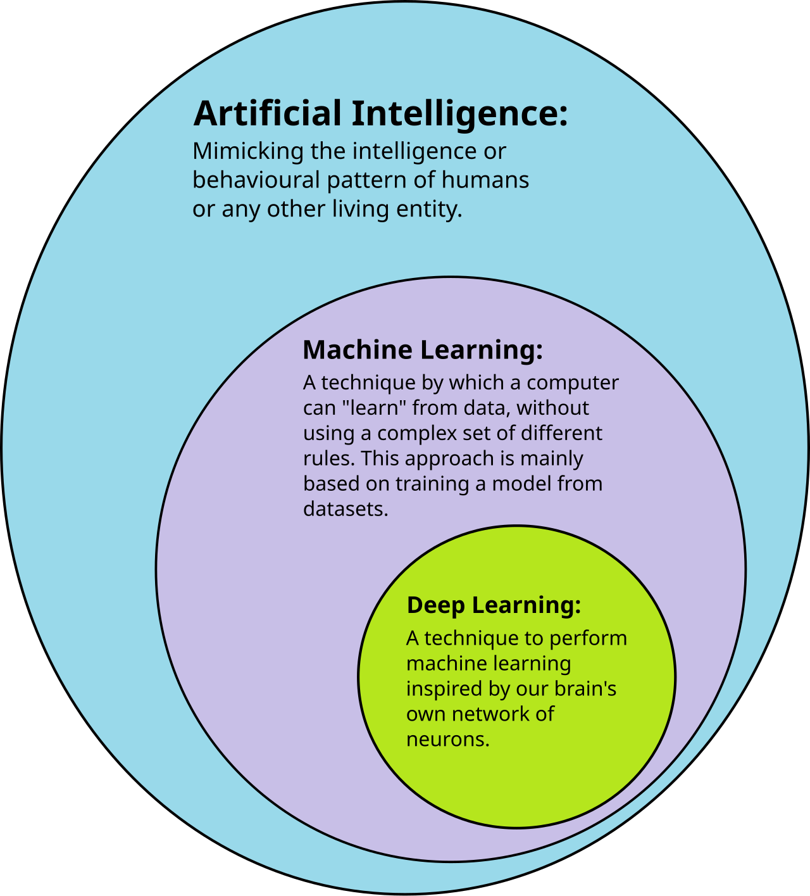
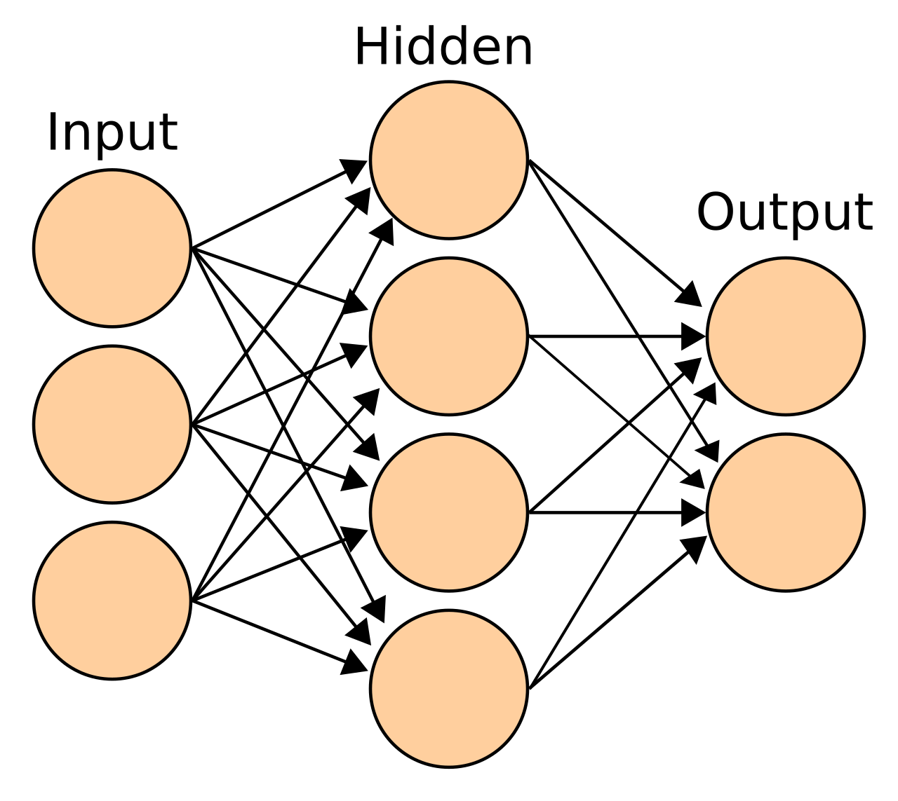
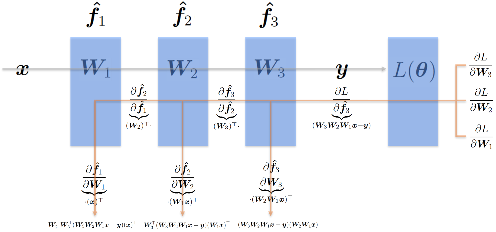
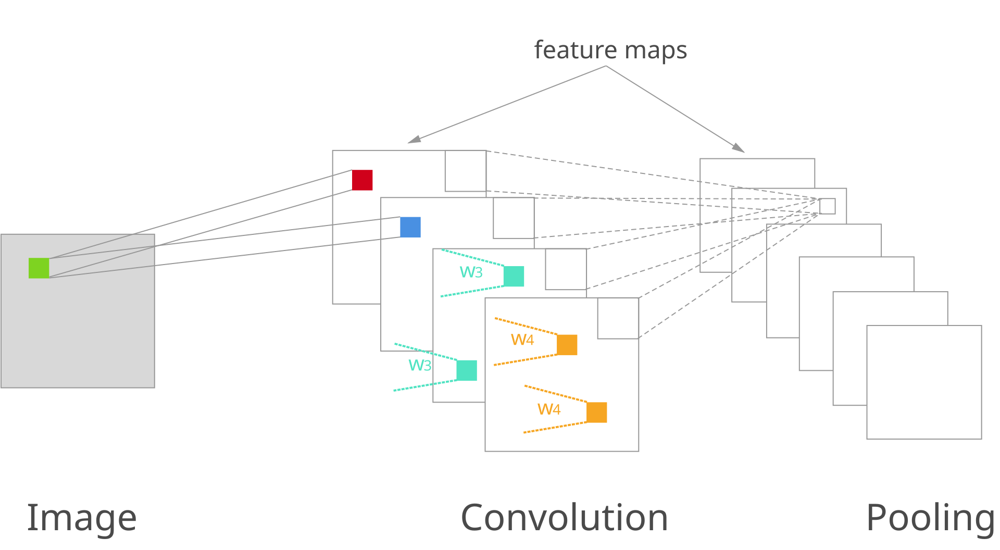
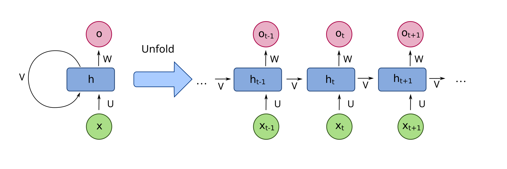

# 深度学习简介

> 原文：[CSDN](https://blog.csdn.net/qq_63283852/article/details/166647747)

**摘要：**本文系统讲解深度学习的基础知识，从人工智能、机器学习与深度学习三者的包含关系切入，回顾机器学习固定五步流程及其处理图像、文本的局限，引出深度学习以人工神经网络为架构、自动提取特征的核心定义。随后拆解神经网络（ANN）的输入层、隐藏层、输出层结构，说明神经元加权求和与激活函数的作用，并介绍张量、全连接层、黑盒特性及反向传播训练原理。接着总结深度学习的四大特点，梳理 CNN、RNN、Transformer 等常见模型及其在图像、文本处理中的应用，最后给出应用场景、发展历史与知识速查表，帮助读者建立完整的深度学习知识框架。

---

## 一、什么是深度学习

### 1.1 人工智能、机器学习与深度学习的关系

三者是**包含关系**：

```python
人工智能（Artificial Intelligence, AI）
    └── 机器学习（Machine Learning, ML）
            └── 深度学习（Deep Learning, DL）
```



| 概念 | 定义 |
| --- | --- |
| **人工智能（AI）** | 让机器表现出智能行为的科学与工程，目标是让机器"仿智" |
| **机器学习（ML）** | 实现人工智能的一种途径，让计算机从数据中学习规律，而无需显式编程 |
| **深度学习（DL）** | 机器学习的一个子集，基于人工神经网络，通过多层非线性变换**自动**学习数据的特征 |

深度学习是机器学习的子集，所以要理解深度学习"深"在哪、新在哪，得先看机器学习是怎么工作的。

### 1.2 先回顾：机器学习是怎么工作的

#### 流程固定：核心五步

机器学习的处理流程是**固定的**：

```python
获取数据 → 数据预处理 → 特征工程 → 模型训练 → 模型评估与预测
```

其中**特征工程由人来完成**——这是机器学习最依赖人工经验的环节，也是它和深度学习最核心的区别。

#### 数据预处理：标准化与归一化

预处理最常见的操作是把不同量纲的特征缩放到接近的范围，两种常用方法：

| 方法 | 英文 | 公式 | 效果 |
| --- | --- | --- | --- |
| **标准化** | Standardization（Z-score） | `z = (x − μ) / σ` | 变换成均值 0、标准差 1 的分布，形状不变 |
| **归一化** | Normalization（Min-Max） | `x' = (x − min) / (max − min)` | 把数据压缩到 [0, 1] 区间 |

两个统计量：

- **均值 μ**：所有数加起来除以个数，代表"平均水平"。如 `[2, 4, 6]` 的均值为 `4`。
- **标准差 σ**：衡量数据的波动程度，即每个数离均值平均有多远。σ 大说明数据忽高忽低，σ 小说明数据都挤在均值附近。

为什么要做缩放：不同特征量纲差异很大（如年龄范围 0~100，收入可达几十万），大数值特征会"压住"小数值特征、主导训练过程；缩放后各特征公平参与，模型收敛更快更稳定。

> 经验：数据近似正态分布或存在异常值时用**标准化**；需要固定范围（如图像像素 0~255 → 0~1）时用**归一化**。

#### 三大任务（按实际使用频率）

| 任务 | 英文 | 说明 | 使用频率 |
| --- | --- | --- | --- |
| **分类** | Classification | 预测离散类别（如垃圾邮件 / 正常邮件） | 大概率用 |
| **回归** | Regression | 预测连续数值（如房价、温度） | 也会用 |
| **聚类** | Clustering | 无监督，把相似样本自动分组 | 很少用，一般只在项目初期做样本相似性分析，且不会从 0 开始造轮子，直接用现成工具 |

#### 局限：处理图像、文本能力较弱

机器学习处理**图像、文本**这类非结构化数据的能力较弱——图像是高维的像素矩阵，文本是离散的符号序列，人工很难设计出有效的特征。这正是要引入深度学习的原因：能不能让算法自己学特征？

### 1.3 深度学习的核心定义

**深度学习**（Deep Learning）是机器学习的分支，是一种以**人工神经网络为架构**、对数据进行**特征学习**的算法。"深度"指网络中使用**多层**结构。

核心思想：通过模仿人脑的神经网络来处理和分析复杂的数据，从大量数据中自动提取复杂特征，擅长处理高维数据，如图像、语音和文本。

核心要点：

1. **基于人工神经网络**：模仿人脑神经元结构构建计算模型
2. **深度**：网络中使用多层结构
3. **逐层抽象**：每层通过非线性变换处理数据，逐渐提取更复杂、更抽象的特征
4. **端到端学习**：从原始数据直接到最终结果，无需人工设计特征

### 1.4 深度学习 vs 传统机器学习

两种流程放在一起看，区别一目了然：

```python
机器学习：  输入 → 人工特征提取 → 分类 → 输出
深度学习：  输入 → 算法自动特征提取 + 分类 → 输出
```

| 对比维度 | 传统机器学习 | 深度学习 |
| --- | --- | --- |
| **特征提取** | 依赖人工设计特征，并进行特征提取 | 不需要人工，依赖算法自动提取特征 |
| **处理流程** | 输入 → 人工特征提取 → 分类 → 输出 | 输入 → 自动特征提取 + 分类 → 输出 |
| **数据需求** | 相对较少 | 通常需要大量标注数据 |
| **计算资源** | 要求较低 | 需要强大的计算资源（如 GPU） |
| **可解释性** | 相对较好 | 可解释性差，被称为"黑箱" |
| **擅长领域** | 结构化数据、简单任务 | 高维数据（图像、语音、文本） |

> **关键区别**：传统机器学习算法依赖人工设计特征，并进行特征提取；
>
> 而深度学习方法不需要人工，而是依赖算法自动提取特征。
>
> 深度学习通过模仿人脑的神经网络来处理和分析复杂的数据，从大量数据中自动提取复杂特征，尤其擅长处理高维数据（图像、语音、文本）。这也是深度学习被看做黑盒子、可解释性差的原因（为什么会变成黑箱，第二章 2.6 节展开）。

深度学习的架构是人工神经网络，那么神经网络长什么样？下面把它拆开看。

## 二、神经网络（ANN）：深度学习的骨架

### 2.1 三种层：输入层、隐藏层、输出层

ANN（Artificial Neural Network，人工神经网络）由三种层组成：

```python
输入层 ──→ 隐藏层（一层或多层） ──→ 输出层
(特征数)      (神经元 + 激活函数)      (由任务决定)
```



| 层 | 神经元个数由什么决定 | 作用 |
| --- | --- | --- |
| **输入层** | 特征数（如鸢尾花 4 个特征 → 4 个神经元） | 只接收数据，不做计算 |
| **隐藏层** | 人为设定（经验值） | 特征提取的核心，逐层抽象 |
| **输出层** | 任务目标（二分类 1 个，多分类 = 类别数，回归 = 预测值个数） | 给出最终结果 |

### 2.2 隐藏层：每个神经元只做两件事

1. **加权求和**：`z = w₁x₁ + w₂x₂ + … + wₙxₙ + b`（w 是权重 weight，b 是偏置 bias）
2. **激活函数**：`a = f(z)`，如 ReLU、Sigmoid

> 为什么必须有激活函数：如果只有加权求和（线性运算），无论叠多少层，整体仍等价于一层线性变换；加入非线性激活函数后，网络才能拟合复杂的非线性关系。

举例：输入 `x = [1, 2]`，权重 `w = [0.5, 0.4]`，偏置 `b = 0.1`，则 `z = 0.5×1 + 0.4×2 + 0.1 = 1.4`，经 ReLU 激活后输出 `a = max(0, 1.4) = 1.4`。

### 2.3 关于"深度"：层数与神经元个数

> - 网络的**深度 = 隐藏层的层数**（输入层和输出层不计入）。
> - 隐藏层越多，网络越"深"，能提取的特征越抽象。
> - 课程约定：每个隐藏层的神经元**至少 2 个**——只有 1 个神经元的隐藏层等价于感知机，网络结构失去意义。
> - 开发经验：隐藏层神经元数按**"前层多、后层逐层递减"的漏斗形**设置，效果通常较好；具体数值没有公式，靠经验调参。

### 2.4 全连接层在哪里

全连接层（Fully Connected Layer，又称 Dense Layer / 稠密层）指**前一层的每个神经元都与后一层的每个神经元相连**的层：

> - 最朴素的 ANN（如多层感知机 MLP）：**整个网络全是全连接层**。
> - **CNN 中**：全连接层在**网络末端**——前面卷积层、池化层负责提特征（保留空间结构），最后展平（Flatten）后接全连接层负责"综合所有特征做分类"。
> - **RNN 中**：全连接层也在末端——词嵌入层 → 循环网络层 → 全连接层输出结果。
> - 缺点：全连接意味着参数量最大，`n` 个输入、`m` 个输出需要 `n×m + m` 个参数，所以 CNN 里它总是放在最后"收口"。

### 2.5 底层数据结构：张量，且输入必须是二维

> - 深度学习框架底层的统一数据结构是**张量（Tensor）**：0 维是标量、1 维是向量、2 维是矩阵、3 维及以上统称张量。
> - 张量中只能存放数值——所以文本、类别标签等都必须先转成数值才能进入网络。
> - **ANN 的输入是二维张量**：`(样本数 × 特征数)`。而图像天然是三维的（高 × 宽 × 通道），所以：
>   - 要么先展平（Flatten）成向量再进全连接网络（会丢失空间结构）；
>   - 要么先用 CNN 提取特征、保留空间信息，再进全连接层——这就是 CNN 存在的意义（第四章展开）。

### 2.6 为什么说深度学习是黑盒

- 深度学习模型内部的参数动辄百万千万，人无法逐个解读每个参数的含义，模型内部的运作机制相对不透明，因此被称为**"黑箱"**，可解释性差。理解模型为什么做出特定决策比较困难，这对某些应用场景是一个挑战。
- 更根本的问题：连"为什么 4 层比 3 层效果好"这类结构问题，目前也**没有数学公式能解释**。只有少数研究者尝试用数学工具（如神经正切核 NTK 等理论）去解释，业界仍以经验调参为主。

结构看懂了，下一个问题自然是：网络里成千上万个参数（w、b）是怎么定下来的？答案是训练——反向传播。

### 2.7 拓展：神经网络是怎么训练的——反向传播



以最简单的单参数模型 `y = wx + b` 为例，训练一共有四个步骤，循环往复：

**① 前向传播（Forward）**：拿当前的参数算出预测值。

**② 计算损失（Loss）**：用损失函数衡量预测值 ŷ 与真实值 y 的差距，如均方误差 `L = (ŷ − y)²`。

**③ 反向传播（Backpropagation）**：拿着结果反推——从损失出发，利用链式法则，逆向算出损失对**每个参数**的梯度（∂L/∂w、∂L/∂b）。梯度含义：参数往这个方向动一点，损失会怎么变。

**④ 更新参数（权重）**：新参数 = 上一次的参数 − 学习率 × 梯度（梯度下降法，Gradient Descent），即：

```python
w ← w − η · (∂L/∂w)
b ← b − η · (∂L/∂b)
```

这就是"参数是在上一次的基础上加（减）一个修正量"——每次只修正一小步（步长由学习率 η 控制），而不是凭空重算。

**数值示例**：真实规律 `y = 4`，输入 `x = 2`，初始参数 `w = 1, b = 0`，学习率 `η = 0.1`：

| 步骤 | 计算 | 结果 |
| --- | --- | --- |
| 前向传播 | `ŷ = 1×2 + 0` | `ŷ = 2` |
| 损失 | `L = (2 − 4)²` | `L = 4` |
| 求梯度 | `∂L/∂w = 2(ŷ−y)·x = −8`；`∂L/∂b = 2(ŷ−y) = −4` | 梯度都是负的 |
| 更新参数 | `w = 1 − 0.1×(−8) = 1.8`；`b = 0 − 0.1×(−4) = 0.4` | `w=1.8, b=0.4` |
| 再来一遍 | `ŷ = 1.8×2 + 0.4 = 4.0` | `L = 0`，损失归零 |

**为什么要循环**：深度网络中参数动辄成千上万个，反向传播每轮把所有参数的梯度一次性算出并全部更新；更新完再用数据跑一遍"前向 + 反向"，如此反复（数据完整过一遍叫一个 **epoch**），直到损失不再明显下降，训练结束。

一句话总结：前向传播算损失，反向传播算梯度，梯度下降更新参数。

## 三、深度学习的特点

看完结构与训练方式，深度学习的四个特点就顺理成章了：

- **多层非线性变换**：模型由多个层次组成，每一层都应用非线性激活函数对输入数据进行变换（2.2 节）。较低层级捕捉简单特征（边缘、颜色等），更高层级识别更复杂的模式（物体、面部等）。
- **自动特征提取**：能自动从原始数据中学习有用的特征，不需要人工特征工程（对比 1.2 节机器学习的人工特征工程）。
- **大数据和计算能力**：通常需要大量标注数据和强大的计算资源（如 GPU）。大数据 + 高性能计算使深度学习在图像识别、自然语言处理等领域取得显著突破。
- **可解释性差**：内部运作机制不透明，被称为"黑箱"（2.6 节已展开）。

| 层级 | 捕捉的特征 |
| --- | --- |
| **较低层级** | 简单的特征（如边缘、颜色等） |
| **更高层级** | 更复杂的模式（如物体或面部识别） |

## 四、常见深度学习模型：图像与文本怎么处理

传统机器学习处理图像、文本的能力较弱（1.2 节），深度学习针对不同数据类型发展出了专门的模型。先看总表，再逐个展开最常用的两个。

| 模型 | 英文全称 | 简称 | 主要应用 |
| --- | --- | --- | --- |
| **卷积神经网络** | Convolutional Neural Networks | CNN | 图像识别、计算机视觉（CV） |
| **循环神经网络** | Recurrent Neural Networks | RNN | 序列数据、自然语言处理（NLP） |
| **自编码器** | Autoencoders | AE | 数据降维、特征学习、异常检测 |
| **生成对抗网络** | Generative Adversarial Networks | GAN | 图像生成、数据增强 |
| **Transformer** | Transformer | — | 自然语言处理、大模型基础 |
| **深度强化学习** | Deep Reinforcement Learning | DRL | 游戏 AI、机器人控制 |
| **图神经网络** | Graph Neural Networks | GNN | 图结构数据、社交网络 |

### 4.1 图像 → CNN（计算机视觉 CV）

CV（Computer Vision，计算机视觉）领域使用 **CNN（Convolutional Neural Networks，卷积神经网络）**：

```python
输入层 → 隐藏层（卷积层 → 池化层 → … → Flatten → 全连接层） → 输出层
```

- **卷积层**：用卷积核在图像上滑动，自动提取局部特征（边缘、纹理等），并保留图像的空间结构。用于图像分类、目标检测、图像分割等任务。
- **池化层**：缩小特征图尺寸，减少参数数量，提高计算效率。
- **全连接层**：位于网络末端，综合特征完成分类（呼应 2.4 节）。



**图像的两种排布：HWC 与 CHW**

| 排布 | 顺序 | 使用场景 |
| --- | --- | --- |
| **HWC** | 高（Height）× 宽（Width）× 通道（Channel） | 图像读取与存储的常见格式（如 OpenCV、PIL 读进来的图像），RGB 图通道为 3 |
| **CHW** | 通道 × 高 × 宽 | PyTorch 等框架内部计算的格式（批量形式为 NCHW），送入网络前需要转换 |

图像张量是三维（HWC），而 ANN 只吃二维输入（2.5 节），这正是 CNN 要先卷积提特征、再 Flatten 进全连接层的原因。

### 4.2 文本 → RNN（自然语言处理 NLP）

NLP（Natural Language Processing，自然语言处理）领域使用 **RNN（Recurrent Neural Networks，循环神经网络）**：

```python
输入层 → 词嵌入层（Embedding） → 循环网络层 → 全连接层 → 输出层
```

- **词嵌入层**：把文字（词）映射成低维数值向量——因为张量只能存数值（2.5 节），文本必须先数值化。
- **循环网络层**：具有"记忆功能"，处理输入数据的时间依赖性；但标准 RNN 难以捕捉长期依赖关系（后来由 LSTM、GRU、Transformer 逐步解决）。
- **全连接层**：末端输出结果。



**序列数据与依赖关系**

- **序列数据（Sequence Data）**：有先后顺序、前后相互关联的数据，如文本（词序）、语音、股价、传感器读数。
- **时间依赖 / 长期依赖**：当前的输出不仅取决于当前输入，还依赖之前出现过的信息。例如"我今天去银行，取了____"，必须结合前文才能填出"钱"。
- **梯度下降法（Gradient Descent）**（课堂提到的"梯度"）：训练时沿损失下降最快的方向更新参数，`w ← w − η·∇L`——已在 2.7 节反向传播中详细讲过，这里不再重复。
- **语音的处理**：声音信号先转成**频谱图（Spectrogram）**——横轴时间、纵轴频率的图像化序列特征——再作为序列数据输入 RNN。

### 4.3 其他模型要点

- **自编码器（AE）**：由**编码器**（把输入压缩成低维表示）和**解码器**（从低维表示重建原始输入）两部分组成，无监督学习。
- **GAN**：包含**生成器**（制造以假乱真的样本）和**判别器**（区分真假样本），二者对抗训练。现在热度已不高，图像生成领域逐渐被扩散模型（Diffusion Model，如 Stable Diffusion）取代，但原理仍值得学习。
- **Transformer**：摒弃递归结构，采用**自注意力机制（self-attention）**，可并行处理整个序列，在机器翻译、文本摘要等任务中表现出色，是 BERT、GPT 等大模型的基础。

### 4.4 深度学习计算框架

| 框架 | 现状 |
| --- | --- |
| **PyTorch** | 当前学界与工业界主流，接口接近 Python，上手容易 |
| **TensorFlow** | 热度已明显下降（口语说"过时"），存量项目仍在使用 |

- 两个框架底层都是**张量运算**，学会一个后另一个迁移成本很低。
- Transformer 架构是后续大模型的基础，必须掌握。

## 五、应用场景

| 应用领域 | 具体场景 |
| --- | --- |
| **计算机视觉** | 图像分类、目标检测、人脸识别、图像生成 |
| **自然语言处理** | 机器翻译、文本分类、情感分析、问答系统 |
| **自动驾驶** | 环境感知、路径规划、决策控制 |
| **推荐系统** | 个性化推荐、广告投放、内容分发 |
| **多模态与智能体** | 图文理解与生成（文生图、视觉问答）、AI Agent（任务规划与工具调用） |
| **医疗健康** | 医学影像分析、疾病诊断、药物发现 |
| **工业与制造业** | 质量检测、预测性维护、智能机器人 |
| **语音与音频处理** | 语音识别、语音合成、音乐生成 |

> 此外，深度学习还广泛应用于智能安防、智能零售、智慧教育、智能家居、智能汽车等领域。

具体展开：

- **计算机视觉（Computer Vision, CV）**
  - **图像分类**：将图像分为不同类别。如社交媒体自动标注照片、医疗影像病变检测。
  - **目标检测（Object Detection）**：在图像或视频中定位并分类多个对象。如自动驾驶中的行人检测、监控视频入侵检测。
  - **面部识别**：分析面部特征进行身份验证。如手机解锁、安防监控。
  - **图像生成**：基于输入生成新图像，如风格转换、超分辨率、老旧照片修复。
- **自然语言处理（Natural Language Processing, NLP）**（课堂在此补充了梯度、序列数据、长期依赖，见 4.2 节）
  - **机器翻译**：一种语言自动翻译成另一种。如 Google 翻译、实时语音翻译。
  - **情感分析**：分析文本情感倾向。如社交媒体监控、产品评论分析。
  - **文本生成**：生成符合语法与语义的文本。如自动写作助手、新闻生成。
  - **语音识别**：语音转文字。如智能助手、自动字幕。
  - **聊天机器人（Chatbot）**：理解用户输入并生成合理回应。如客服机器人、GPT 类模型。
- **推荐系统（Recommendation Systems）**
  - **电影、音乐推荐**：根据历史评分与行为推荐。如 Netflix、Spotify。
  - **电商推荐**：根据购买与浏览习惯推荐商品。如亚马逊、淘宝。
  - **社交媒体推荐**：分析社交行为推荐内容或好友。如 Facebook、Instagram。

## 六、发展历史

### 6.1 人工智能发展历史

| 阶段 | 时间 | 主要特征 | 标志性事件 |
| --- | --- | --- | --- |
| **符号主义** | 20 世纪 50-70 年代 | 专家系统占主导 | 1950：图灵提出"图灵测试"，并设计国际象棋程序 1962：IBM 的 Arthur Samuel 跳棋程序战胜人类高手（第一次浪潮） |
| **统计主义** | 20 世纪 80 年代-2000 年 | 主要用统计模型解决问题 | 1995：Cortes 和 Vapnik 提出支持向量机（SVM） 1997：IBM 深蓝战胜国际象棋世界冠军卡斯帕罗夫（第二次浪潮） |
| **神经网络** | 21 世纪初期 | 神经网络、深度学习流派 | 2012：AlexNet——深度学习在 CV 领域的开山之作 2016：Google AlphaGo 战胜李世石（第三次浪潮） |
| **大规模预训练模型** | 2017-至今 | 大规模预训练模型 | 2017：NLP 的 Transformer 框架出现 2018：BERT 和 GPT 出现 2022：ChatGPT 出现，进入大模型 AIGC 阶段 |

### 6.2 深度学习发展历史

| 阶段 | 时间 | 主要进展 |
| --- | --- | --- |
| **早期探索** | 1940s-1980s | 1943：McCulloch 和 Pitts 模仿生物神经系统构建计算模型（M-P 神经元） 1957：Frank Rosenblatt 提出**感知器**（Perceptron），能做简单二分类 1960 年代末：出现**多层感知器（MLP）**，但受限于计算能力和数据量，应用受限 |
| **挑战与瓶颈** | 1980s-1990s | 1986：Rumelhart、Hinton、Williams 发表**反向传播（Backpropagation, BP）算法**，使多层神经网络能通过梯度下降优化参数、解决复杂非线性问题 因计算资源限制，且对图像、语音等复杂数据处理能力较弱，深度学习未广泛应用；**SVM、决策树**等传统方法成为主流 |
| **复兴与突破** | 2000s-2010s | 2006：Hinton 团队提出**深度置信网络（DBN）**，引入无监督预训练，标志深度学习复兴 2012：Krizhevsky 等设计的 **AlexNet** 在 ImageNet（ILSVRC）竞赛中夺冠，将 Top-5 错误率从 26.2% 降至 15.3%，标志深度学习在 CV 领域的成功 2014：Goodfellow 提出**生成对抗网络（GAN）**，开启生成模型新时代 2015：何恺明等提出 **ResNet（残差网络）**，解决梯度消失 / 爆炸问题，使训练上百层的网络成为可能 |
| **爆发期** | 2016-至今 | 2016：AlphaGo 战胜李世石，深度强化学习进入公众视野 2017：Transformer 框架出现，奠定预训练语言模型基础 2018：BERT 和 GPT 出现 2022：ChatGPT 出现，进入大模型 AIGC 阶段 |
