# PyTorch框架使用上

> 原文：[CSDN](https://blog.csdn.net/qq_63283852/article/details/166850176)

**摘要:**PyTorch 是一个基于 Python 语言的深度学习框架，它将数据封装成张量（Tensor）来进行处理（官方早期定位是"基于 Python 的科学计算包"，如今已发展为深度学习的主流框架）。PyTorch 提供了灵活且高效的工具，用于构建、训练和部署机器学习和深度学习模型。PyTorch 广泛应用于学术研究和工业界，特别是在计算机视觉、自然语言处理、强化学习等领域。张量是 PyTorch 中的核心数据抽象：由同一种数据类型的元素组成的多维数组，与 NumPy 数组类似。

---

## 一、PyTorch 框架简介

### 1.1 什么是 PyTorch


- PyTorch 是一个**基于 Python 语言的深度学习框架**，它将数据封装成**张量（Tensor）**来进行处理（官方早期定位是"基于 Python 的科学计算包"，如今已发展为深度学习的主流框架）。
- PyTorch 提供了灵活且高效的工具，用于**构建、训练和部署**机器学习和深度学习模型。
- PyTorch 广泛应用于学术研究和工业界，特别是在计算机视觉、自然语言处理、强化学习等领域。

### 1.2 PyTorch 的特点

| 特点 | 说明 |
| --- | --- |
| **类似 NumPy 的张量计算** | 支持高效的数值计算 |
| **自动微分系统** | 支持自动梯度计算 |
| **深度学习库** | 提供丰富的神经网络组件 |
| **动态计算图** | 灵活构建计算图 |
| **GPU 加速** | 支持 CUDA |
| **跨平台支持** | 支持多种操作系统 |

- **类似于 NumPy 的张量计算**
  - 基本数据结构是张量（Tensor），与 NumPy 数组类似，但张量具有 GPU 加速能力（通过 CUDA），深度学习模型可以高效地在 GPU 上运行。
- **自动微分系统（autograd）**
  - 提供 `autograd` 模块，能**自动计算模型中每个参数的梯度**。
  - 《00-深度学习简介》里反向传播最繁琐的一步就是求 ∂L/∂w、∂L/∂b——autograd 就是把这一步自动化的模块。梯度计算简洁高效，且支持复杂的模型和动态计算图。
- **完整的深度学习库（torch.nn）**
  - `torch.nn` 子模块包含大量预构建的**层**（全连接层、卷积层、循环神经网络层等）、**损失函数**（交叉熵、均方误差等）和**优化算法**（SGD、Adam 等）。
  - `torch.nn.Module` 是构建神经网络的基础类，继承该类即可定义自己的网络架构。
- **动态计算图**
  - 运行时构建和修改模型结构，灵活性高，适合研究和模型调试。
- **GPU 加速（CUDA 支持）**
  - 只需把数据和模型转移到 GPU，PyTorch 会自动优化计算过程；通过 `tensor.to(device)` 一行代码即可在 CPU、GPU 之间（甚至 GPU 之间）搬运。
- **跨平台支持**
  - 支持多种硬件平台（CPU、GPU、TPU 等）、多种操作系统（Linux、Windows、macOS）以及分布式计算环境（多 GPU、分布式训练）。

### 1.3 PyTorch 与 TensorFlow 的比较

| 对比项 | PyTorch | TensorFlow |
| --- | --- | --- |
| **计算图** | 动态图（边写边执行，像普通 Python 代码一样调试） | 1.x 是静态图（先建图再执行）；2.x 引入 Eager Execution 后也支持动态图 |
| **API 风格** | 更贴近 Python（Pythonic），易学易用、调试方便 | 1.x 封装较重，调试不便 |
| **适用场景** | 研究和原型设计的首选，学术界与部分工业界更为流行 | 生态偏工程部署（1.x 时代优势明显） |

> [PyTorch vs. TensorFlow: Key Differences and Performance Comparison | Toptal®](https://www.toptal.com/developers/deep-learning/pytorch-vs-tensorflow "PyTorch vs. TensorFlow: Key Differences and Performance Comparison | Toptal®")--推荐文章
>
> [PyTorch 与 TensorFlow 深度学习 |内置设备](https://builtin.com/data-science/pytorch-vs-tensorflow "PyTorch 与 TensorFlow 深度学习 |内置设备")--推荐文章
>
> 结论呼应《00-深度学习简介》：当前学界与工业界新项目的主流是 **PyTorch**——灵活性和调试体验优于早期 TensorFlow，这是它"后期制胜"的关键。

### 1.4 PyTorch 发展历史

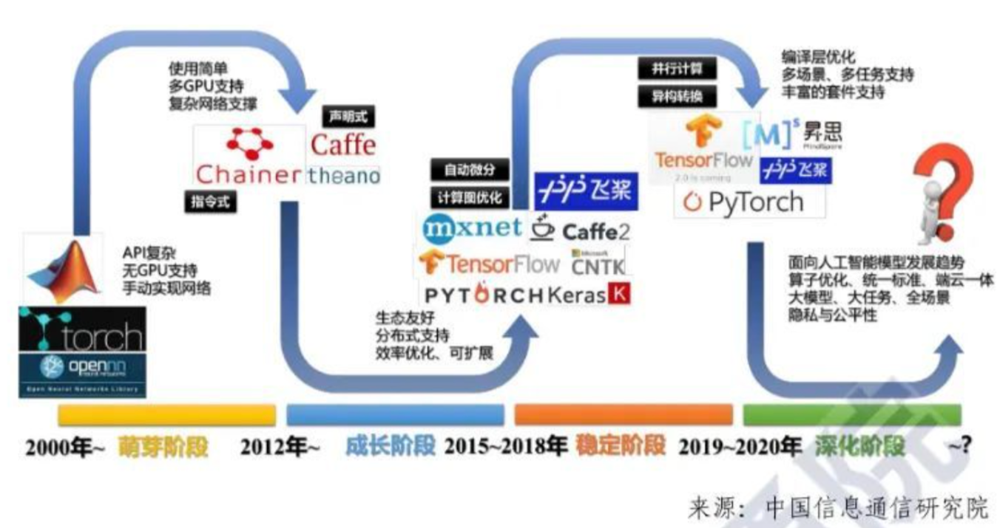

| 阶段 | 时间 | 关键进展 |
| --- | --- | --- |
| **Torch** | 2002 | 由 Ronan Collobert 等人开发，基于 Lua 语言的科学计算框架，提供多维张量操作和科学计算工具 |
| **Torch7** | 2011 | Torch 的最后一个主要版本（由 Ronan Collobert、Clement Farabet 等人维护），在深度学习领域取得一定成功；随着 PyTorch 的普及，Torch 停止维护 |
| **PyTorch 0.1.0** | 2017 年初 | Facebook 人工智能研究院（FAIR）在 Torch 基础上发布第一个版本，全面改用 Python 风格（Pythonic）接口，模型定义和调试更直观灵活 |
| **PyTorch 0.2.0** | 2017 年中 | PyTorch 从诞生起就采用**动态图**（define-by-run）机制，0.2.0 持续完善相关能力——这正是它后期超越 TensorFlow 1.x 的关键 |
| **PyTorch 1.0.0** | 2018 年底 | 首个稳定版本（合并 Caffe2），进一步简化模型的构建、训练与部署；引入 TorchScript 支持生产环境。PyTorch 的代码本身就是"立即执行"（Eager）模式 |
| **PyTorch 2.0** | 2023 | 引入 `torch.compile` 加速训练；TorchDynamo 替代 `torch.jit.trace` / `torch.jit.script`；编译器性能大幅提升，分布式训练也做了优化 |

### 1.5 安装与验证

```bash
pip install torch -i https://pypi.tuna.tsinghua.edu.cn/simple
```

- `-i` 用于指定镜像源：国内直接访问 PyPI 官方源速度慢，改用清华镜像源可显著加速下载。
- GPU 版本需要与本机 CUDA 版本匹配，按需从 PyTorch 官网选择对应安装命令。

安装完成后验证：

```python
import torch

print(torch.__version__)  # 能打印版本号即安装成功
```

## 二、张量（Tensor）：PyTorch 的核心数据结构

### 2.1 什么是张量

- **张量是 PyTorch 中的核心数据抽象**：由**同一种数据类型**的元素组成的**多维数组**，与 NumPy 数组类似。
  - 严格来说"矩阵"只是二维张量，张量是多维数组的统称。
- 在 PyTorch 中，张量以**类**（`torch.Tensor`）的形式封装，数值计算、矩阵操作、自动求导等处理方法都定义在这个类中。

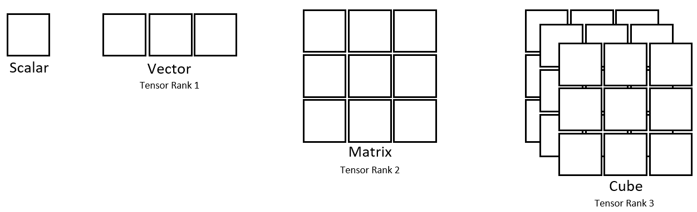

维度是逐级堆叠出来的：

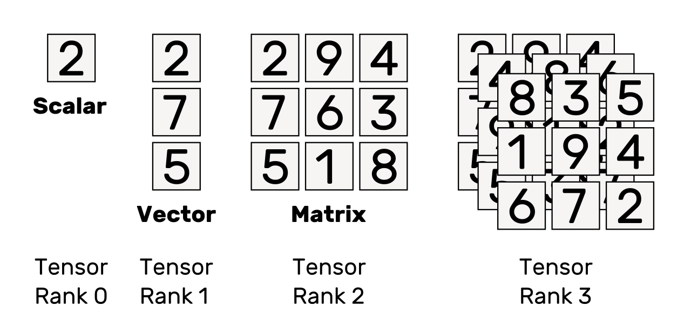

- **0 维**：标量（一个数）；**1 维**：向量；**2 维**：矩阵
- 多个二维张量组成三维张量（如一张图像：高 × 宽 × 通道）
- 多个三维张量组成四维张量（如一批图像：样本数 × 通道 × 高 × 宽，即《00-深度学习简介》提到的 NCHW）
- 多个四维张量组成五维张量（如一批视频片段）

此为层级视图:

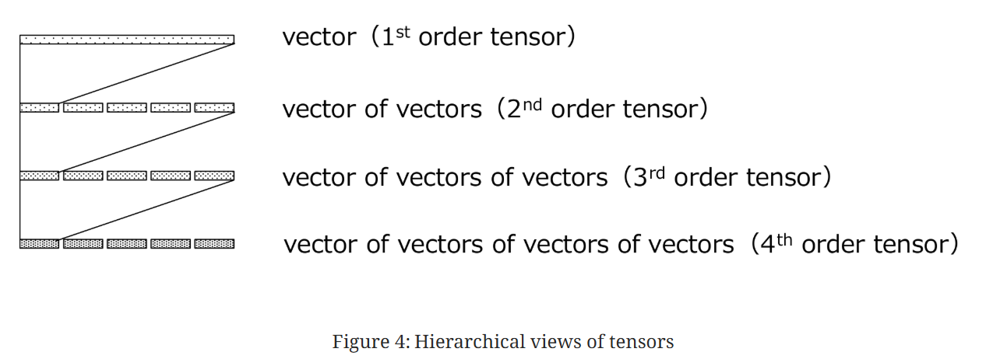

> [[2411.16094] Very Basics of Tensors with Graphical Notations: Unfolding, Calculations, and Decompositions--推荐文章](https://ar5iv.labs.arxiv.org/html/2411.16094 "[2411.16094] Very Basics of Tensors with Graphical Notations: Unfolding, Calculations, and Decompositions--推荐文章")
>
> 呼应《00-深度学习简介》2.5 节：张量是深度学习底层的统一数据结构，且**只能存放数值**；ANN 的输入是二维（样本数 × 特征数），图像是三维 HWC——学完本章的创建方法，这些维度就都能亲手造出来了。

### 2.2 张量的数据类型

常用数据类型与对应的构造器：

| 类别 | dtype | 对应构造器 | 说明 |
| --- | --- | --- | --- |
| 浮点 | `torch.float16` | `torch.HalfTensor` | 半精度浮点 |
| 浮点 | `torch.float32` | `torch.FloatTensor` | 默认类型 |
| 浮点 | `torch.float64` | `torch.DoubleTensor` | 双精度浮点 |
| 整型 | `torch.int16` | `torch.ShortTensor` | 短整型 |
| 整型 | `torch.int32` | `torch.IntTensor` | 整型 |
| 整型 | `torch.int64` | `torch.LongTensor` | 长整型（整数默认） |
| 其他 | `torch.uint8` / `torch.bool` | — | 无符号 8 位整型 / 布尔型 |

**类型里的数字——比特位**

- `float16` 里的 16 指的是 **16 个比特位（bit）**，`float32` 就是 32 个比特位，以此类推。比特位越多，能表示的数值范围越大、精度越高。
- 单位换算：1 字节（Byte）= 8 比特（bit）；1 KB = 1024 B，往上是 MB、GB、TB、PB、EB、ZB、YB（1024 进制）。
  - 大小关系：bit < B(字节) < KB < MB < GB < TB < PB < EB < ZB < YB
  - 示例数据：2022 年全球数据总量已达 ZB 级别（约 44 ZB）。
- 由此可知一个 `float32` 元素占 **4 字节**——张量越大越占内存，这也是"半精度训练"能省显存的原因。

> 张量中默认的数据类型是 **float32（torch.FloatTensor）**；整数的默认类型是 int64。创建时元素类型由源数据决定，下一节代码可以验证。

### 2.3 基本创建方式

#### 方式一：torch.tensor(data, dtype) —— 根据数据创建

知识点：**元素类型跟随源数据**——NumPy 数组是 float64，创建的张量就是 float64；Python 浮点列表默认 float32；想指定类型就传 `dtype=` 参数。

```python
import torch  # 需要安装 torch 模块
import numpy as np

# 1. 标量 -> 0 维张量, 整数默认 int64
data = torch.tensor(10)
print(data)

# 2. NumPy 数组: 源数据是 float64, 张量元素类型也是 float64
data = np.random.randn(2, 3)
data = torch.tensor(data)
print(data)

# 3. 列表: Python 浮点数默认 float32
data = [[10., 20., 30.], [40., 50., 60.]]
data = torch.tensor(data)
print(data)
#结果
# tensor([[10., 20., 30.],
#         [40., 50., 60.]])

# 4. 用 dtype= 显式指定元素类型: 以指定的为准, 不再跟随源数据
data = torch.tensor(10, dtype=torch.float32)          # 整数指定成浮点
print(data, data.dtype)        # tensor(10.) torch.float32

data = torch.tensor([1, 2, 3], dtype=torch.float64)   # int64 指定成 float64
print(data, data.dtype)        # tensor([1., 2., 3.]) torch.float64

data = torch.tensor([1.5, 2.7], dtype=torch.int64)    # 浮点指定成整数: 截断小数
print(data, data.dtype)        # tensor([1, 2]) torch.int64

# 常用别名: torch.float = torch.float32, torch.double = torch.float64
data = torch.tensor([1, 2, 3], dtype=torch.float)
print(data, data.dtype)        # tensor([1., 2., 3.]) torch.float32
```

> 注意:浮点转整数和后面IntTensor 一样是 **截断小数 （1.5→1），不是四舍五入**。

#### 方式二：torch.Tensor(形状) —— 根据形状创建

先补一个概念——形状（shape）：张量**每个维度上的元素个数**，按维度顺序写成一组数。比如"2 行 3 列"的矩阵，形状就是 `(2, 3)`：第 0 维有 2 个元素（2 行），第 1 维有 3 个元素（3 列）。前面 `np.random.randn(2, 3)`、`torch.zeros(2, 3)` 里反复出现的 `2, 3`，说的都是形状。

这个函数有**两种行为**，取决于你传的是什么：

**行为一：传几个整数 → 当作形状，创建"未初始化"的张量**

```python
# 创建 2 行 3 列的张量, 默认 dtype 为 float32
data = torch.Tensor(2, 3)
print(data)
```

运行一次，打印出这样的东西(内存残留数据)：

```python
tensor([[3.0702e-31, 2.5223e-26, 4.5889e-41],
        [2.5223e-26, 4.5889e-41, 5.0584e-31]])
```

> **什么叫"内存残留数据"**
>
> `torch.Tensor(2, 3)` 对计算机发出的语言是——"给我一块能装 6 个 float32 的内存"，但**只申请，不填数**。但这块内存是计算机之前用过又释放掉的，里面还留着上一个程序（或上一个变量）写的旧数据。就像酒店房间退房后没打扫，你直接住进去，抽屉里还有上一位客人的东西——打印出来的就是这些"上一位客人"留下的乱七八糟的数。
>
> **实验情况**：多运行几次程序，每次打印的值都不一样——因为每次申请到的内存块不同，残留的数据也不同。这些数没有规律，也不保证是 0，**所以任何情况下都不能假设未初始化张量的值。**

**行为二：传一个列表 → 当作数据，按数据创建（等价 torch.tensor）**

```python
# 传递列表时, 创建包含指定元素的张量 (注意元素被转成了浮点 10. 20.)
data = torch.Tensor([10])
print(data)        # tensor([10.])
data = torch.Tensor([10, 20])
print(data)        # tensor([10., 20.])
```

两种行为对比：

| 写法 | 传的是什么 | 结果 |
| --- | --- | --- |
| `torch.Tensor(2, 3)` | 几个整数 → 形状 | 2×3 的未初始化张量，值是随机的 |
| `torch.Tensor([10, 20])` | 一个列表 → 数据 | 一维张量 `[10., 20.]`，等价于 `torch.tensor([10, 20])` |

#### 方式三：torch.IntTensor() 等 —— 创建指定类型的张量

知识点：整型构造器收到浮点数时会**直接截断小数部分**（不是四舍五入）；无参调用时同样是创建未初始化张量。

```python
# 1. 创建 2 行 3 列, dtype 为 int32 的张量
data = torch.IntTensor(2, 3)
print(data)

# 2. 注意: 传入的元素类型不正确时, 会进行类型转换 (截断小数: 2.5 -> 2)
data = torch.IntTensor([2.5, 3.3])
print(data)

# 3. 其他类型构造器
data = torch.ShortTensor()   # int16
data = torch.LongTensor()    # int64
data = torch.FloatTensor()   # float32
data = torch.DoubleTensor()  # float64
```

### 2.4 线性区间张量

#### torch.arange(start, end, step) —— 固定步长

知识点：在 `[start, end)` 区间按步长step生成元素，**左闭右开**。

```python
# 在 [0, 10) 区间按步长 2 生成: [0, 2, 4, 6, 8]
data = torch.arange(0, 10, 2)
print(data)
```

#### torch.linspace(start, end, steps) —— 固定元素个数

知识点：在 `[start, end]` 区间生成 `steps` 个元素，**左闭右闭**——首尾两个数都包含。

它和 `arange` 的分工正好相反：

| 函数 | 你指定的 | 它自己算的 |
| --- | --- | --- |
| `torch.arange` | 步长 step | 生成几个元素（区间长度 ÷ 步长） |
| `torch.linspace` | 生成几个元素 steps | 步长 step（用下面公式） |

**步长公式为什么是 `(end − start) / (steps − 1)`**

想象把一根从 start 到 end 的线段**均匀打点**。要放 `steps` 个点，点与点之间的间隔只有 steps − 1 段（不是 steps 段！就像 5 根手指之间只有 4 个缝隙）。间隔数知道了，每段长度就出来了：

```python
step = (end - start) / (steps - 1)      ← 总长度 ÷ 间隔数
```

然后从起点出发，每次往前走一个 step，第 i 个点（i 从 0 数起）就是：

```python
value_i = start + step × i        i = 0, 1, ..., steps-1
```

拿 `linspace(0, 9, 10)` 逐项走一遍：

```python
10 个点落在 [0, 9] 上, 间隔有 10 - 1 = 9 段
step = (9 - 0) / (10 - 1) = 9 / 9 = 1

i=0:  0 + 1×0 = 0     ← 第 1 个点(左端点, 包含)
i=1:  0 + 1×1 = 1
i=2:  0 + 1×2 = 2
...
i=9:  0 + 1×9 = 9     ← 第 10 个点(右端点, 也包含)

结果: [0, 1, 2, ..., 9]  共 10 个数
```

```python
data = torch.linspace(0, 9, 10)
print(data)
# tensor([0., 1., 2., 3., 4., 5., 6., 7., 8., 9.])
```

除不尽时 step 就是小数，点照样均匀分布，且终点一定取到：

```python
# 5 个点落在 [0, 9]: 间隔 4 段, step = 9/4 = 2.25
data = torch.linspace(0, 9, 5)
print(data)
# tensor([0.0000, 2.2500, 4.5000, 6.7500, 9.0000])   9 包含在内
```

> 对比记忆：`arange(0, 10, 2)` → `[0, 2, 4, 6, 8]`，10 取不到（右开）；
>
> `linspace(0, 10, 5)` → `[0, 2.5, 5, 7.5, 10]`，10 一定取到（右闭）。一句话：想要包含终点，用 linspace。

> 为什么叫"线性"：以下两个函数生成的元素是等差数列——相邻两个元素之间的差（步长）固定不变，元素在数轴上均匀线性排列，所以叫线性（区间）张量。区别在于：`arange` 由"步长"决定生成几个，`linspace` 由"个数"决定步长是多少。

### 2.5 随机张量

#### torch.randn / torch.rand —— 随机浮点张量

知识点：`randn` 服从**标准正态分布**（均值 0、方差 1）；`rand` 服从 **[0, 1) 均匀分布**。

下图为正态分布曲线:说明数据更集中在均值附近。

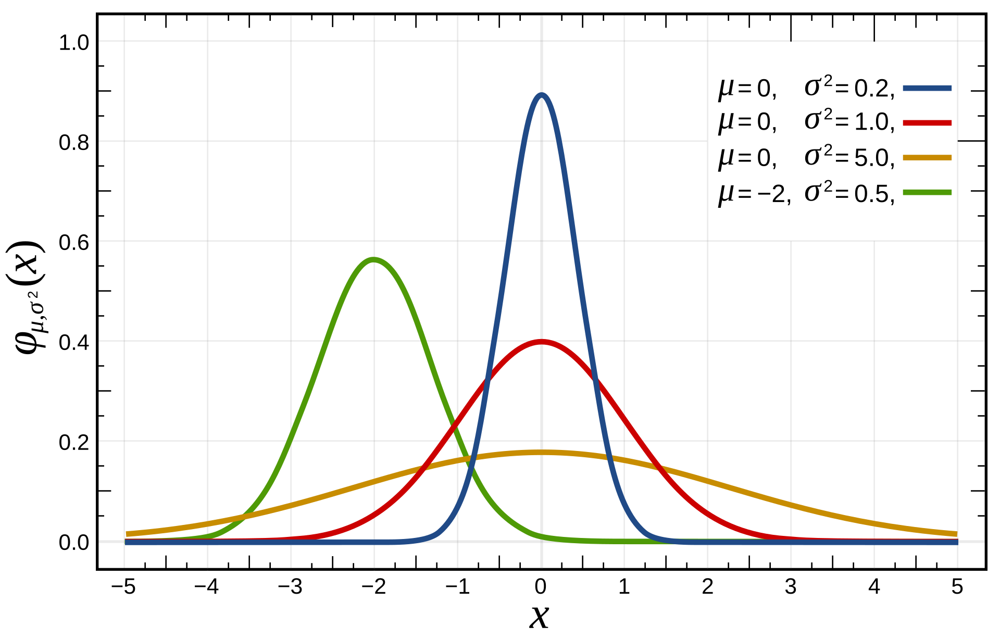

下图为均匀分布示意图:

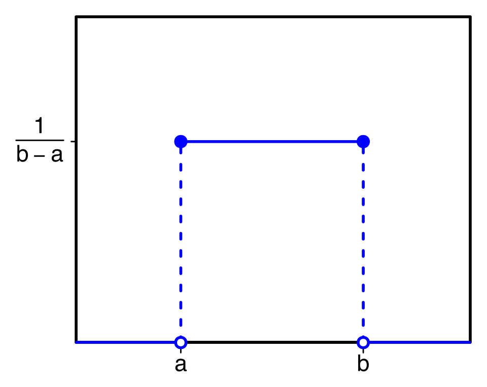

```python
# 创建 2 行 3 列的标准正态分布张量
data = torch.randn(2, 3)
print(data)
```

#### torch.randint(low, high, size) —— 随机整数张量

知识点：取值区间 `[low, high)`，**左闭右开**。

```python
# 在 [0, 10) 中随机取整数, 生成 2 行 3 列张量
data = torch.randint(0, 10, (2, 3))
print(data)
```

#### 随机种子：torch.initial_seed() 与 torch.manual_seed(seed)

> **误区：计算机不会真正的"随机"**
>
> 计算机是确定性机器，只会按公式算数。所谓随机数是**伪随机数**：从一个起始数字（种子，seed）出发，用一套**写死的公式**不断推算出下一个数。公式人人相同、永远不变，于是有一个必然结论：
>
> 种子相同 → 推算出的整条数列完全相同

由此回答几个常见疑问：

- **为啥设置了就不变了**：起点固定 → 往后抄到的每个数都固定 → 每次运行程序都从同一页开始抄，结果自然一模一样。
- **为啥我和别人跑出来一模一样**：因为你们翻的是同一种子，且生成的函数、参数、调用顺序都相同——不是巧合，是为了保证结果可对照、可复现。
- **参数可以随便填吗**：可以。任何整数都行，`1`、`24`、`2026` 只是"种子"编号，本身没有好坏或特殊含义。
- **不设置种子为啥每次都变**：PyTorch 默认拿**系统时间戳**当种子——时间一直在走`torch.initial_seed()` 查到的就是当前生效的种子值。

```python
# 查看当前随机数种子
print('随机数种子:', torch.initial_seed())

# 设置随机数种子后, 每次运行生成的随机数都相同
torch.manual_seed(100)
data = torch.randn(2, 3)
print(data)
print('随机数种子:', torch.initial_seed())
```

再验证一遍"固定起点"的效果：

```python
import torch

# 不设种子 -> 用时间戳当种子, 每次运行结果都不同
print(torch.randn(3))

# 设种子 -> 起点固定, 每次运行打印的都是同一组数
torch.manual_seed(100)
print(torch.randn(3))

# 重新回同一个起点, 数列从头再来一遍
torch.manual_seed(100)
print(torch.randn(3))     # 和上一行完全相同

# 换个种子, 序列整体改变
torch.manual_seed(24)
print(torch.randn(3))     # 又是另一组, 但以后每次用 24 都出这一组
```

> 用途：论文、调试、课堂练习都要求"结果可复现"——固定种子后，别人跑你的代码能得到和你逐位相同的结果，出了问题才好对答案。知识点：`initial_seed()` 查看（或获取）当前随机种子；`manual_seed(n)` **固定随机种子**——之后每次运行生成的随机数序列都相同，用于**实验复现**。

**输出结果**：

```python
tensor([[-0.5209, -0.2439, -1.1780],
        [ 0.8133,  1.1442,  0.6790]])
随机数种子: 4508475192273306739
tensor([[ 0.3607, -0.2859, -0.3938],
        [ 0.2429, -1.3833, -2.3134]])
随机数种子: 100
```

**小结**：

| 方法 | 说明 |
| --- | --- |
| `torch.arange(start, end, step)` | 创建线性张量（按步长） |
| `torch.linspace(start, end, steps)` | 创建线性张量（按个数） |
| `torch.initial_seed()` | 查看随机数种子 |
| `torch.manual_seed(seed)` | 设置随机数种子 |
| `torch.randn(size)` | 创建随机浮点类型张量 |

### 2.6 指定值张量

知识点：`zeros / ones / full` 按指定形状创建；对应的 **`*_like` 系列**按**已有张量的形状**创建同形张量——这组函数可以避免重复手写形状。

```python
# 1. 创建指定形状的全 0 张量
data = torch.zeros(2, 3)
print(data)
# tensor([[0., 0., 0.],
#         [0., 0., 0.]])

# 2. 根据已有张量的形状创建全 0 张量
data = torch.zeros_like(data)
print(data)
# tensor([[0., 0., 0.],
#         [0., 0., 0.]])      形状、类型都跟着 data 走
```

```python
# 1. 创建指定形状的全 1 张量
data = torch.ones(2, 3)
print(data)
# tensor([[1., 1., 1.],
#         [1., 1., 1.]])

# 2. 根据已有张量的形状创建全 1 张量
data = torch.ones_like(data)
print(data)
# tensor([[1., 1., 1.],
#         [1., 1., 1.]])
```

```python
# 1. 创建 2 行 3 列、值全为 10 的张量 (整数填充默认 int64)
data = torch.full([2, 3], 10)
print(data)
# tensor([[10, 10, 10],
#         [10, 10, 10]])

# 2. 根据已有张量的形状创建值全为 20 的张量
data = torch.full_like(data, 20)
print(data)
# tensor([[20, 20, 20],
#         [20, 20, 20]])
```

> 看输出的细节：
>
> `zeros / ones` 的打印是 `0. / 1.`——**带小数点**，因为这两个函数默认 `float32`；
>
> `full` 填整数时打印 `10`——**不带点**，默认 `int64`。`*_like` 不光抄形状，也抄元素类型。

> 开发建议：
>
> 要**按数据**创建 → 用 `torch.tensor`；
>
> 要**按形状**创建 → 用 `torch.zeros / ones / full / randn` 等，而不是 `torch.Tensor(2, 3)`——后者不仅语义不明（要回看参数才能猜出意图），还会出现"未初始化"的问题。

### 2.7 元素类型转换

三种方式：**创建时用 `dtype=` 指定**；创建后用 `data.type()` 转换；或用 `.double()` 等快捷方法。

#### 方式一：创建时用 dtype= 指定

```python
# dtype=torch.float 即 float32 (张量的默认类型)
t1 = torch.tensor([1, 2, 3, 4, 5], dtype=torch.float)
print(f"t1:{t1}，元素类型：{t1.dtype}，张量类型：{type(t1)}")
```

#### 方式二：data.type(dtype) —— 通用转换

```python
# 将 t1 转换为 int16
t2 = t1.type(torch.int16)
print(f"t2:{t2}，元素类型：{t2.dtype}")

data = torch.full([2, 3], 10)
print(data.dtype)  # torch.int64

# 将 data 元素类型转换为 float64
data = data.type(torch.DoubleTensor)
print(data.dtype)  # torch.float64

# 转换为其他类型
# data = data.type(torch.float64)       # 与上一行等价
# data = data.type(torch.ShortTensor)   # int16
# data = data.type(torch.IntTensor)     # int32
# data = data.type(torch.LongTensor)    # int64
# data = data.type(torch.FloatTensor)   # float32
# data = data.type(torch.float16)       # 半精度浮点
```

#### 方式三：.double() 等快捷方法（每一种如下，默认类型已标注）

```python
data = torch.full([2, 3], 10)

print(data.half())    # -> float16 (半精度)
print(data.float())   # -> float32 ==张量的默认类型==
print(data.double())  # -> float64
print(data.short())   # -> int16
print(data.int())     # -> int32
print(data.long())    # -> int64  ==整数张量的默认类型==

# 与 data.type() 功能等价, 写法更短, 按需选用
```

## 三、张量与 NumPy 的互转

> [Tensors — PyTorch Tutorials 2.14.0+cu130 documentationhttps://docs.pytorch.org/tutorials/beginner/basics/tensorqs_tutorial.html#bridge-with-numpy](https://docs.pytorch.org/tutorials/beginner/basics/tensorqs_tutorial.html#bridge-with-numpy "Tensors — PyTorch Tutorials 2.14.0+cu130 documentation")--推荐文章
>
> 为什么要互转：NumPy 是 Python 数据科学的基础库（读数据、预处理常用 ndarray），而 PyTorch 计算用张量——数据在两个世界之间流转，就需要这一组转换函数。

### 3.1 张量 → NumPy：.numpy()（共享内存）

知识点：`张量.numpy()` 转出的 ndarray 与原张量**共享内存**——改一个，另一个跟着变；链式加 `.copy()` 拷贝一份，就**不共享**了。

```python
import torch

# 1. 创建张量
t1 = torch.tensor([1, 2, 3, 4, 5])
print(f"t1:{t1}，元素类型：{t1.dtype}，张量类型：{type(t1)}")

# 2. 张量 -> numpy
# n1 = t1.numpy()          # 共享内存: 改一个, 另一个跟着变
n1 = t1.numpy().copy()     # 链式写法 copy(): 拷贝一份, 不共享内存
print(f"n1:{n1}，元素类型：{n1.dtype}，类型：{type(n1)}")

# 3. 验证是否共享内存: 只改 n1
n1[0] = 100
print(f"t1:{t1}")   # tensor([1, 2, 3, 4, 5])  t1 没变
print(f"n1:{n1}")   # [100   2   3   4   5]    只有 n1 变了
```

对比：不加 `.copy()` 时的共享内存效果（示例）：

```python
data_tensor = torch.tensor([2, 3, 4])
data_numpy = data_tensor.numpy()   # 共享内存
data_numpy[0] = 100
print(data_tensor)  # tensor([100,  3,  4])  张量也变了!
print(data_numpy)   # [100   3   4]
```

### 3.2 NumPy → 张量：from_numpy() 与 torch.tensor()

知识点：两种方式**只差一个共享内存**——

- `torch.from_numpy(ndarray)`：**共享内存**（零拷贝，效率高、省内存，但一方修改另一方跟着变），dtype 跟随 ndarray；
- `torch.tensor(ndarray)`：**不共享内存**（拷贝数据，安全独立），还能顺手用 `dtype=` 转类型。(推荐)

```python
import numpy as np
import torch

# 1. 创建 numpy 数组
n1 = np.array([11, 22, 33])
print(f"n1:{n1}，元素类型：{n1.dtype}")

# 2. numpy -> 张量, 两种方式
t1 = torch.from_numpy(n1)     # 共享内存; 需要 float32 时可再 .type(torch.float32)
t2 = torch.tensor(n1)         # 不共享内存 (拷贝)

# 3. 验证: 修改 numpy 数组
n1[0] = 99
print(f"n1:{n1}")   # [99 22 33]
print(f"t1:{t1}")   # tensor([99, 22, 33])  跟着变了 (共享)
print(f"t2:{t2}")   # tensor([11, 22, 33])  没变   (拷贝)
```

### 3.3 从标量张量中提取数值：.item()

知识点：`.item()` 把**只有一个元素的标量张量**（0 维）提取成 Python 数值，后面算损失、看精度时经常用。

```python
# 标量张量, 类型随数据: 100.34 是 Python 浮点 -> float32
t1 = torch.tensor(100.34)
print(f"t1:{t1}，元素类型：{t1.dtype}，张量类型：{type(t1)}")

# 提取内容 -> Python float
value = t1.item()
print(f"value:{value}，类型：{type(value)}")   # 100.34
```

## 四、张量数值计算

### 4.1 基本运算：加减乘除取负

| 函数 | 全称 | 符号等价写法 | 说明 |
| --- | --- | --- | --- |
| `add()` | add（加） | `a + b` | 加法 |
| `sub()` | subtract（减） | `a - b` | 减法 |
| `mul()` | multiply（乘） | `a * b` | 乘法 |
| `div()` | divide（除） | `a / b` | 除法**（结果自动变浮点）** |
| `neg()` | negative（取负） | `-a` | 取负号 |

知识点：

1. 带下划线的版本（`add_`、`sub_`、`mul_`、`div_`、`neg_`）会直接修改原数据（原地操作），效果类似 pandas 的 `inplace=True`；
2. **符号 `+ - * /` 可以替代对应的加减乘除函数**，实际代码里更常用；
3. 张量和**数值**运算 = 该数值与张量中每个元素依次运算。

```python
import torch

data = torch.randint(0, 10, [2, 3])
print(data)
# tensor([[3, 7, 4],
#         [0, 0, 6]])

# 1. 不修改原数据, 返回新张量
new_data = data.add(10)         # 等价 new_data = data + 10
print(new_data)

# 2. 直接修改原数据 (带下划线的函数)
data.add_(10)                   # 等价 data += 10
print(data)

# 3. 其他运算同理
print(data.sub(100))            # 减法  等价 data - 100
print(data.mul(100))            # 乘法  等价 data * 100
print(data.div(100))            # 除法  等价 data / 100, 结果是浮点数
print(data // 2)                # 整除(向下取整), 结果仍是整数
print(data.neg())               # 取负  等价 -data
```

```python
# 符号写法 vs 下划线写法
t1 = torch.tensor([1, 2, 3])

t2 = t1 + 10        # 符号写法: 不修改 t1
t2 = t1.add(10)     # 不修改 t1

t1.add_(10)         # 下划线写法: 修改 t1 本身
t1 += 10            # 符号的"原地"等价形式

print(f"t1:{t1}")   # tensor([21, 22, 23])
print(f"t2:{t2}")   # tensor([11, 12, 13])
```

### 4.2 点乘运算（Hadamard 积）

**点乘**指的是**相同形状**的张量**对应位置**的元素各自相乘（逐元素乘法，不是线性代数里的点积），使用 `mul` 或运算符 `*` 实现。

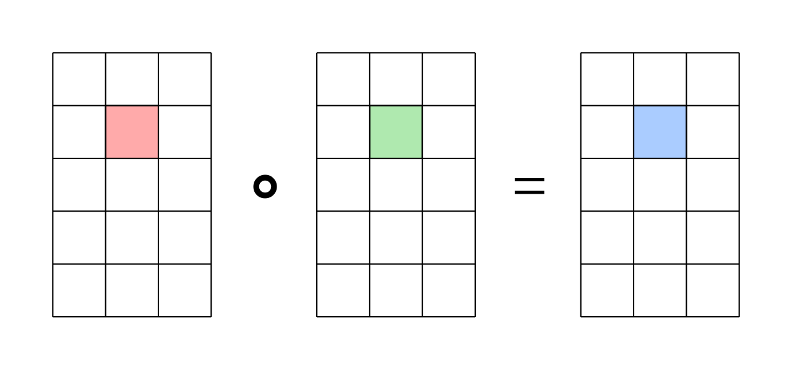

```python
data1 = torch.tensor([[1, 2], [3, 4]])
data2 = torch.tensor([[5, 6], [7, 8]])

# 第一种方式: mul 函数
data = torch.mul(data1, data2)
print(data)
# 第二种方式: * 运算符
data = data1 * data2
print(data)
# tensor([[ 5, 12],      1*5=5   2*6=12
#         [21, 32]])      3*7=21  4*8=32  一一对应, 位置不变
```

```python
# 示例: 2 行 3 列的同形状张量点乘
t1 = torch.tensor([[1, 2, 3], [3, 4, 5]])
t2 = torch.tensor([[1, 2, 3], [3, 4, 5]])
t3 = t1 * t2        # 与 t1.mul(t2) 等价, 两种方式均可
print(f"t3:{t3}")
```

### 4.3 矩阵乘法运算

> - [Inside the Matrix: Visualizing Matrix Multiplication, Attention and Beyond – PyTorchhttps://pytorch.org/blog/inside-the-matrix/](https://pytorch.org/blog/inside-the-matrix/ "Inside the Matrix: Visualizing Matrix Multiplication, Attention and Beyond – PyTorch")--推荐文章(有多张 3D matmul 动画截图,展示行×列、列分解、外积求和等不同视角,非常直观)
> - [VizLearn - Matrix MultiplicationInteractive matrix multiplication - click an output cell to see the row and column that produce it, with the shape rule enforced live.https://vizlearn.in/maths/matrix_multiplication.html](https://vizlearn.in/maths/matrix_multiplication.html "VizLearn - Matrix Multiplication")--推荐html(矩阵乘法交互式演示)

**矩阵乘法的要求**（和点乘完全不同）：

- 第一个矩阵形状 `(n, m)`，第二个矩阵形状 `(m, p)`——第一个矩阵的**列数** 必须等于 第二个矩阵的**行数**（A 列 = B 行）；
- 结果形状为 `(n, p)`（A 的行数 × B 的列数）。
- 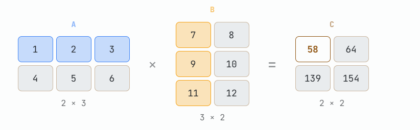

**怎么算**：结果的第 `i` 行第 `j` 列 = **A 的第 `i` 行** 与 **B 的第 `j` 列** 对应相乘再求和（"行 × 列"）。

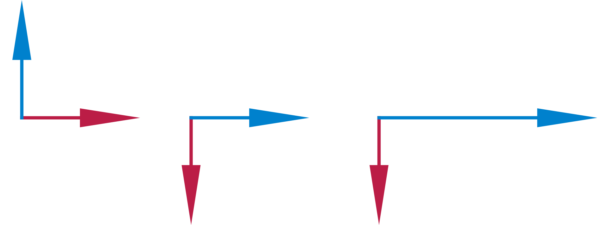

以 `data1 @ data2`（`(3,2)` 乘 `(2,2)` → `(3,2)`）为例：

```python
data1 = [[1, 2],        data2 = [[5, 6],
         [3, 4],                 [7, 8]]
         [5, 6]]

结果[0][0] = data1 第0行 [1, 2] · data2 第0列 [5, 7] = 1×5 + 2×7 = 19
结果[0][1] = data1 第0行 [1, 2] · data2 第1列 [6, 8] = 1×6 + 2×8 = 22
结果[1][0] = data1 第1行 [3, 4] · data2 第0列 [5, 7] = 3×5 + 4×7 = 43
...其余同理, 得到 [[19, 22], [43, 50], [67, 78]]
```

> 为什么深度学习离不开它：《00-深度学习简介》里全连接层的加权求和 `z = w₁x₁ + … + wₙxₙ + b`，写成矩阵形式就是 `Z = X @ W + b`——一次矩阵乘法就算完了一整层所有神经元。

| 方法 | 说明 |
| --- | --- |
| `@` 运算符 | 两个矩阵的乘积运算（推荐） |
| `torch.matmul()` | 效果同 `@`；高维张量时要求最后两个维度符合矩阵运算规则 |
| `torch.dot()` | 仅支持一维张量（向量内积：对应相乘再求和），二维会报错 |

```python
data1 = torch.tensor([[1, 2], [3, 4], [5, 6]])   # 形状 (3, 2)
data2 = torch.tensor([[5, 6], [7, 8]])           # 形状 (2, 2)

# 方式一: @ 运算符
data3 = data1 @ data2
print("data3->", data3)
# data3-> tensor([[19, 22],
#                 [43, 50],
#                 [67, 78]])      形状 (3, 2) = A行3 × B列2

# 方式二: torch.matmul, 效果相同
data4 = torch.matmul(data1, data2)
print("data4->", data4)

# dot() 仅支持一维: 向量内积
t4 = torch.tensor([1, 2, 3])
t5 = torch.tensor([4, 5, 6])
t6 = t4.dot(t5)
print(f't6: {t6}')   # tensor(32) = 1×4 + 2×5 + 3×6 = 4+10+18

# 二维张量用 dot() 会直接报错:
# t1 = torch.tensor([[1, 2, 3], [3, 4, 5]])
# t2 = torch.tensor([[1, 2], [3, 3], [4, 5]])
# t1.dot(t2)   # RuntimeError: 1D tensors expected
```

**本章小结**：

| 运算类型 | 方法 | 要求 |
| --- | --- | --- |
| **基本运算** | `add`、`sub`、`mul`、`div`、`neg`（带下划线修改原数据） | 同形状或"张量 vs 数值" |
| **点乘运算** | `torch.mul()` 或 `*` | 形状必须相同，对应元素相乘 |
| **矩阵乘法** | `@` 或 `torch.matmul()` | A 列 = B 行，结果 = A 行 B 列；`dot()` 仅一维 |

## 五、张量运算函数

PyTorch 为每个张量封装了很多实用的计算函数：

| 函数 | 说明 | dim 参数 |
| --- | --- | --- |
| `mean()` | 均值 | 有（要求 Float/Double 类型） |
| `sum()` | 求和 | 有 |
| `max()` / `min()` | 最大值 / 最小值 | 有（返回值 + 索引） |
| `sqrt()` | 平方根 | 无（逐元素） |
| `pow()` | 幂运算 | 无（逐元素） |
| `exp()` | 自然指数 eˣ | 无（逐元素） |
| `log()` / `log2()` / `log10()` | 对数（以 e / 2 / 10 为底） | 无（逐元素） |

> **dim 参数怎么理解**：dim 指定"被压扁（消除）的那个维度"。对形状 `(2, 3)` 的张量：
>
> - `dim=0`：压掉第 0 维（行）→ 按**列**聚合，结果形状 `(3,)`；
> - `dim=1`：压掉第 1 维（列）→ 按**行**聚合，结果形状 `(2,)`；
> - 不传 dim：全部压掉，结果是一个标量。

**max(dim) 的返回值**：不是单个张量，而是一个 named tuple——`values` 是最大值，`indices` 是最大值所在的下标位置（分类任务里常用来取"预测类别"）。

```python
import torch

t1 = torch.tensor([[1, 2, 3],
                   [4, 5, 6]])
print(f't1:{t1}')

# 1. sum 求和
print(t1.sum(dim=0))   # 按列求和 -> tensor([5, 7, 9])    (1+4, 2+5, 3+6)
print(t1.sum(dim=1))   # 按行求和 -> tensor([ 6, 15])    (1+2+3, 4+5+6)
print(t1.sum())        # 全部求和 -> tensor(21)
print('-' * 30)

# 2. max 求最大值 (min 同理), 返回 values + indices
print(t1.max(dim=0))
# 每列最大: values=tensor([4, 5, 6]), indices=tensor([1, 1, 1])  都来自第 1 行
print(t1.max(dim=1))
# 每行最大: values=tensor([3, 6]),   indices=tensor([2, 2])     都在第 2 列
print(t1.max())        # 全局最大 -> tensor(6)
print('-' * 30)

# 3. mean 求均值: ==要求张量为 Float/Double 类型==
# print(t1.mean())      # 整数张量会报错, 先转 float 或创建时指定 dtype
print(t1.float().mean())          # 全体均值 -> 3.5
print(t1.float().mean(dim=0))     # 按列均值 -> tensor([2.5, 3.5, 4.5])

data = torch.randint(0, 10, [2, 3], dtype=torch.float64)  # 创建时就指定, 省得转换
print(data.mean())                 # tensor(4.1667)

# 4. 幂运算: ** 与 pow 均可
print(t1.float() ** 2)             # 运算符写法
print(t1.float().pow(2))           # 方法写法
print(torch.pow(t1.float(), 2))    # 函数写法, 三者等价

# 5. sqrt / exp / log (逐元素)
d = torch.tensor([4.0, 9.0, 16.0])
print(d.sqrt())     # tensor([2., 3., 4.])
print(d.exp())      # e^x
print(d.log())      # 以 e 为底
print(d.log2())     # 以 2 为底
print(d.log10())    # 以 10 为底
```

## 六、张量索引操作

从 0 开始的行列索引和高亮单元格， `t[row, col]`。

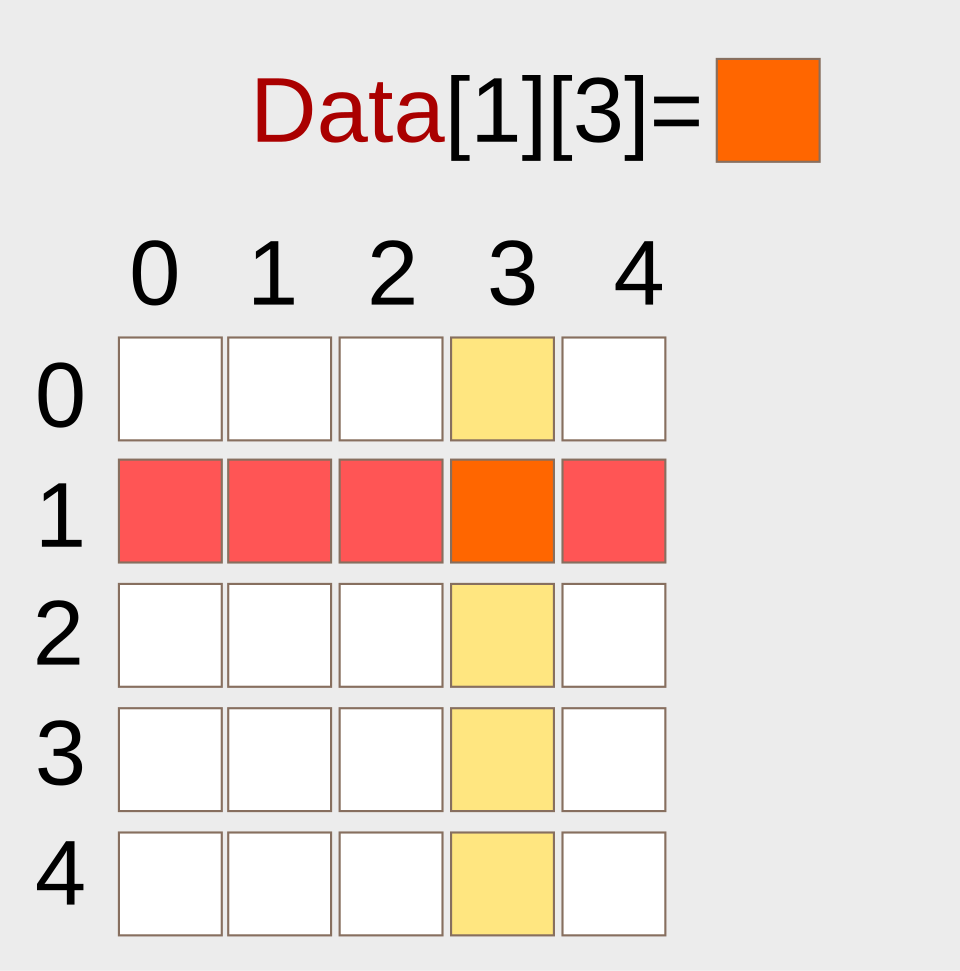

> [PyTorch Tensor Indexing and Slicinghttps://www.cosmiclearn.com/pytorch/tensor-indexing.php](https://www.cosmiclearn.com/pytorch/tensor-indexing.php "PyTorch Tensor Indexing and Slicing")--推荐文章(索引专题讲解(含切片/高级索引/布尔掩码对比表))
>  [https://blog.wangxm.com/2026/08/torch-visualized-the-operations/https://blog.wangxm.com/2026/08/torch-visualized-the-operations/](https://blog.wangxm.com/2026/08/torch-visualized-the-operations/ "https://blog.wangxm.com/2026/08/torch-visualized-the-operations/")--推荐文章(50 个 PyTorch 操作,每个一张图,全部在同一坐标系下——淡色块是输入、实色块是输出,代码面板附带形状变化)

### 6.1 准备数据

```python
import torch

# 随机种子固定为 24: 这个数字本身没有特殊含义, 任意整数都行,
# 目的只是让每次运行生成同一批随机数, 保证运行结果一致
torch.manual_seed(24)
t1 = torch.randint(1, 10, (5, 5))   # [1, 10) 左闭右开 -> 元素是 1~9, 形状 5 行 5 列
print(t1)
# tensor([[6, 9, 9, 2, 8],
#         [7, 8, 5, 8, 4],
#         [7, 4, 3, 9, 3],
#         [6, 1, 4, 2, 8],
#         [1, 2, 5, 7, 4]])
```

### 6.2 简单行、列索引

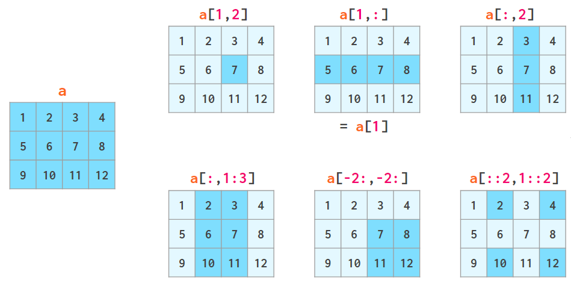

语法格式：`t1[行, 列]`，逗号前后各写一个"行/列的下标或范围"；省略就表示全取。

```python
print(t1[1])       # 第 1 行 (下标从 0 数, 即人脑理解第二行,上一行是第0行)
# tensor([7, 8, 5, 8, 4])
print(t1[1, :])    # 等价写法: 第 1 行的所有列
# tensor([7, 8, 5, 8, 4])
print(t1[:, :])    # 注意: 行列都省略 = 整个张量, 不是"某一行"
# (打印结果和 t1 一模一样, 一个都没筛)
print(t1[:, 2])    # 所有行的第 2 列 (第三列)
# tensor([9, 5, 3, 4, 5])
```

### 6.3 列表索引

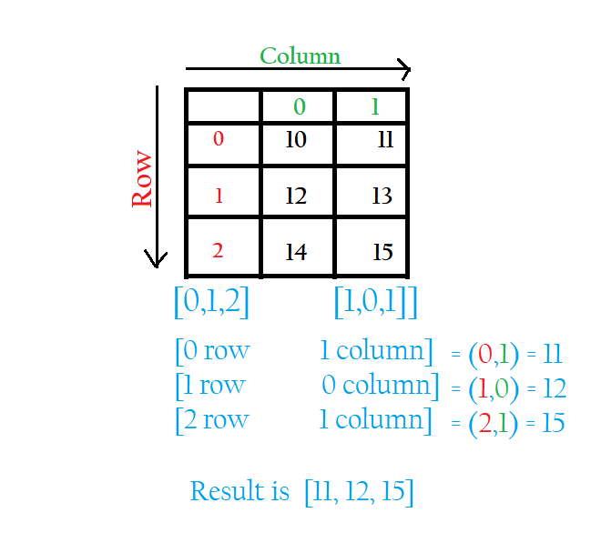

语法格式：`t1[行下标列表, 列下标列表]`，示例`t1[[行1, 行2], [列1, 列2]]`逗号前后写的不再是单个下标或切片，而是**一组下标组成的列表**（如 `[0, 1]指的是第0行和第一行`）；某一方省略则该方全取（如 `t1[[0, 2]]` 取第 0、2 两整行）。

配对规则：两个列表**按位置一一配对**成坐标——`[0,1]` 配 `[1,2]` (这个示例数据恰好取[行,行],[列,列]和和原本数据一致)得到坐标 `(0,1)` 和 `(1,2)`，每个坐标各取**一个**元素，所以返回 2 个值。它取的是"两个点"，不是"第 0、1 行 × 第 1、2 列"的整块区域！

```python
print(t1[[0, 1], [1, 2]])   # 坐标 (0,1), (1,2) 两个元素
# tensor([9, 5])        即 t1[0,1]=9, t1[1,2]=5
# 以下为原列表 便于查看
# tensor([[6, 9, 9, 2, 8],
#         [7, 8, 5, 8, 4],
#         [7, 4, 3, 9, 3],
#         [6, 1, 4, 2, 8],
#         [1, 2, 5, 7, 4]])

print(t1[[1, 3], [2, 4]])   # 坐标 (1,2), (3,4) 两个元素
# tensor([5, 8])        即 t1[1,2]=5, t1[3,4]=8

# 需求: 取第 0、1 行的第 1、2 列, 共 4 个元素 -> 一块 2x2 区域
# 行索引写成列向量 [[0],[1]], 它与 [1,2] 自动组合出所有坐标:
# (0,1) (0,2) / (1,1) (1,2), 结果排成 2x2
print(t1[[[0], [1]], [1, 2]])
# tensor([[9, 9],
#         [8, 5]])
```

### 6.4 范围索引（切片）

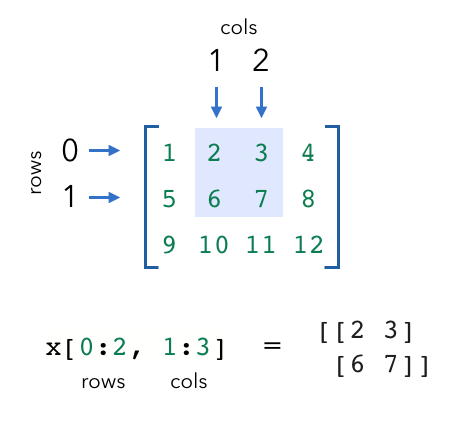

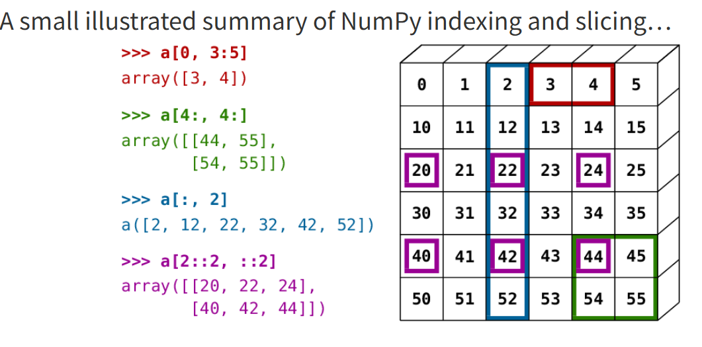

语法格式：`[start:stop:step]`，包左不包右（stop 不包含），`step` 是步长；留空表示"从头/到尾"。

```python
print(t1[:3, :2])     # 前 3 行的前 2 列 (行 0~2, 列 0~1)
# tensor([[6, 9],
#         [7, 8],
#         [7, 4]])

# 以下为原列表 便于查看
# tensor([[6, 9, 9, 2, 8],
#         [7, 8, 5, 8, 4],
#         [7, 4, 3, 9, 3],
#         [6, 1, 4, 2, 8],
#         [1, 2, 5, 7, 4]])

print(t1[1:, :2])     # 第 1 行到最后一行的前 2 列
# tensor([[7, 8],
#         [7, 4],
#         [6, 1],
#         [1, 2]])
print(t1[:2, :2])     # 第 0、1 行的第 0、1 列, 共 4 个元素
# tensor([[6, 9],
#         [7, 8]])
print(t1[1::2, ::2])  # 行从 1 开始步长 2 -> 第 1、3 行(奇数行)
                      # 列步长 2 -> 第 0、2、4 列(偶数列)
# tensor([[7, 5, 4],
#         [6, 4, 8]])
```

### 6.5 布尔索引

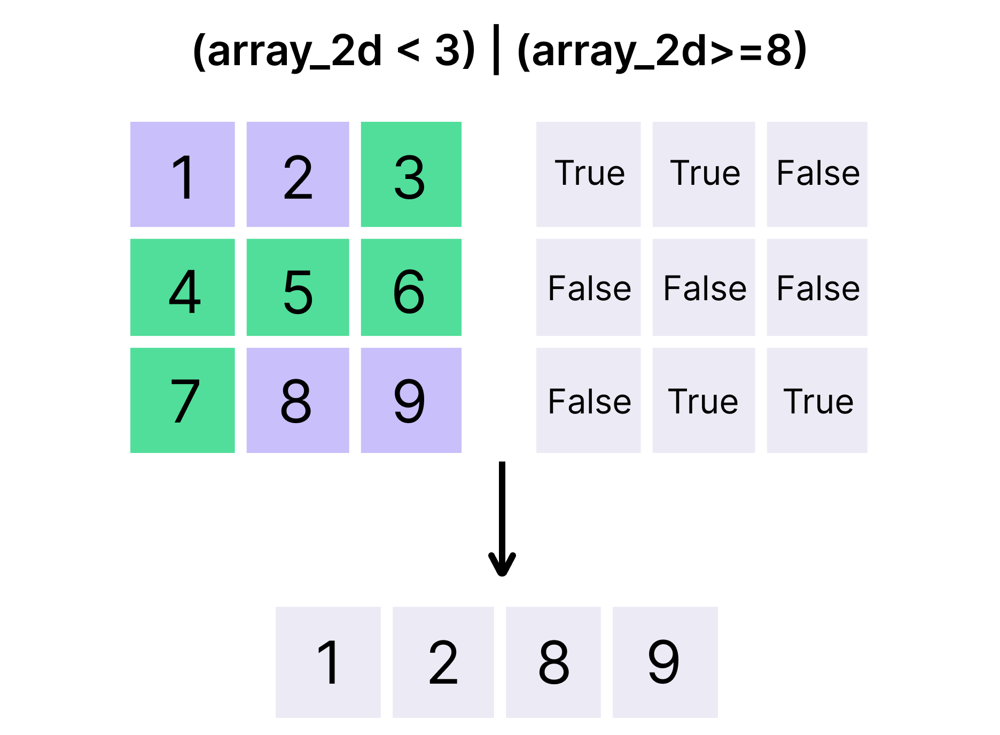

知识点：条件表达式（如 `> 5`）会生成一个**布尔张量**（True/False）；把它放进 `[]` 就变成了**掩码**——只保留 True 对应的位置。

```python
# 需求1: 第 3 列大于 5 的行数据
# 拆开看: t1[:, 3] 取出第 3 列 [2,8,9,2,7] -> >5 得到 [F,T,T,F,T]
#        -> 当作行掩码, 第 1、2、4 行被保留
print(t1[t1[:, 3] > 5])
# tensor([[7, 8, 5, 8, 4],
#         [7, 4, 3, 9, 3],
#         [1, 2, 5, 7, 4]])

# 需求2: 第 1 行大于 5 的数据, 两种写法结果不同
# 第 1 行 = [7,8,5,8,4] -> >5 -> [T,T,F,T,F] -> 保留第 0、1、3 列
print(t1[:, t1[1] > 5])      # 所有行 × "第1行>5"的那些列 -> 二维 (5, 3)
# tensor([[6, 9, 2],
#         [7, 8, 8],
#         [7, 4, 9],
#         [6, 1, 2],
#         [1, 2, 7]])
print(t1[1, t1[1, :] > 5])   # 只取第 1 行中 >5 的值       -> 一维 (3,)
# tensor([7, 8, 8])
# 区别: 逗号前是 [:] 还是 [1], 决定了"哪些行"参与
```

### 6.6 多维索引

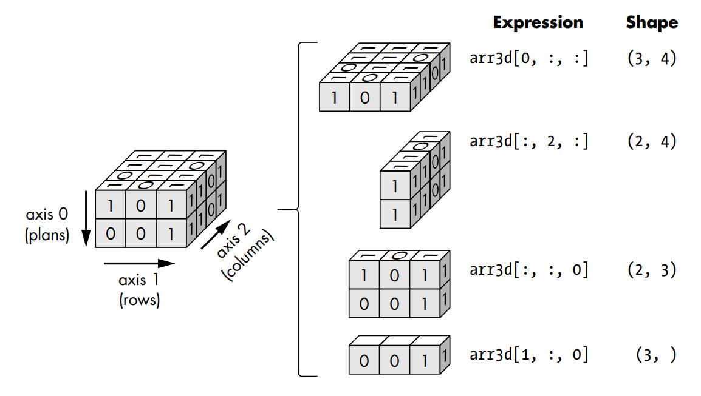

知识点：**轴（维度）按 shape 从左到右编号**。形状 `(2, 3, 4)`：0 轴长度 2、1 轴长度 3、2 轴长度 4。可以想象成 2 张 3×4 的表格摞在一起：0 轴是"第几张表"，1 轴是"第几行"，2 轴是"第几个"。

```python
t2 = torch.randint(1, 10, (2, 3, 4))
print(t2)
# tensor([[[3, 4, 6, 5],
#          [8, 8, 8, 3],
#          [4, 9, 6, 7]],
#
#         [[2, 8, 8, 5],
#          [6, 4, 2, 2],
#          [2, 7, 9, 4]]])

print(t2[0, :, :])   # 0 轴取第 0 个: 一张完整的 3x4 表格
# tensor([[3, 4, 6, 5],
#         [8, 8, 8, 3],
#         [4, 9, 6, 7]])
print(t2[:, 0, :])   # 1 轴取第 0 个: 每张表各取第 0 行 -> 2x4
# tensor([[3, 4, 6, 5],
#         [2, 8, 8, 5]])
print(t2[:, :, 0])   # 2 轴取第 0 个: 每行取第 0 个元素 -> 2x3
# tensor([[3, 8, 4],
#         [2, 6, 2]])
```

**小结**：

| 索引类型 | 示例 | 要点 |
| --- | --- | --- |
| **简单行列索引** | `data[0]`、`data[:, 0]` | `t[行, 列]`，省略即全取 |
| **列表索引** | `data[[0, 1], [1, 2]]` | 行列列表按位置配对成坐标，取"点" |
| **范围索引** | `data[:3, :2]`、`data[2:, :2]` | 切片包左不包右，支持 step |
| **布尔索引** | `data[data[:, 2] > 5]` | 条件生成掩码，保留 True 的行/列 |
| **多维索引** | `data[0, :, :]`、`data[:, 0, :]` | 轴按 shape 从左到右编号 |
