# PyTorch框架进阶基础下

> 原文：[CSDN](https://blog.csdn.net/qq_63283852/article/details/166996034)

**摘要：**本文系统讲解PyTorch张量操作与自动微分，涵盖形状变换（reshape、unsqueeze、transpose、view等）、拼接操作（cat、stack），并深入解析autograd机制，通过线性回归案例完整演示“数据准备→模型构建→损失计算→优化更新”的训练全流程，附知识速查表，助力快速掌握深度学习核心基础。

---

下图为标量、向量、矩阵、高维张量之间的区别，让我们先建立“张量维度”的视觉概念:

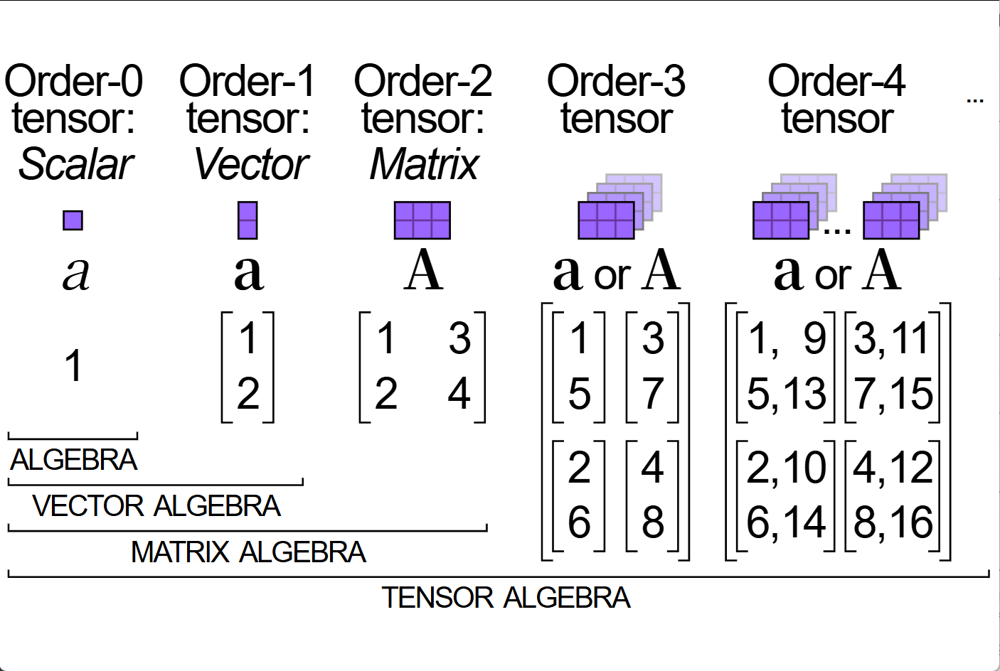

## 一、张量形状操作

深度学习里数据在网络中层与层之间流动，形状要不停变换——这组函数就是"变形工具"。它们有一个共同点：**只改变形状，不改变数据本身、不改变元素总个数。**

### 1.1 先会看形状：shape 与 size()

```python
import torch
data = torch.tensor([[10, 20, 30], [40, 50, 60]])   # 2 行 3 列
shape 属性和 size() 方法, 两种写法完全等价
print(data.shape)              # torch.Size([2, 3])
print(data.size())             # torch.Size([2, 3])
print(data.shape[0], data.shape[1])   # 2 3    (第 0 维 2 个, 第 1 维 3 个)
print(data.size(0), data.size(1))     # 2 3    (等价写法)
print(data.shape[-1])          # 3      (-1 = 最后一维)
print(data.shape[0] * data.shape[1])  # 6      (元素总数 = 各维相乘)
```

### 1.2 reshape()：按数据变形

一维数据 reshape 成三维张量， 强调 reshape 是“重新组织形状”，元素本身不丢失。`reshape` 在保证数据不变的前提下，把张量变成指定形状。

**各维相乘必须等于元素总数**，否则报错。

```python
data = torch.tensor([[10, 20, 30], [40, 50, 60]])   # 6 个元素
new_data = data.reshape(1, 6)     # 1×6 = 6 ✓
print(new_data)
tensor([[10, 20, 30, 40, 50, 60]])
print(new_data.shape)             # torch.Size([1, 6])
data.reshape(2, 5)   # 报错! 2×5 = 10 ≠ 6
RuntimeError: shape '[2, 5]' is invalid for input of size 6
```

> **为什么 reshape(2, 5) 报错**：变形只是"重新摆放"，不能凭空造出或丢掉元素。6 个元素摆不进 2 行 5 列（10 个坑）的格子。合法目标形状必须满足：各维相乘 = 6。

一维数据 reshape 成三维张量:

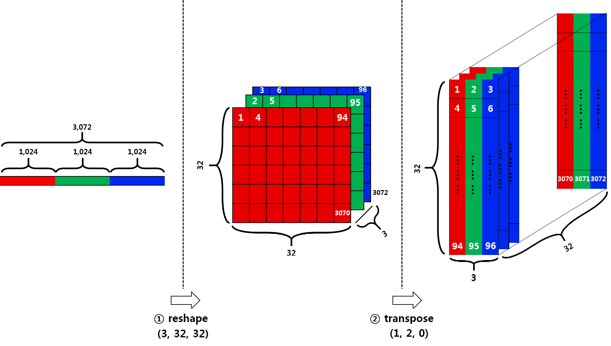

这张用 RGB 数据演示 `(3,072) → (3,32,32)`，虽然是图像数据，但 reshape 的意思很直观。

### 1.3 unsqueeze() / squeeze()：升维与降维

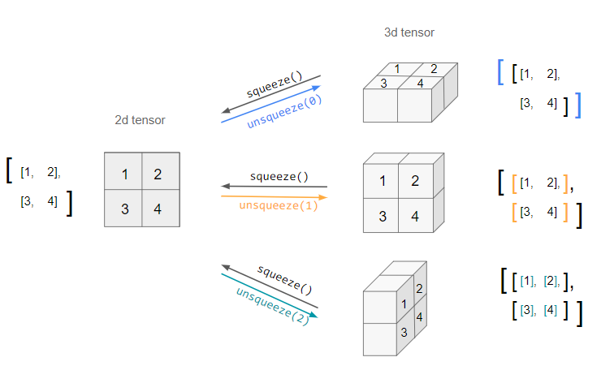

- `unsqueeze(dim=)`：在 **dim 位置插入一个长度为 1 的新维度**（升维）
- `squeeze()`：删除**所有长度为 1** 的维度（降维）

> **先搞懂什么叫"维度的长度"**
>
> 形状 (2, 3) 读作"第 0 维长度 2、第 1 维长度 3"
>
> 长度 = 沿着这个维度数数，能数出几个元素。
>
> 落到打印上就一条规则：**一层方括号 = 一个维度，括号里装了几个东西 = 这一维的长度**。

用「数括号」的方式理解维度，对照表如下：

| 写法 | 括号层数 | 维度 | 形状 |
| --- | --- | --- | --- |
| `[1, 2, 3, 4, 5]` | 1 层 | 1 维 | `(5,)` |
| `[[1, 2, 3, 4, 5]]` | 2 层 | 2 维 | `(1, 5)` |
| `[[1], [2], [3], [4], [5]]` | 2 层 | 2 维 | `(5, 1)` |

规则：**一层方括号 = 一个维度，括号里装了几个东西 = 这一维的长度**。

```python
[1, 2, 3, 4, 5]            # 1 层括号 → 1 维，装 5 个数 → (5,)
[[1, 2, 3, 4, 5]]          # 2 层括号 → 2 维，外层装 1 行 → (1, 5)
[[1], [2], [3], [4], [5]]  # 2 层括号 → 2 维，外层装 5 行，每行装 1 个数 → (5, 1)
```

所以"长度为 1 的维度"就是那层括号里只装了一个东西。unsqueeze 加一层"只装一个东西"的括号，squeeze 把这种括号拆掉——数据一个不动，变的只是"层级"。

`unsqueeze` 插长度 1 维度:

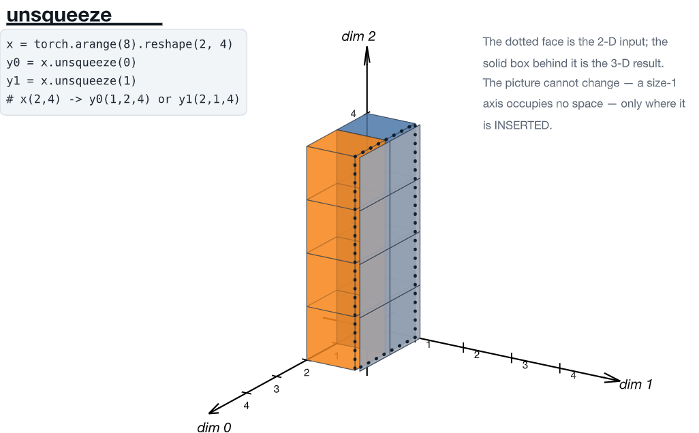

虚线面是二维输入；其后方的实心框是三维结果。注意：**图像不能改变**——一个尺寸为 1 的轴不占用空间，它**仅在插入位置处存在**。换句话说，unsqueeze 只是给张量"加了一层空壳"（长度为 1 的维度），数据本身一个都没动，只是维度层级变高了。

`squeeze` 删除长度 1 维度:

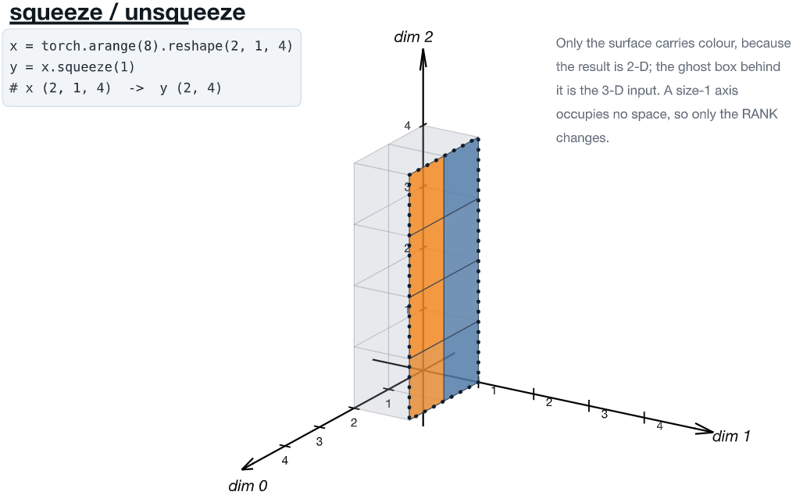

长度为 1 的维度不占用任何数据空间，因此 unsqueeze / squeeze 只改变张量的**维度数（RANK）**——比如从一维变二维，而元素总数、元素值、内存数据全部不变。配图中：有颜色的部分是真实数据，透明的"幽灵框"只是示意长度为 1 的维度，画出来好看，不占地方。

> - **RANK（秩）= 维度数 = shape 里数字的个数**。(5,) 秩为 1；(1,5) 秩为 2；(2,3,4) 秩为 3。
> - **尺寸(size) = 某一维的长度**。"尺寸为 1 的轴"就是我们上面说的"长度为 1 的维度"。
> - **为什么"不占用空间"**：元素总数 = 各维长度相乘，乘 1 永远不变。所以 (5,) → (1,5) → (5,1)，变的只是"有几层括号"（RANK），5 个元素、每个元素的值、内存里的数据全都原封不动。

真实数据画成**有颜色的部分**；长度为 1 的维度（或仅作示意用的额外层级）画成**透明虚线框**，就是"幽灵框"。它只示意"这个层级存在"，不对应任何真实格子。

```python
t = torch.tensor([1, 2, 3, 4, 5])         # 一维: (5,)
t2 = t.unsqueeze(0)     # 在 0 号位置前插入长度 1
print(t2, t2.shape)
tensor([[1, 2, 3, 4, 5]]) torch.Size([1, 5])   外面多包一层 []
t3 = t.unsqueeze(1)     # 在 1 号位置(末尾)插入长度 1
print(t3, t3.shape)
tensor([[1], [2], [3], [4], [5]]) torch.Size([5, 1])   每个元素各包一层 []
t4 = t.unsqueeze(-1)    # -1 也是末尾, 结果同 dim=1
print(t4.shape)         # torch.Size([5, 1])
t5 = t4.squeeze()       # 删掉所有长度为 1 的维度
print(t5, t5.shape)
tensor([1, 2, 3, 4, 5]) torch.Size([5])
```

> **几个疑问的答案**：
>
> **为什么打印多了一层 `[]`**：长度为 1 的新维度在打印时表现为"多包一层方括号"。`unsqueeze(0)` 把整行包起来（1×5），`unsqueeze(1)` 给每个元素各包一层（5×1）——数据还是那 5 个，只是"层级"变了。
>
> **为什么新维度长度不是 2 或 4**：unsqueeze 只负责"插入一个坑位"，长度固定是 1；想要长度 2 就得复制数据，那是另一回事（广播机制，后面课程会讲）。
>
> **dim 的合法范围**：对 (5,) 的一维张量，dim ∈ [-2, 1]；对 (2, 3) 的二维张量，dim ∈ [-3, 2]。超出范围报错——代码里三维上就不可以了：对二维张量 `unsqueeze(3)` 越界。

```python
# 对 2 行 3 列张量升维
t1 = torch.randint(1, 10, (2, 3))
print(t1.unsqueeze(0).shape)   # torch.Size([1, 2, 3])  整表包一层
print(t1.unsqueeze(1).shape)   # torch.Size([2, 1, 3])  每行包一层
print(t1.unsqueeze(2).shape)   # torch.Size([2, 3, 1])  每个元素包一层
squeeze 只删"长度为 1"的维度, 其他维度原样保留
t6 = torch.randint(1, 10, (2, 1, 3, 1, 1))
print(t6.squeeze().shape)      # torch.Size([2, 3])
```

unsqueeze 和 reshape 的本质区别：

- `unsqueeze` **只能**加"长度为 1"的轴，且永不复制数据（纯加壳）；
- `reshape` 可以任意变形（(2,3)→(3,2) 这种就是真重排），非连续张量上还可能复制数据；
- 其实 `reshape(1, 5)` 也能达到和 `unsqueeze(0)` 一样的效果——区别只在"用途专用"与"通用"。

### 1.4 transpose() / permute()：交换维度

- `transpose(dim0, dim1)`：一次交换**指定的两个维度**
- `permute(dims)`：一次**重排所有维度**（把每个维度的新顺序列出来）

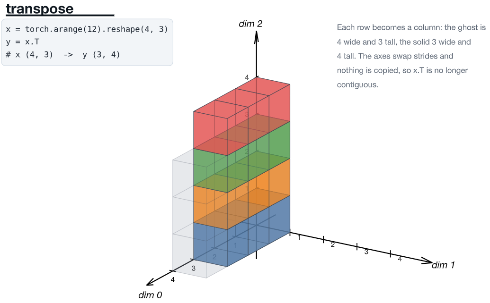

> 原话:每一行变为一列:虚线为4宽3高，实线为3宽4高。轴交换步长且无数据复制，因此x.T不再连续。

transpose 的直观效果：原来的行变成列，即"转置"。

输入形状 (4,3)（淡色块）→ 输出形状 (3,4)（实色块），两块叠加在同一原点。

底层机制：不搬数据，只把两个轴的 **stride（步长）** 互换。**stride 是"沿某维走一步要跳几个内存位置"，换一下步长就等于换了解读方式。**

因为只改步长、不搬数据，所以 transpose 返回的是 **view**（共享内存）。步长换了之后，"显示顺序"和"内存顺序"对不上 → `is_contiguous()` 变 False → 这正是文章 1.5 里 `view()` 会报错、要先 `contiguous()` 的根因。

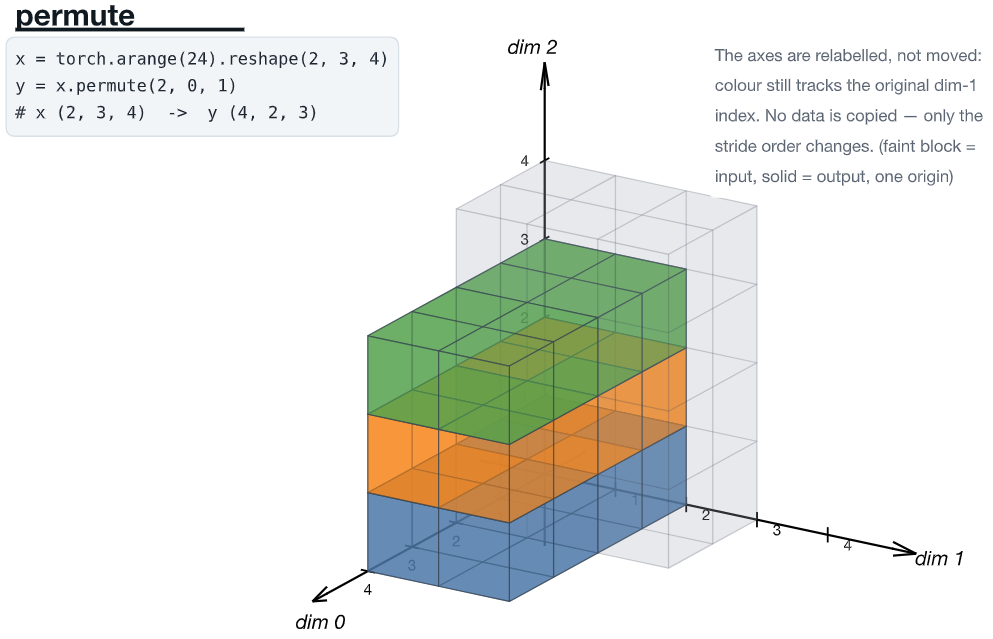

> 原话:轴被重新标记，但未移动:颜色仍追踪原始的dim-1索引。没有数据复制——只有步长顺序改变。(虚线块=输入，实线块=输出，一个原点)。

permute 不搬数据元素，只给每个轴**重新贴标签**（原来叫第 0 维，现在叫第 1 维，等等）。图里用颜色标记"原始的第 1 维"，转完之后数据没动，动的只是"哪条轴叫什么"。

和 transpose 同理：只改 stride 的**顺序**（transpose 是换两个，permute 是重排全部），不复制数据，返回 view。

画法约定：两块叠在同一原点，看形变

```python
data = torch.arange(1, 61).reshape(3, 4, 5)   # 3×4×5 的确定性数据, 共 60 个
# 1. 交换 1 和 2 维: (3, 4, 5) -> (3, 5, 4)
print(torch.transpose(data, 1, 2).shape)      # torch.Size([3, 5, 4])
2. 想变到 (4, 5, 3)? transpose 要连做两次
d2 = torch.transpose(data, 0, 1)    # (4, 3, 5)
d3 = torch.transpose(d2, 1, 2)      # (4, 5, 3)
print(d3.shape)                     # torch.Size([4, 5, 3])
3. permute 一步到位: 把"第 1 维放最前, 第 2 维放中间, 第 0 维放最后"
print(torch.permute(data, [1, 2, 0]).shape)   # torch.Size([4, 5, 3])
print(data.permute([1, 2, 0]).shape)          # 同上, 方法写法
```

permute 的参数含义：`[1, 2, 0]` 表示"新张量的第 0 维 = 原来的第 1 维，第 1 维 = 原来的第 2 维，第 2 维 = 原来的第 0 维"。新 shape 的每一维长度 = 原 shape 对应位置的长度：原 (3,4,5) → 新 (4,5,3)。

> **总结**:transpose 和 permute 本质都是**只改步长、不搬数据**——所以快、省内存，但代价是结果**不连续**(后面要 `view()` 就得先 `contiguous()` 把数据按新顺序重写一遍)。**形状变了、数据没动**。

### 1.5 view() 与 contiguous()：内存连续性

**第 1 步 · 先建立一个概念：内存是一条线**

张量无论几维，内存里其实都是"一条线"排开的。以 `data = torch.tensor([[10, 20, 30], [40, 50, 60]])` 为例，6 个元素在内存里的真实存储顺序永远是：

```python
内存:   10  20  30  40  50  60
```

**第 2 步 · view 的思路：不搬数据，只换"切法"**

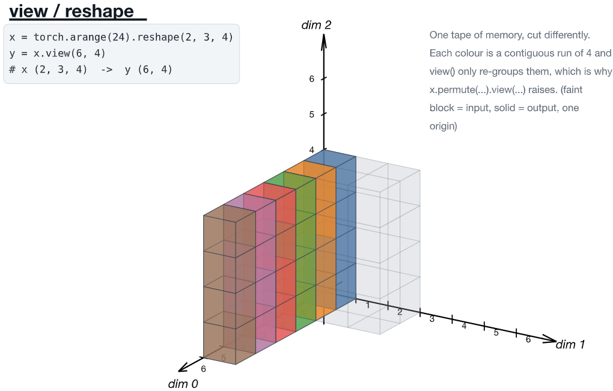

view 和 reshape 一样能改形状，但view并不复制数据，而是在原内存上换一种"切法"来读：每行切几个数一变，形状就变了。

```python
(2,3) 的切法:     [10 20 30] [40 50 60]   → 2 行 3 列
view(3,2) 的切法: [10 20] [30 40] [50 60] → 3 行 2 列
```

同一块内存、同一批数，只是"切法"变了。因为从头到尾没复制过数据，所以 view 快、省内存。

**第 3 步 · view 的硬要求：内存必须连续**

- **连续** = "张量显示出来的顺序"和"内存里实际存的顺序"一致。
- 新创建的张量默认连续（`is_contiguous()` → True），所以新建后直接 view 没问题。

**第 4 步 · 问题出在 transpose / permute 之后**

这两个操作只改步长、不搬数据：显示顺序变了，内存里数据还按老顺序躺着，两者对不上，就变成"不连续"。看 `t3 = torch.transpose(data, 0, 1)`：

```python
t3 显示:  10  40       按显示顺序读, 需要的内存是: 10 40 20 50 30 60
          20  50       内存里实际存的却是:        10 20 30 40 50 60  ← 对不上!
          30  60
```

**为什么这时 view 会直接报错**：view 的承诺是"绝不搬数据"。面对一块按老顺序躺着的内存，它没法既不搬数据、又按 t3 显示的样子切出 (2,3)——做不到，就宁可报错，也不偷偷复制。

**第 5 步 · contiguous() 可以解决不连续**

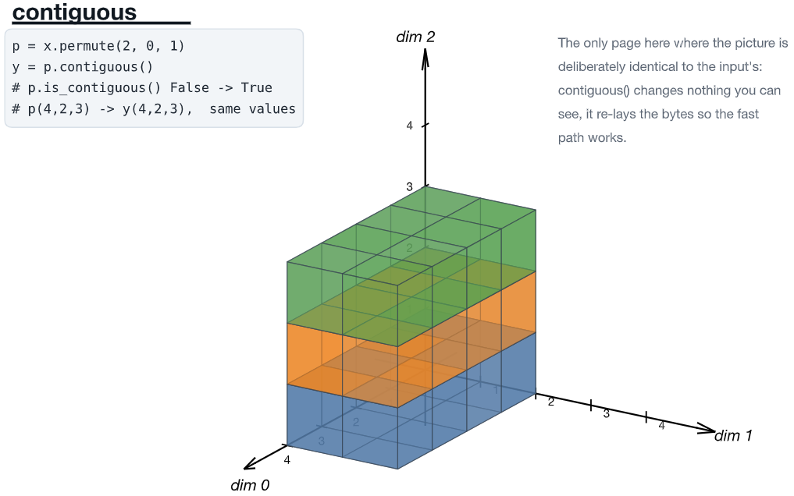

它把数据按当前显示的顺序重新写一遍内存（复制一份）：10, 40, 20, 50, 30, 60。写完之后，显示顺序和内存顺序重新对上，变回连续，view 就能用了。

**标准写法**：

```python
t3 = torch.transpose(data, 0, 1)   # 不连续了
t4 = t3.contiguous().view(2, 3)    # 先重写内存变连续, 再 view
```

完整过程验证：

```python
data = torch.tensor([[10, 20, 30], [40, 50, 60]])
1. 新张量: 连续
print(data.is_contiguous())            # True
2. view 直接变形: (2,3) -> (3,2)
t2 = data.view(3, 2)
print(t2)
tensor([[10, 20],
[30, 40],
[50, 60]])
print(t2.is_contiguous())              # True
3. transpose 之后: 不连续了
t3 = torch.transpose(data, 0, 1)
print(t3)
tensor([[10, 40],
[20, 50],
[30, 60]])
print(t3.is_contiguous())              # False
t3.view(2, 3)   # 报错! view 不能用于非连续张量
4. 先 contiguous 变连续, 再 view
print(t3.contiguous().is_contiguous()) # True
t4 = t3.contiguous().view(2, 3)
print(t4)
tensor([[10, 40, 20],
[50, 30, 60]])
```

**注意：contiguous().view() 不是"还原"**

t4 是 `[[10,40,20],[50,30,60]]`，而不是原来的 `[[10,20,30],[40,50,60]]`：

```python
contiguous() 后的内存: 10  40  20  50  30  60    (按 t3 显示的样子重铺)
view(2,3) 的切法:      [10 40 20] [50 30 60]    → [[10,40,20],[50,30,60]]
```

因为 contiguous() 是**按 t3 当前显示的样子**重新铺内存，view 只是在这份新内存上重新切形状——它俩都不知道"原来长什么样"，所以结果回不去了。

**总结**：view 是"不搬数据只换切法"，要求内存连续；transpose / permute 只改步长不搬数据，会破坏连续性；contiguous 专门把不连续的张量按显示顺序重写一遍内存，让 view 重新可用。reshape 则更"圆滑"——能 view 就 view，不能就自动复制一份再切，所以 reshape 永远不报错，而 view 会。

### 1.6 小结

| 函数 | 作用 |
| --- | --- |
| `reshape()` | 改变形状，数据不变；各维相乘必须等于元素总数 |
| `unsqueeze()` | 在 dim 位置插入长度为 1 的维度（升维） |
| `squeeze()` | 删除**所有长度为 1** 的维度（降维） |
| `transpose()` | 一次交换指定的两个维度 |
| `permute()` | 一次重排全部维度 |
| `view()` | 改形状但不复制数据，要求内存连续 |
| `contiguous()` | 把非连续张量变成连续的（按当前显示顺序重写内存） |
| `is_contiguous()` | 判断显示顺序与内存顺序是否一致 |

> 重点掌握：**reshape()、permute()、view()、unsqueeze()**。

## 二、张量拼接操作

### 2.1 torch.cat()：按已有维度拼接

把多个张量沿某个**已有指定维度**拼起来，维度数不变，被拼的那个维度变长。

> 要求：除拼接维外，其他维度长度必须一致。

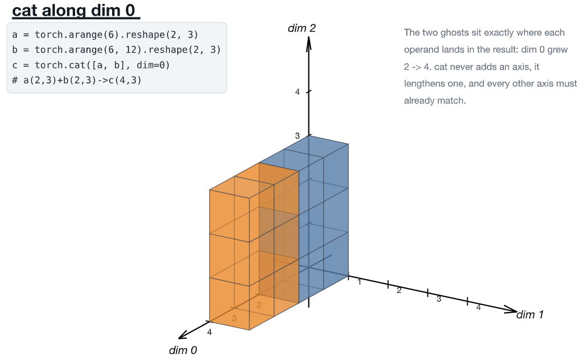

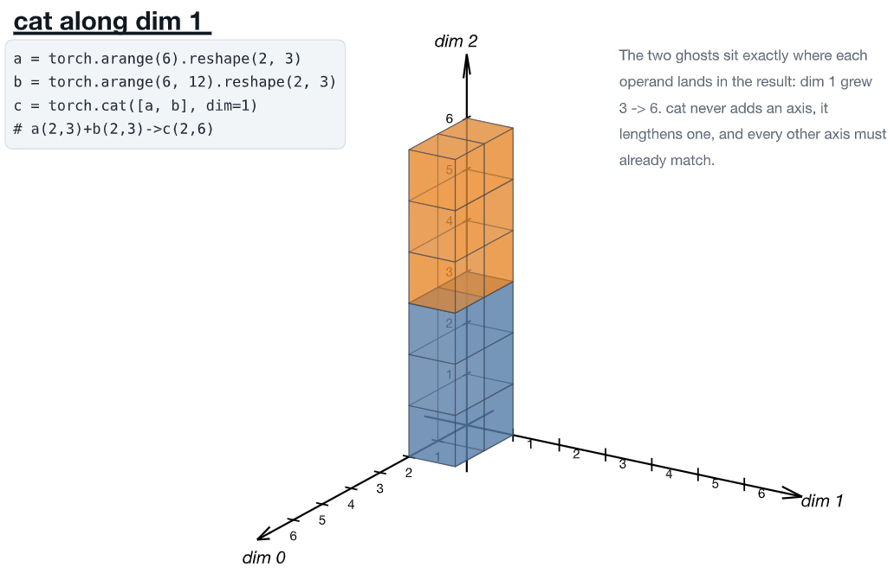

比如两个 (2,3) 的张量，cat(dim=0) 就是沿着0维度摞起来变成 (4,3)，cat(dim=1) 就是左右接起来变成 (2,6)。维度数还是 2，只是被拼的那一维变长了。要求是：除拼接维外，其他维度必须一致,否则拼不上。

```python
data1 = torch.tensor([[[7, 8, 7], [6, 3, 6]]])      # (1, 2, 3)
data2 = torch.tensor([[[3, 6, 5], [7, 5, 0]]])      # (1, 2, 3)
1. 按 0 维拼接: 两块上下摞 -> (2, 2, 3)
print(torch.cat([data1, data2], dim=0).shape)   # torch.Size([2, 2, 3])
2. 按 1 维拼接: 同一表里上下接行 -> (1, 4, 3)
print(torch.cat([data1, data2], dim=1).shape)   # torch.Size([1, 4, 3])
3. 按 2 维拼接: 同一行里左右接列 -> (1, 2, 6)
print(torch.cat([data1, data2], dim=2).shape)   # torch.Size([1, 2, 6])
dim=-1 等价于最后一维 (这里 = dim 2)
```

**dim 是"沿着哪条边接"**：拼 0 维 = 摞表、拼 1 维 = 接行、拼 2 维 = 接列。被拼接的那个维度长度变成两者之和，其余维度不变。

### 2.2 torch.stack()：开辟新维度堆叠

把多个形状完全相同的张量摞起来，会多出一个新维度。在新维度上堆叠，会增加一个新维度，所以stack函数会开一个新维度，维度数 +1。

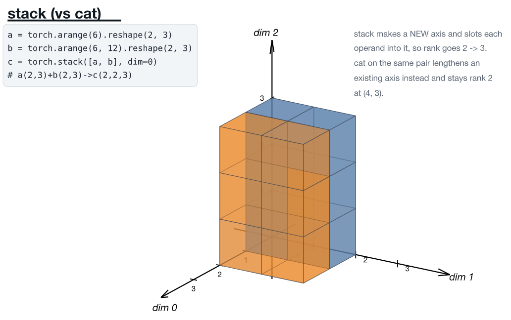

比如两个 (2,3) 的张量，stack(dim=0) 变成 (2,2,3)——多出来的那个 2 就是"两个张量"这个维度。要求是：所有输入张量形状必须完全相同。

```python
data1 = torch.tensor([[6, 2, 8], [9, 8, 3]])    # (2, 3)
data2 = torch.tensor([[9, 2, 8], [0, 7, 9]])    # (2, 3)
dim=0: 两张表摞起来 -> (2, 2, 3)
print(torch.stack([data1, data2], dim=0).shape)   # torch.Size([2, 2, 3])
dim=1: 按"行"为单位交错 -> (2, 2, 3)
结果: [[data1第0行, data2第0行], [data1第1行, data2第1行]]
print(torch.stack([data1, data2], dim=1).shape)   # torch.Size([2, 2, 3])
dim=2: 按"元素"为单位配对 -> (2, 3, 2)
结果: data1[i][j] 和 data2[i][j] 配成一队
print(torch.stack([data1, data2], dim=2).shape)   # torch.Size([2, 3, 2])
```

stack 的 dim 指的是"**新维度插在哪个位置**"：dim=0 按整张表摞、dim=1 按行配对、dim=2 按元素配对。

### 2.3 cat 与 stack 对比

| 函数 | 维度数 | 要求 | 一句话 |
| --- | --- | --- | --- |
| `torch.cat()` | 不变 | 除拼接维外其余维度一致 | "接长"某个已有维度 |
| `torch.stack()` | +1 | 输入形状完全相同 | "开一个新维度"把张量摞进去 |

```python
# 2 维张量:
t1 = torch.randint(1, 10, (2, 3))
t2 = torch.randint(1, 10, (2, 3))
print(torch.cat([t1, t2], dim=0).shape)    # torch.Size([4, 3])
print(torch.cat([t1, t2], dim=1).shape)    # torch.Size([2, 6])
# torch.cat([t1, t2], dim=2)   # 报错! 2 维张量的 dim 合法范围是 [-2, 1], 没有 2 维
print(torch.stack([t1, t2], dim=0).shape)  # torch.Size([2, 2, 3])
print(torch.stack([t1, t2], dim=1).shape)  # torch.Size([2, 2, 3])
print(torch.stack([t1, t2], dim=2).shape)  # torch.Size([2, 3, 2])
```

## 三、自动微分模块

### 3.1 先回答：前面学那么多函数，到底为了什么

> 从《01》到现在，我们学了张量创建、数值计算、运算函数、索引、形状操作、拼接——它们都是"积木"。积木本身不是目的，搭出一个能"学习"的模型才是目的。

什么叫"学习"？以预测问题为例：

- 我们假设规律长成 `z = wx + b` 这样一条直线：z 是预测值，x 是输入特征，w（权重）和 b（偏置）是两个可以拧的"旋钮"，术语叫**参数（Parameters）**。
- 所谓"学习"，就是把 w、b 这两个旋钮拧到合适的值，让预测值 z 贴近真实值 y。
- 旋钮一开始是随便拧的（随机初始化），预测必然离谱。

> 术语讲解：只有一个特征 x 时叫**一元线性模型**；"多元线性"指它的推广形式 `y = w₁x₁ + w₂x₂ + … + b`——每个特征各配一个旋钮（权重），原理完全相同。本章统一用最简形式演示。

于是"学习"这件事，顺理成章拆成四个环环相扣的问题，也是本章前半段的路线：

| 顺序 | 问题 | 由谁回答 |
| --- | --- | --- |
| ① | 怎么知道当前旋钮拧得效果？ | 损失函数（3.2） |
| ② | 旋钮该往哪个方向拧？ | 梯度（3.3） |
| ③ | 方向有了，具体怎么拧？ | 梯度下降（3.4） |
| ④ | 模型有百万个旋钮时，方向算不过来怎么办？ | 自动微分（3.5 起） |

### 3.2 第一步：算一算当前差距多大——正向传播与损失

回归线 + 残差图:

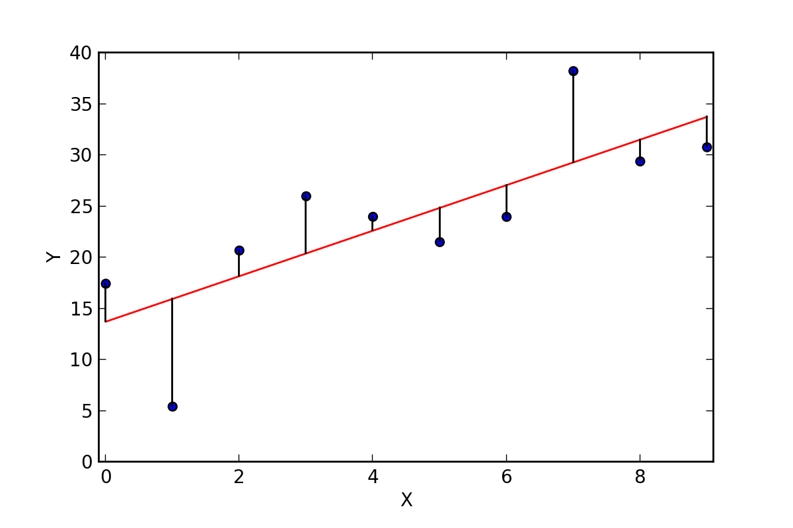

预测值与真实值之间的距离就是误差，损失函数负责量化差距。

从输入 x 出发，沿公式一路算到最终评价，这个过程叫正向传播（forward）：

1. 模型公式算出预测值：`z = wx + b`
2. 用**损失函数**量化预测与真实的差距，这里取均方误差 MSE：`loss = (z − y)²`

注意这一步用到的乘法、加法、减法、平方……全是《01》运算函数一章学过的东西——前面学的内容，就是在这里搭模型的。

**数值示例**：设 x = 2，w = 3，b = 1，真实值 y = 9：

```python
① 乘法:  w·x = 3 × 2 = 6
② 加法:  6 + b = 6 + 1 = 7                          → 预测值 z = 7
③ 均方误差: loss = (z − y)² = (7 − 9)² = 4          → 损失 loss = 4
```

损失是一个数：越大效果越差，0 代表预测完美。可是损失算出来之后呢？怎么把这个 4 降下去——旋钮 w、b 到底该往哪个方向拧？

### 3.3 第二步：找方向——什么是梯度

单个参数时, 损失是参数的函数，比如 loss = (wx+b - y)²。导数 ∂loss/∂w 回答的就是："w 这个旋钮拧大一丁点，loss 会变多少？" 导数是单参数情形下的"变化率"。

**多个参数时，每个参数各求一个导数，组成一组——这一组就叫梯度。** 比如 loss 由 w 和 b 两个参数决定，梯度就是 (∂loss/∂w, ∂loss/∂b) 这一组数。一个参数配一个导数，几个参数就有几个分量。所以梯度不是什么新东西，就是"把所有参数的导数打包在一起"。

梯度方向 / 曲面图:

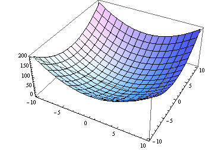

梯度是多个参数导数组成的向量；它指出损失变化最快的方向。

**梯度指示调参方向。** 关键在导数的正负：

- 导数为负 → 参数增大一点，损失反而下降 → 这个参数该加
- 导数为正 → 参数增大一点，损失上升 → 这个参数该减

导数怎么算？具体计算交给机器, 这里一笔带过地演示一次，好知道机器在算什么。沿用上面的数：loss = (z−y)²，z = wx + b：

```python
∂loss/∂w = 2(z−y)·x = 2×(7−9)×2 = -8     (内层: ∂z/∂w = x)
∂loss/∂b = 2(z−y)·1 = 2×(7−9)×1 = -4     (内层: ∂z/∂b = 1)
```

两个梯度都是负的 → w、b 都应该增大。这个结论马上用进更新公式（见 3.4）。

### 3.4 第三步：沿方向更新——梯度下降

梯度下降等高线图:

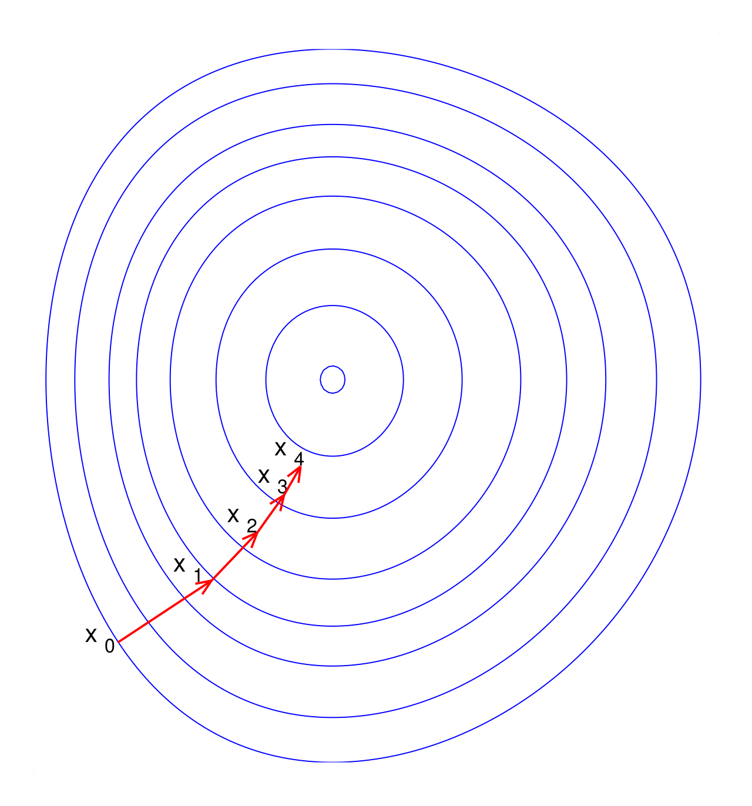

一个点经过若干次迭代逐步逼近极小值(参数经过多次更新逐步逼近最低点), 很好解释 `参数新 = 参数旧 - lr×grad`

这里给出两条更新公式：

```python
权重更新:  w新 = w旧 − 学习率 × 梯度
偏置更新:  b新 = b旧 − 学习率 × 梯度
```

- **学习率（Learning Rate）**：每次更新的步子大小，太大会震荡、太小会太慢，常取 0.1、0.01 等。
- 公式里的**减号**：梯度指向损失上升最快的方向，沿它的反方向走损失才会下降
- 这个算法叫**梯度下降法（Gradient Descent）**：沿梯度反方向一小步一小步挪，损失随之下降。

**数值示例：手动更新一次**。w = 3，梯度 −8；b = 1，梯度 −4；学习率取 0.1：

```python
w新 = 3 − 0.1×(−8) = 3.8
b新 = 1 − 0.1×(−4) = 1.4
```

验证效果：新预测值 z = 3.8×2 + 1.4 = **9.0**，正好等于真实值，损失 = 0！

> 别激动——这是一维问题且数字是设计好的，才一步到位。真实模型是多维、非线性的，要重复"正向 → 反向 → 更新"很多轮，损失才逐步下降（见 3.9、3.10）。

**代码中更新参数**：

> **补语法：`with torch.no_grad():`**
>
> 这是 Python 的 `with` 语句（上下文管理器），套路固定：
>
> ```
> with 模式开关:
>     缩进块里的代码   # ← 只在这个块内, 临时处于该模式
> # 缩进结束, 自动退出模式, 不用手动关闭
> ```
>
> 模式的生效范围就是缩进块，进入和退出全自动。

`torch.no_grad()` 就是 PyTorch 提供的一个"模式开关"：在这个块里做的所有运算，都不记录进计算图、不追踪梯度。

**为什么更新参数时必须关追踪**：更新公式 `w -= lr * w.grad` 本身也是一次运算。更新只是尝试和调整的动作，不是要学习的内容——若它也被记进计算图，图上就会混入一堆调参动作，下一轮 backward 沿图反向走时会算出错的梯度。所以规矩是：正向传播、算 loss 时不关（要建图）；更新参数时关（不建图）。

```python
lr = 0.1
with torch.no_grad():
w -= lr * w.grad     # w新 = w旧 − 学习率 × 梯度
b -= lr * b.grad
w.grad.zero_()           # 梯度清零, 为下一轮做准备 (为什么必须清零: 见 3.6 注意③)
b.grad.zero_()
print(w)   # tensor(3.8000, requires_grad=True)
print(b)   # tensor(1.4000, requires_grad=True)
```

- 更新要放在 `torch.no_grad()` 里。
- 用 `-=` 就地修改，w 仍是原来那个叶子张量；若写成 `w = w - lr * w.grad`，会创建新张量、丢掉追踪身份。

**用 .data 更新**

```python
# 代入权重更新公式: w新 = w旧 − 学习率 × 梯度
w.data = w.data - 0.01 * w.grad
```

`.data` 是张量里"绕过追踪的原始数据"，直接改它 autograd 不会阻拦（.data 的风险见 3.8）——这是用的历史写法；新代码推荐 `with torch.no_grad():`，语义更清晰也更安全。

两种写法都必须注意：不能写 `w = w - ...`，那会创建新张量、丢掉 requires_grad 身份。

带箭头的梯度下降路径:

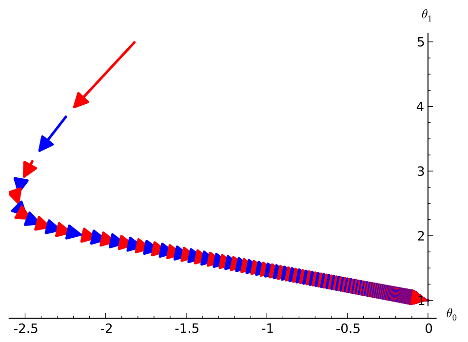

箭头越来越短，直观表现“越靠近最优值，更新步子越小”

### 3.5 真正的难题：百万个参数，梯度怎么算得过来

回到 3.3 被我们"一笔带过"的求导。给一两个参数手推链式法则不难，但——

- 真实神经网络动辄百万、上亿个参数，每个都要对损失求导，手算根本不可能；
- 而且算式怎么搭，求导路径就跟着怎么变，导数无法事先写死。

PyTorch 的答案是 `torch.autograd`（自动微分模块）：你只管像 3.2 那样把算式搭出来，它自动算出所有参数的梯度，支持任意结构的计算图。

**它凭什么能自动算？靠两样东西：**

**① 计算图（Computation Graph）：正向搭算式时自动记录的"运算路线图"**

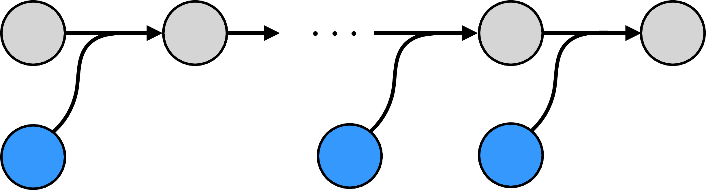

每做一步运算，PyTorch 就悄悄记下一个节点。下面给出流程图（仍以 y = wx + b + MSE 为例）：

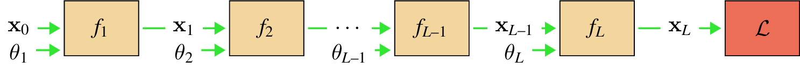

```python
正向传播（左→右，算出损失）：
  x ──► ①×(w·x) ──► ②+(+b) ──► z ──► ③MSE ──► loss
        ▲              ▲                     ▲
        w              b                     y(真实值)
        └────── 要学习的参数 Parameters ──────┘
反向传播（右→左）：从 loss 出发逐层求导，把梯度回传给 w、b
```

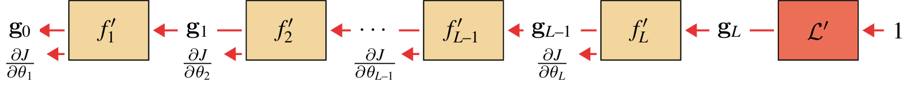

图中每个节点的身份：

| 节点 | 类型 | 说明 |
| --- | --- | --- |
| x、y | 输入数据 | 特征 / 真实标签，不需要求梯度 |
| w、b | **参数** | 可训练，靠梯度更新 |
| ×、+ | 运算节点 | 分别计算 w·x、w·x+b |
| z | 中间结果 | 预测值 |
| MSE | 损失函数 | 衡量 z 与 y 的差异 |
| loss | 最终输出 | 反向传播的起点 |

一次完整训练对应的三段：

| 阶段 | 做什么 | 图上方向 |
| --- | --- | --- |
| **正向传播** | 数据 → 预测值 → 和真实值比 → 得到损失 | 左 → 右 |
| **反向传播** | 从损失往回逐层求导，得到每个参数的梯度 | 右 → 左 |
| **参数更新** | 用梯度按 3.4 的公式调整 w、b | 图外公式 |

**② 反向传播（Backpropagation）：沿计算图往回逐层套链式法则**

Backpropagation 神经网络图:

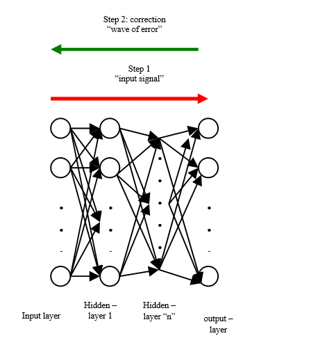

误差从输出端向前层传播，逐层计算梯度。

图是正向记的，求导却要反过来走：从最右端的 loss 出发，每经过一个节点就套一次链式法则，一路把梯度回传给 w、b。这个"沿计算图反向执行链式法则"的过程，就叫反向传播——它不是凭空冒出来的新概念，而是 autograd"执行求导"的具体方式。《00-深度学习简介》里讲的反向传播，到这里终于有了工程实现。

**四个容易缠在一起的词，一次理清：**

| 术语 | 身份 | 一句话 |
| --- | --- | --- |
| 链式法则 | 数学方法 | 求复合函数导数的规则（外层导数 × 内层导数） |
| 计算图 | 数据结构 | PyTorch 正向运算时自动记录的运算路线 |
| 反向传播 | 执行过程 | 沿计算图反向套链式法则，把梯度算出来 |
| 自动微分 autograd | PyTorch 模块 | 提供"记录计算图 + 反向传播"的整套能力 |

> 这正是《01》里"动态计算图"特点的落地：边搭算式边记录图，再反向求导，一条龙。

### 3.6 autograd 三件套：requires_grad、backward、grad

完整代码（延续 x = 2，w = 3，b = 1，y = 9）：

```python
import torch
1. 数据: 不会被训练更新, 用默认的 requires_grad=False
x = torch.tensor(2.0)
y_true = torch.tensor(9.0)
2. 参数: 必须声明 requires_grad=True, PyTorch 才会记录它参与的运算
w = torch.tensor(3.0, requires_grad=True)
b = torch.tensor(1.0, requires_grad=True)
3. 正向传播: 计算图随运算自动搭建
z = w * x + b
loss = (z - y_true) ** 2
4. 反向传播: 一行代码, 自动算出所有参数的梯度
loss.backward()
5. 访问梯度: 结果存在每个参数的 .grad 属性里
print(w.grad)   # tensor(-8.)
print(b.grad)   # tensor(-4.)
```

`-8.` 和 `-4.` 与 3.3 的手推完全一致——backward() 一次调用，链式法则全自动。

三件套各自的角色：

| 名称 | 类型 | 作用 |
| --- | --- | --- |
| `requires_grad=True` | 创建张量时的开关 | 声明"这个张量是参数，请追踪它参与的所有运算" |
| `backward()` | 损失张量的方法 | 从 loss 出发反向遍历计算图，链式法则算出所有被追踪张量的梯度 |
| `.grad` | 张量的属性 | 存放 backward() 算出的梯度；只有 requires_grad=True 的张量才有 |

三个注意事项：

**① 被追踪的张量必须是浮点型**。整数张量开启 requires_grad 会直接报错：

```python
w = torch.tensor(3, requires_grad=True)   # 报错! int 不行
# RuntimeError: Only Tensors of floating point... can require gradient
```

原因：导数是连续量的概念，整数是离散的、不可导。所以参数一律用 float。

**② 为什么只追踪参数、不追踪数据**：训练更新的是 w、b，x 和 y_true 永远不变.

**③ 梯度会累加，用完必须清零**。每调用一次 backward()，梯度会在旧值上累加而不是覆盖——3.4 代码里每轮 zero_() 的原因就在这里：

```python
loss.backward()
print(w.grad)        # tensor(-8.)
loss.backward()
print(w.grad)        # tensor(-16.)  ← 累加了两次!
w.grad.zero_()       # 手动清零, 下一轮从 0 开始
```

> 设计成累加是为了支持"一个损失分多次 backward"的特殊场景；日常训练循环里每轮算完必须清零（见 3.9、3.10）。

计算图的实体, 每个中间结果都带着 `grad_fn`：

```python
z = w * x + b
print(z)          # tensor(7., grad_fn=)
print(z.grad_fn)  #  —— 记录"z 是由一次加法算出来的"
```

`grad_fn` 是计算图的运算记录，标明"怎么算出来的"，backward() 就是顺着这条链反向走的。

### 3.7 硬性规定：backward 只能由"标量"调用

规范表述：PyTorch 不支持"向量对向量"直接求导，`backward()` 只能被标量张量（一个数）调用。如果损失是向量，先用 `sum()` / `mean()` 聚合成标量。

**示例 1：标量张量求导**（y 本身就是一个数）

```python
import torch
x = torch.tensor(10., requires_grad=True)   # 一个点
y = 2 * x ** 2                              # 一条曲线 y = 2x²
print(y)              # tensor(200., grad_fn=)
print(y.grad_fn)      #   —— y 是由"乘法"算出来的
y.backward()          # y 已是标量, 直接 backward
print(x.grad)         # tensor(40.)
手算: y' = 4x, x=10 -> 40  ✓
```

**示例 2：向量张量求导**（y 是向量，必须先聚合）

```python
x = torch.tensor([10., 20.], requires_grad=True)
y = 2 * x ** 2
print(y)              # tensor([200., 800.], grad_fn=)
y.sum().backward()    # y 是向量, 不能直接 backward -> 先 sum 成标量
print(x.grad)         # tensor([40., 80.])
手算: sum = 2x₁² + 2x₂², 对 x₁ 求导 = 4x₁ = 40, 对 x₂ 求导 = 4x₂ = 80  ✓
```

为什么 sum 之后每个分量还能得到自己的梯度：sum 对 x₁ 的偏导只经过 y₁ 那一项（y₂ 与 x₁ 无关），所以梯度各回各的, 互不干扰。

> 统一写 `y.sum().backward()` 是好习惯：标量时 sum 是空操作（原样不变），向量时自动兜底。

### 3.8 带梯度的张量与 NumPy：detach()

**知识点**：设置了 `requires_grad=True` 的张量不能直接转 numpy，会报错，因为 numpy 没有"追踪/求导"这套机制。

**解决：**先用 `detach()` 分离出一个不带追踪的新张量再转。

```python
import torch
t1 = torch.tensor([10., 20.], requires_grad=True)
t1.numpy()   # 报错!
RuntimeError: Can't call numpy() on Tensor that requires grad.
Use tensor.detach().numpy() instead.
1. detach(): 产生一个新张量, 数据共享, 但不再追踪
t2 = t1.detach()
print(t1.requires_grad)   # True
print(t2.requires_grad)   # False
2. 共享同一份内存 (改一个, 另一个跟着变)
print(t1.data)            # tensor([10., 20.])
print(t2.data)            # tensor([10., 20.])
print(id(t1.data) == id(t2.data))   # True —— 同一块内存
3. detach 后就能转 numpy 了
print(t2.numpy())         # [10. 20.]
4. 最终常用写法: 一行链式
n2 = t1.detach().numpy()
```

三个常见疑问：

- **`import numpy as np` 为什么没用到？** 是的。`.numpy()` 是张量自己的方法，不需要显式 import numpy；只有直接使用 np 的功能（如 `np.array`）才需要。
- **验证是否共享时,为什么 `t1[0] = 100` 不允许、`t1.data[0] = 100` 却允许**：t1 是带追踪的叶子张量，autograd 禁止直接就地修改它（否则计算图对不上账）；`.data` 拿到的是"绕过追踪的原始数据"，改它 autograd 不管，但也有风险，训练循环外尽量别这么改参数。
- **detach() 是拷贝吗**：不是。它共享同一份内存，只是"摘掉"了追踪标记；想要独立副本要再加 `.copy()`。

### 3.9 应用：梯度下降求 y = x² + 20 的极小值

需求：求 `y = x² + 20` 的极小值点。数学上求导 `y' = 2x = 0` 得 x = 0

但梯度下降不用公式，靠迭代自己走过去，这正是"学习"的雏形：

抛物线上的梯度下降(从 x=10 开始，一步步向 x=0 靠近):

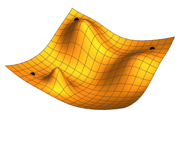

```python
import torch
1. 定义起点
x = torch.tensor(10., requires_grad=True)
lr = 0.01
2. 循环迭代 1000 次
for i in range(1, 1001):
y = x ** 2 + 20                 # 3-1 正向计算
if x.grad is not None:          # 3-2 梯度清零(第一次还没有梯度, 要判空)
x.grad.zero_()
y.backward()                    # 3-3 反向传播: 梯度 = 2x
x.data = x.data - lr * x.grad   # 3-4 梯度更新(.data 写法)
if i % 200 == 0:
    print(f'第{i}次: x={x.item():.6f}, y={y.item():.6f}')
print(f'最终: x={x.item():.6f}, y={y.item():.6f}')
```

输出（示例，按每轮 x ← 0.98x 逐轮推得）：

```python
第200次: x=0.175866, y=20.030930
第400次: x=0.003093, y=20.000010
第600次: x=0.000054, y=20.000000
第800次: x=0.000001, y=20.000000
最终: x=0.000000, y=20.000000
```

**为什么每轮 x 变成上一轮的 0.98 倍**：梯度 = 2x，更新 `x ← x − 0.01×2x = 0.98x`。离 0 越远步子越大、越近步子越小，自然"刹车"——最终收敛到极小值点 x = 0，y = 20。

不同学习率的下降步长:

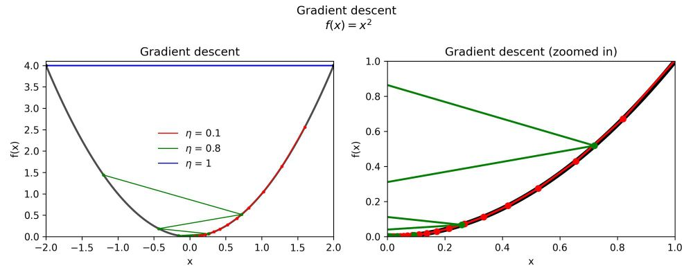

学习率小 → 慢；太大 → 容易跨过最优点或震荡。

每一轮输出的 x（新）成为下一轮输入的 x（旧），循环往复直到收敛。\

### 3.10 完整示例：迷你训练循环

把"正向 → 反向 → 更新 → 清零"串成循环，让机器自己把 w、b 学出来。数据背后的真实规律是 `y = 2x + 1`，但代码不知道, 看它能不能学回来：

```python
import torch
数据: 3 个样本, 背后规律是 y = 2x + 1 (代码不知道)
x = torch.tensor([1.0, 2.0, 3.0])
y = torch.tensor([3.0, 5.0, 7.0])
参数从 0 开始学
w = torch.tensor(0.0, requires_grad=True)
b = torch.tensor(0.0, requires_grad=True)
lr = 0.1   # 学习率
for epoch in range(1, 5):
pred = w * x + b                   # 1. 正向传播: 预测值(一批一起算)
loss = ((pred - y) ** 2).mean()    # 2. 均方误差 MSE: 差的平方取平均
loss.backward()                    # 3. 反向传播: 自动算出 w.grad、b.grad

with torch.no_grad():              # 4. 参数更新
    w -= lr * w.grad
    b -= lr * b.grad

w.grad.zero_()                     # 5. 梯度清零
b.grad.zero_()

print(f'第{epoch}轮  loss={loss.item():.4f}  w={w.item():.4f}  b={b.item():.4f}')
```

输出：

```python
第1轮  loss=27.6667  w=2.2667  b=1.0000
第2轮  loss=0.3319   w=2.0178  b=0.8933
第3轮  loss=0.0053   w=2.0439  b=0.9076
第4轮  loss=0.0013   w=2.0399  b=0.9085
```

**第一轮手算核对**：

```python
pred = [0, 0, 0]  差 = pred - y = [-3, -5, -7]
loss = (9 + 25 + 49) / 3 = 83/3 ≈ 27.6667
w.grad = 2×(−3×1 + −5×2 + −7×3)/3 = −68/3 ≈ −22.6667
b.grad = 2×(−3 −5 −7)/3 = −10
更新: w = 0 − 0.1×(−22.6667) = 2.2667;  b = 0 − 0.1×(−10) = 1.0
```

看趋势：loss 从 27.7 → 0.33 → 0.005 → 0.001，一路下降；w、b 一路逼近真实规律 **2 和 1**。这就是"学习"的本质：反复用梯度把参数往损失更低的方向挪。

> 实际开发中，第 4、5 步通常交给优化器（`torch.optim`，如 SGD、Adam）和 `optimizer.zero_grad()` 代劳——第四节的线性回归案例就是这么做的。这里手写一遍，是为了看清它替你做了什么。

### 3.11 应用：多维数据的一次梯度计算

真实模型的输入不是一个数，而是一批数据（矩阵）。这是自动微分最真实的应用场景

一次走通"前向 → 损失 → 反向"：

```python
import torch
1. 输入 x: 2 个样本, 每个样本 5 个特征 -> (2, 5) 全 1
x = torch.ones(2, 5)
2. 真实值 y: 2 个样本, 每个样本 3 个输出 -> (2, 3) 全 0
y = torch.zeros(2, 3)
3. 参数: 权重 (5, 3), 偏置 (3,) —— 形状不是随便定的!
w = torch.randn(5, 3, requires_grad=True)
b = torch.randn(3, requires_grad=True)
4. 前向传播: 矩阵乘法 + 加偏置
z = torch.matmul(x, w) + b       # (2,5)·(5,3) -> (2,3), b 广播到每行
5. 损失函数: 均方误差 (nn = neural network 神经网络模块)
criterion = torch.nn.MSELoss()
loss = criterion(z, y)
6. 反向传播: 一次算出全部参数的梯度
loss.backward()
print(w.grad.shape)   # torch.Size([5, 3])  与 w 同形状
print(b.grad.shape)   # torch.Size([3])     与 b 同形状
```

（输出只记形状：w、b 是随机初始化的，每次运行数值不同，但形状恒定。）

集中回答几个的点：

- **为什么 w 是 (5, 3)**：矩阵乘法规则——`(2,5)·(5,3)` 中 x 的列数 5 必须等于 w 的行数 5，结果取外侧 `(2,3)`。5 = 输入特征数，3 = 输出维度（可理解为 3 个神经元）。w 的每一行管一个特征、每一列管一个输出。
- **偏置 b**：每个输出神经元配一个可学习的常数，形状 `(3,)` 就是 3 个输出各一个；`(2,3) + (3,)` 按广播规则加到每一行。
- 这里的 `z = x@w + b` 就是 3.5 计算图的多维版：乘法→加法→MSE，链条一模一样，只是节点从数字变成了矩阵。

### 3.12 偏置

实际开发中，大多数情况下可以不考虑偏置，会将偏置矩阵直接设置为全 0 矩阵。（流程图上仍画出 b，是为了保证理论完整；工程上常做这个简化。）

为什么可以这样：

- 偏置的作用只是给预测值"平移"一个常数，影响小；
- 全 0 的偏置在训练中照样能被梯度更新挪到合适的位置，不吃亏；
- PyTorch 的 `nn.Linear` 提供了开关：`nn.Linear(in_features, out_features, bias=False)`，需要省略时一行搞定。

## 四、案例：线性回归

### 4.1 案例目标与四步流程

目标：给一堆带噪声的散点 (x, y)，让模型自己找出那条最贴近的直线 `y = wx + b`。

带噪声的散点图:

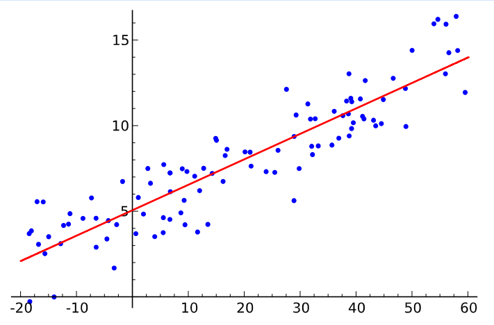

`noise` 让点不完全落在直线上，更接近真实数据

| 步骤 | 说明 | 用到的工具 |
| --- | --- | --- |
| **1. 准备训练集数据** | 造数据、打包、分批 | `make_regression` → `TensorDataset` → `DataLoader` |
| **2. 构建模型** | 定义假设函数 y = wx + b | `nn.Linear` |
| **3. 设置损失函数和优化器** | 衡量误差 + 自动更新参数 | `nn.MSELoss()` + `optim.SGD()` |
| **4. 模型训练** | 前向 → 反向 → 更新，循环多轮 | 训练循环 |

**优化器是什么**：3.10 里我们手写 `w.data -= lr * grad`——参数一多就写不过来了。优化器（optimizer）就是"替你执行更新公式"的工具：你把参数交给它，它记住每个参数的梯度，`step()` 一调用，所有参数按公式自动更新。常用的 SGD、Adam 只是"更新公式"不同。

### 4.2 准备数据：make_regression

```python
from sklearn.datasets import make_regression
import matplotlib.pyplot as plt
plt.rcParams['font.sans-serif'] = ['SimHei']   # Windows: 正常显示中文
plt.rcParams['axes.unicode_minus'] = False     # 正常显示负号
def create_dataset():
x, y, coef = make_regression(
n_samples=100,     # 100 条样本 (100 个点)
n_features=1,      # 每条样本 1 个特征 (一元回归)
noise=1.0,         # 噪声强度: 值越大散点越分散
coef=True,         # 返回真实系数 (默认 False 返回 None)
bias=14.5,         # 真实偏置
random_state=3,    # 随机种子: 相同则生成的数据相同
)
print(type(x))                       #   —— 出来是 numpy 数组
x = torch.tensor(x, dtype=torch.float32)   # 转成张量
y = torch.tensor(y, dtype=torch.float32)
return x, y, coef
```

**集中回答**：

- **为什么有噪声更好**：真实世界的数据从来不是完美直线，总带测量误差、随机扰动。噪声让点**离散地分布在直线两侧**——模型必须"从乱中找规律"，这样的训练才接近实战。全是完美直线上的点，训练毫无难度，也检验不出模型能力。
- **噪声的量级**：`noise` 是噪声的标准差。 如果写`noise=True是`不规范写法（`True` 被当成数字 `1`），效果等于 `noise=1.0`，建议直接写数字。
- **bias可以随便设置吗**：可以。它只是我们**人为假定的"真实规律"**的一部分，定多少都行——它的用途是最后和模型学到的 bias 对比，看训练准不准。
- **random_state**：随机种子（《01》随机张量一节的老朋友），保证每个人生成的数据集一样。
- **中文显示的字体问题**：Windows 用 `SimHei`（黑体）；Mac 上换成 `'Arial Unicode MS'` 或 `'PingFang SC'`。

### 4.3 TensorDataset 与 DataLoader

数据链路：**numpy → 张量 → 数据集对象 → 数据加载器**。

```python
from torch.utils.data import TensorDataset   # 构造数据集对象
from torch.utils.data import DataLoader      # 数据加载器
dataset = TensorDataset(x, y)      # 把 (特征, 标签) 打包成一条条样本对
dataloader = DataLoader(
dataset,          # 参1: 数据集对象
batch_size=16,    # 参2: 每批 16 条
shuffle=True,     # 参3: 每轮开始前打乱顺序
)
```

**集中回答**：

- **TensorDataset 干什么**：把 x 和 y 按"第 i 个 x 配第 i 个 y"包成对，取出来就是 `(train_x, train_y)` 一对。
- **100 条、每批 16 条，为什么是 7 批**：16 × 6 = 96，装完 6 批还剩 4 条 → 再装第 7 批（只有 4 条）。即 批数 = ⌈100 / 16⌉ = 7，最后一批 `(16,16,16,16,16,16,4)`。代码里 `for train_x, train_y in dataloader` 每次取一批，循环 7 次。
- **为什么训练集要打乱（shuffle=True）、测试集不打乱**：
  - 训练打乱 → 每轮的批组合都不同，模型不会"记住数据的先后顺序"，参数更新更有代表性；
  - 测试不打乱 → 评估只算指标、不更新参数，顺序本就无影响，不打乱保证结果可复现、可对比。

### 4.4 模型：nn.Linear(1, 1)

带斜率和截距的回归线:

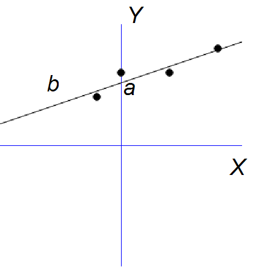

把 `y=wx+b` 中的 w、b 和直线的斜率、截距对应起来。

```python
from torch import nn    # nn = neural network
model = nn.Linear(in_features=1, out_features=1)
```

- `nn.Linear` 就是内置的**假设函数** `y = wx + b`（也叫线性层/全连接层）。
- `in_features=1`：输入特征数（对应 x）；`out_features=1`：输出维度（对应 y）, 注意大写 Linear，类名。
- 它内部自动创建参数 `model.weight`（w）和 `model.bias`（b），并且已经设好 `requires_grad=True`, 不用我们手动声明。
- 对照 3.11 的多维例子：`nn.Linear(5, 3)` 就等价于 w(5,3) + b(3)。

### 4.5 损失函数：nn.MSELoss()

```python
criterion = nn.MSELoss()                    # criterion = "标准"，损失函数的惯用变量名
loss = criterion(y_pred, train_y.reshape(-1, 1))
```

- 均方误差：3.5 计算图里的 MSE，衡量预测与真实的平均平方差。
- **`reshape(-1, 1)` 的 -1** ：-1 表示"这一维自动推算"——总元素数不变，剩下的维度定了，-1 那维自动算出来。`train_y` 原形状 (16,)，reshape(-1,1) → (16,1)，和 y_pred 的 (16,1) 对齐才能逐元素算误差。

### 4.6 优化器：optim.SGD

```python
from torch import optim
optimizer = optim.SGD(params=model.parameters(), lr=1e-2)   # lr=0.01
```

- **SGD**（Stochastic Gradient Descent，随机梯度下降）：每次用一小批数据估梯度、更新一次——"随机"就来自批的随机性。
- `model.parameters()`：把模型里所有参数（weight、bias）打包交给优化器管理。
- 训练（替代 3.4 的手动更新）：

```python
optimizer.zero_grad()   # 1. 梯度清零 —— 内部会遍历所有参数处理, 不用手动判空
loss.backward()         # 2. 反向传播算梯度
optimizer.step()        # 3. 执行更新: w新 = w旧 - lr × 梯度
```

> 对比 3.4：`x.grad.zero_()` + `x.data = ...` 两步手动操作，现在由 `zero_grad()` + `step()` 代劳。

### 4.7 完整训练代码

```python
import torch
from torch.utils.data import TensorDataset, DataLoader
from torch import nn, optim
from sklearn.datasets import make_regression
import matplotlib.pyplot as plt
plt.rcParams['font.sans-serif'] = ['SimHei']
plt.rcParams['axes.unicode_minus'] = False
---------- 1. 造数据 ----------
def create_dataset():
x, y, coef = make_regression(
n_samples=100, n_features=1, noise=1.0,
coef=True, bias=14.5, random_state=3)
x = torch.tensor(x, dtype=torch.float32)
y = torch.tensor(y, dtype=torch.float32)
return x, y, coef
---------- 2. 训练 ----------
def train(x, y, coef):
dataset = TensorDataset(x, y)
dataloader = DataLoader(dataset, batch_size=16, shuffle=True)
model = nn.Linear(1, 1)                       # 假设函数 y = wx + b
criterion = nn.MSELoss()                      # 损失函数
optimizer = optim.SGD(model.parameters(), lr=0.01)   # 优化器

epochs, loss_list = 100, []
for epoch in range(epochs):                   # 外层: 整轮循环
    total_loss, total_sample = 0.0, 0
    for train_x, train_y in dataloader:       # 内层: 每批一次 (共 7 批)
        y_pred = model(train_x)               # 前向传播
        loss = criterion(y_pred, train_y.reshape(-1, 1))   # 算损失

        optimizer.zero_grad()                 # 梯度清零
        loss.backward()                       # 反向传播
        optimizer.step()                      # 更新参数

        total_loss += loss.item()             # 累计本批损失
        total_sample += 1
    loss_list.append(total_loss / total_sample)          # 本轮平均损失
    print(f'轮数:{epoch + 1}, 平均损失值:{total_loss / total_sample}')

print(f'模型参数, 权重:{model.weight}, 偏置:{model.bias}')
return model, loss_list
if name == 'main':
x, y, coef = create_dataset()
model, loss_list = train(x, y, coef)
```

两个此前容易踩的坑：

- **total_loss 必须每轮重置**：第一版把 `total_loss, total_sample = 0.0, 0` 写在了循环外，第 2 轮起平均损失会越算越错。应该放在**外层循环的开头**，每轮清零。
- **`for _ in range(epochs)` 里的下划线**：`_` 是占位符，表示"我需要循环 100 次但用不上循环变量"，和 `for i in range(...)` 效果一样，只是更简洁。

### 4.8 运行结果与解读

真实运行输出（节选）：

```python
轮数:1, 平均损失值:911.8385271344866
轮数:2, 平均损失值:597.354474748884
轮数:3, 平均损失值:449.9265616280692
轮数:4, 平均损失值:383.0806230817522
轮数:5, 平均损失值:242.68763405936105
轮数:8, 平均损失值:112.71026120867047
轮数:10, 平均损失值:63.30958557128906
轮数:20, 平均损失值:3.876573375293187
轮数:30, 平均损失值:1.033963714327131
轮数:40, 平均损失值:0.9643536635807582
轮数:100, 平均损失值:0.8456088815416608
模型参数, 权重:Parameter containing:
tensor([[27.4863]], requires_grad=True), 偏置:Parameter containing:
tensor([14.4547], requires_grad=True)
```

**三个关键解读**：

1. **参数逼近真实值**：真实 coef = 27.478、bias = 14.5；模型学到 weight = 27.4863、bias = 14.4547——非常接近，训练成功。这就是《00》说的"机器从数据中自动学习规律"。
2. **损失曲线为什么先陡降后平稳**：前几轮参数离最优很远，梯度大、修正快；接近最优后梯度变小，收益递减。
3. **为什么 30 轮之后损失在 0.8 左右小幅波动、不再下降**：因为数据里有噪声——噪声造成的"不可约误差"就是模型能达到的下限（`noise=1.0` 时下限约为 noise² = 1，批间随机波动使其在 0.8 附近抖动）。模型已经把规律学完了，剩下的误差是噪声本身，不是模型不行。mini-batch + shuffle 的随机性也让曲线天然带锯齿。

### 4.9 可视化训练效果

```python
# 1. 损失变化曲线
plt.plot(range(epochs), loss_list)
plt.title('损失值曲线变化图')
plt.grid()
2. 拟合直线 vs 真实直线
plt.scatter(x.numpy(), y.numpy())                 # 原始散点
y_pred = model(x).detach().numpy()                # 模型预测线
coef_t = torch.tensor(coef, dtype=torch.float32)
y_true = (x * coef_t + 14.5).detach().numpy()     # 真实规律线
plt.plot(x, y_pred, color='red', label='预测')
plt.plot(x, y_true, color='green', label='真实')
plt.legend()      # 显示 label 图例
plt.grid()
plt.show()
```

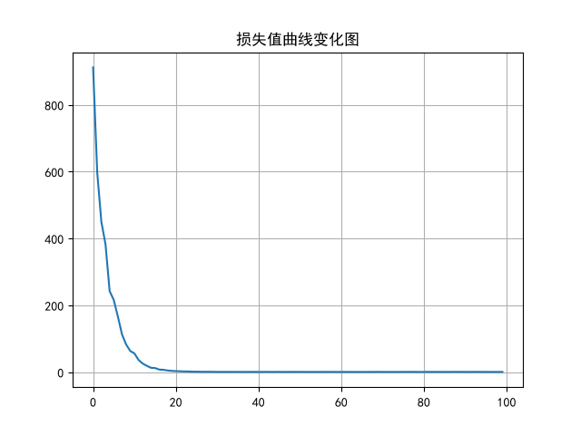

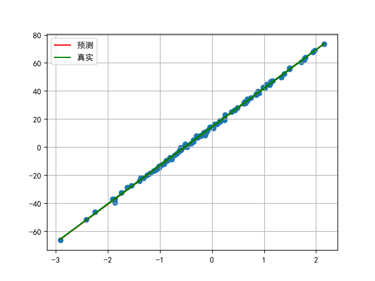

**集中回答**：

- **为什么画图前要 `.detach().numpy()`**：`model(x)` 的输出带着计算图（要参与求导），不能直接转 numpy——就是 3.8 的场景。预测只用于画图、不参与训练，detach 摘掉追踪再转。
- **为什么手写 `y_pred = [v * model.weight + model.bias for v in x]` 不行**：`model.weight` 是 1×1 的二维 Parameter，逐元素乘一维 x 会形状错乱。直接 `model(x)` 一次性前向最干净。
- **`y_true = x * coef + 14.5` 出现 DeprecationWarning**：coef 是 numpy 标量、x 是张量，两者混算触发 NumPy 2.0 的兼容性警告。规范写法先把 coef 转成张量（如上 `coef_t`）。
- **`plt.legend()` 作用**：把每条线 `label=` 参数指定的名字显示成图例（右上角小框），没有它分不清哪条是"预测"哪条是"真实"。
- **为什么 `train(x, y, coef)` 里 coef 只是画图用、不传也能训练**：训练循环里只用了 `x` 和 `y`（模型只能看到这两样），coef 只在 4.9 画"真实直线"做对比时用——所以不传 coef 模型照样训练，只是没法画对比线。

## 五、知识速查表

| 知识点 | 核心要点 |
| --- | --- |
| **形状操作** | `reshape`（乘积须等于元素总数）、`unsqueeze`/`squeeze`（插/删长度 1 的维度）、`transpose`（换两维）、`permute`（重排全部）、`view`+`contiguous`（要求内存连续） |
| **拼接操作** | `torch.cat`（沿已有维度接长，维度数不变）、`torch.stack`（开新维度堆叠，维度数 +1，形状须完全相同） |
| **自动微分** | 大白话 = 求导；`torch.autograd` 支持任意计算图的自动梯度计算 |
| **requires_grad=True** | 只给参数开；数据不开；必须是浮点型 |
| **backward()** | 从标量损失出发反向遍历计算图；只能由标量调用，向量先 `sum()`/`mean()`；梯度会累加 |
| **.grad / zero_()** | 梯度存在参数的该属性里；用 `zero_()` 清零 |
| **grad_fn** | 中间结果的"出生记录"，backward 顺它反向走 |
| **.data 与 detach()** | 取出"不带追踪的原始数据"（共享内存）；带梯度张量转 numpy 前必须先 detach |
| **权重更新** | `w新 = w旧 - 学习率 × 梯度`（b 同理）；更新放 `no_grad()` 或用 `.data` |
| **训练循环五步** | 正向 → 求损失 → backward → 更新 → 清零，循环往复 |
| **偏置** | 实际开发常省略，设为全 0 矩阵；`nn.Linear(..., bias=False)` |
| **线性回归四步** | 准备数据 → 构建模型 → 设置损失和优化器 → 模型训练 |
| **make_regression** | 造回归数据集；noise 噪声（越大越散）、coef 返回真实系数、bias 真实偏置、random_state 固定数据 |
| **TensorDataset / DataLoader** | 打包 (特征, 标签) 对 / 分批加载；批数 = ⌈总数/批大小⌉；shuffle 训练 True / 测试 False |
| **nn.Linear(in, out)** | 线性层 = 假设函数 y = wx + b；参数自动 requires_grad=True |
| **nn.MSELoss()** | 均方误差；先 `criterion(预测, 真实)` 再用返回值 backward |
| **optim.SGD(params, lr)** | 优化器：zero_grad() → backward() → step() 三连 |
| **reshape(-1, 1)** | -1 表示该维自动推算，用于把 (16,) 变 (16,1) 对齐 |
| **画图** | 带梯度张量先 `detach().numpy()`；`legend()` 显示图例；中文 Windows 用 SimHei、Mac 用 Arial Unicode MS |
| **一次训练的信号** | loss 逐轮下降、参数逼近真实规律，说明学习在生效；损失不再下降 ≈ 达到噪声下限 |
