# 神经网络基础

> 原文：[CSDN](https://blog.csdn.net/qq_63283852/article/details/167498349)

**摘要:**本文系统介绍神经网络的基础原理，从生物神经元类比出发，构建单个神经元的数学模型，阐述全连接网络的三层结构与前向传播机制。重点解析激活函数的作用与选型策略，强调非线性对网络拟合能力的关键意义，并对比Sigmoid、Tanh、ReLU等函数特性。同时讲解参数初始化的重要性及Kaiming、Xavier等方法的应用场景，最后通过PyTorch实现网络搭建、参数计算与损失函数设计，涵盖多分类交叉熵、二分类BCE及回归损失等核心内容，为深度学习实践奠定理论基础。

---

## 一、什么是神经网络——从生物神经元到数学模型

### 1.1 生物神经元的工作机制

**人工神经网络（Artificial Neural Network，ANN）** 也简称为**神经网络（Neural Network，NN）**，是一种模仿生物神经网络结构和功能的计算模型。

人脑可以看作一个生物神经网络，由约 860 亿个神经元连接而成。每个神经元的工作流程：


| 生物部件 | 做什么 | 对应人工神经元的部件 |
| --- | --- | --- |
| **树突(Dendrites)** | 接收来自其他神经元的输入信号 | 输入 x（特征） |
| **突触(**Synapse / Synapses**)** | 连接强度有强有弱 | 权重 w |
| **细胞体（细胞核）(**Cell body (nucleus) / Soma (nucleus)**)** | 汇总信号，逐渐聚集电荷，达到电位阈值就被激活 | 加权求和 z + 激活函数 f |
| **轴突(**Axon**)** | 把结果输出给下一个神经元 | 输出 a |

### 1.2 单个神经元的数学模型

**构建神经网络就是在构建神经元**。把上表的生物流程翻译成数学，一个神经元干两件事：

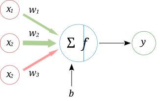

```python
输入 x₁, x₂, ..., xₙ
    ↓
① 加权求和（线性）：z = b + Σ(xᵢ · wᵢ)
    ↓
② 激活函数（非线性）：a = f(z)
    ↓
输出 a
```

**数值示例**：设输入 x₁=2, x₂=3，权重 w₁=0.5, w₂=-1，偏置 b=1：

- ① 加权求和：z = 1 + (2×0.5) + (3×(-1)) = 1 + 1 - 3 = **-1**
- ② 激活（假设用 Sigmoid）：a = f(-1) = 1/(1+e¹) ≈ **0.269**

### 1.3 多个神经元构成神经网络：三层结构

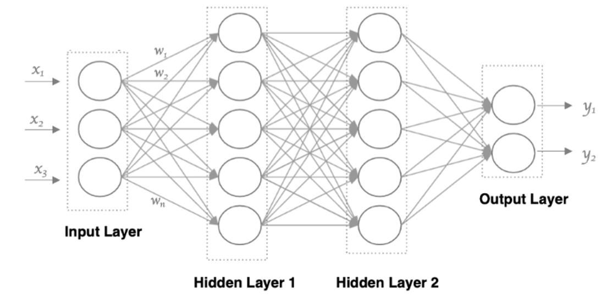

单个神经元能力有限，把多个神经元按层组织起来就是神经网络：

| 层 | 说明 |
| --- | --- |
| **输入层（Input Layer）** | 即输入 x 的那一层（图像、文本、声音等）。有几个输入特征，输入层就有几个神经元。输入层只负责**传递数据，不做计算** |
| **隐藏层（Hidden Layers）** | 输入层和输出层之间的所有层。神经网络的"深度"由隐藏层数量决定。每个隐藏神经元 = 一次"加权和 + 激活" |
| **输出层（Output Layer）** | 即输出 y 的那一层，根据任务（回归、二分类、多分类）生成最终预测结果 |

结构示意（相邻层之间两两全连接，每个连接上有一个权重 w）：

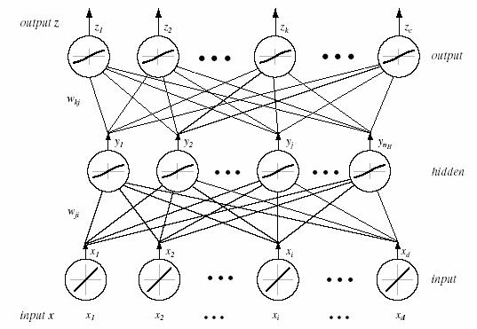

```python
输入层(3个特征)      隐藏层(3个神经元)     输出层(2个神经元)
   x₁ ──────┬──────→  h₁  ──┬──────→  o₁
            ├────────→  h₁  ──┤
   x₂ ──────┼──────→  h₂  ──┼──────→  o₂
            ├────────→  h₂  ──┤
   x₃ ──────┴──────→  h₃  ──┴────
```

关键规则：

- 相邻层之间的神经元相互连接，每个**连接分配一个强度（权重 w）**
- 前一层神经元的输出 = 后一层神经元的输入（信息逐层向前流动）
- 信息只沿一个方向移动：输入层 → 隐藏层 → 输出层
- 同一层的多个神经元并行处理相同的输入，各自学习输入数据的不同特征——每个神经元关注的部分不同，合起来才能捕捉数据的完整属性

> **注意**:构建单层神经元不是越多越好。传统全连接网络常见"漏斗形"（前面宽、后面窄），像逐层压缩信息、提炼特征，这是**经验设计**而非定理；
>
> 现代网络（如 Transformer）每层宽度相同也很常见。层数/宽度要和任务、数据量匹配，盲目加宽会过拟合且费算力。

### 1.4 全连接神经网络的特点

- **同一层的神经元之间没有连接**，相互隔离
- **第 N 层的每个神经元与第 N-1 层的所有神经元相连**——这就是 "fully connected（全连接）" 的含义
- 第 N-1 层神经元的输出就是第 N 层神经元的输入
- 每个连接都有一个权重 w，每个神经元还有一个偏置 b
- 全连接网络接收的样本数据是**二维**的（样本数 × 特征数），数据在层与层之间也以二维形式传递（呼应《02-PyTorch框架进阶》3.11 的 (2,5)·(5,3)+b）

> **疑问解答：为什么单独强调"全连接"？**
>
> | 疑问 | 解答 |
> | --- | --- |
> | 难道有**不是全连接**的神经网络吗？ | 有，而且很多——全连接只是神经网络家族中的一种"连接方式"。  卷积神经网络 CNN：局部连接 + 权重共享，每个神经元只看输入的一小块区域；  循环神经网络 RNN：带"环"，隐藏状态跨时间步传递；  Transformer：注意力动态连接。  课程后面会学 CNN/RNN，它们会打破"N 层连 N-1 层全部"这条规则——所以现在要把全连接的规则单独列清楚 |
> | 全连接代价是什么？ | 参数量最大。例：100×100 图像有 1 万个像素，第一层只放 1000 个神经元，权重就是 1000 万个——CNN 就是为了砍这个参数量而发明的 |
> | 和 1.1~1.3 讲的神经网络有区别吗？ | 没有区别。1.1~1.3 讲的"神经网络"默认就是全连接神经网络：1.2 的神经元数学模型 + 1.3 的三层结构 + 1.4 的连接规则 = 一个完整的全连接网络。1.4 只是把"全连接"这个名字背后的规则单独拎出来讲 |
> | 和**感知机**是什么关系？ | 感知机（Perceptron，1958）是只有一层的最早网络：输入→输出一个神经元，z=w·x+b 后用**阶跃激活**（≥0 输出 1，否则 0）——它连"异或"这种线性不可分问题都拟合不了，且阶跃不可微、无法用 BP 训练。把感知机堆出隐藏层 + 换成可微激活函数（Sigmoid/ReLU），就升级成**多层感知机（MLP）——它就是全连接神经网络的另一个名字**。演进线：感知机（单层、阶跃）→ MLP/全连接网络（多层、可微）→ CNN/RNN（连接方式改进） |
> | 为什么要强调"全连接"？ | ① 它是参数最多的"满配"结构，是理解其他网络的基准（CNN 是在它基础上做减法）；② 4.4 的参数量公式 fan_in×fan_out+fan_out 只对全连接层成立；  ③ 术语上 `nn.Linear` 层 = 全连接层 = FC 层，第九章案例里说的"3 个全连接层"就是它 |

### 1.5 内部状态值 z 与激活值 a

每一个神经元工作时，前向传播会产生两个值；反向传播时对应产生两个梯度：

| 概念 | 公式 | 说明 |
| --- | --- | --- |
| **内部状态值 z** | `z = W·x + b` | 加权求和的结果，反映该神经元接收到的**输入与权重计算**的结果 |
| **激活值 a** | `a = f(z)` | 激活函数对 z 做**非线性变换**后的结果，决定该神经元的最终输出 |

公式中：`W` 权重矩阵、`x` 输入、`b` 偏置、`f` 激活函数。

> z 是"攒够的电荷"，a 是"放出的信号"——激活函数就是把 z 变成 a 的那道闸门。下一章专门讲它。

## 二、激活函数——为什么要"拐个弯"

### 2.1 为什么必须有激活函数（非线性）

**激活函数对每层的输出做变换，为网络注入非线性因素**，使神经网络可以拟合各种曲线。

如果不加激活函数会怎样？多层线性叠加仍然是线性。它可以被提取公因式、合并成一个权重：

```python
第1层: z₁ = w₁·x          （w₁ = 3）
第2层: z₂ = w₂·z₁         （w₂ = 2）
合并:  z₂ = w₂·(w₁·x) = (w₂·w₁)·x = 6·x
```

数值验证：两层网络 2×(3x) = 6x——无论叠多少层线性变换，等价于一个权重为 6 的**单层**线性模型。所以：

1. **没有非线性因素的网络，等价于一个线性模型**（《00-深度学习简介》：线性模型连"异或"这种简单关系都拟合不了）
2. 加了激活函数，网络就能**逼近任意函数**，拟合能力大幅提升

激活函数拐了弯（非线性），`f(2·(3x))` 就没法合并成 `6x` 了——网络的"深"才有了意义。

另外还有一个隐藏要求：激活函数必须可微。因为网络参数更新使用的是反向传播算法（BP），梯度要沿着计算链一路求导传回去（《02》第三章手推过），不可微的函数（如 Binary step 阶跃函数）算不出梯度，BP 就走不通——这也是 2.2 起每个激活函数都配一个导数公式的原因。

**可视化动手玩**：[A Neural Network Playgroundhttp://playground.tensorflow.org](http://playground.tensorflow.org "A Neural Network Playground") 是 TensorFlow 官方的神经网络交互式 playground——网页上搭一个小网络、选一个数据集（比如圆圈分类），点运行就能实时看到"决策边界"随训练一点点长出来。把激活函数从 None 换成 Tanh，能直观看到加了非线性之后，网络才圈得出圆形边界（线性不可分场景的拟合能力变强）。

### 2.2 Sigmoid——把任意数压进 (0,1)

**S形函数(**Sigmoid**)**是指其[图](https://en.wikipedia.org/wiki/Graph_of_a_function "图")具有特征性S形**或S形曲线**的任何[数学函数](https://en.wikipedia.org/wiki/Mathematical_function "数学函数")。

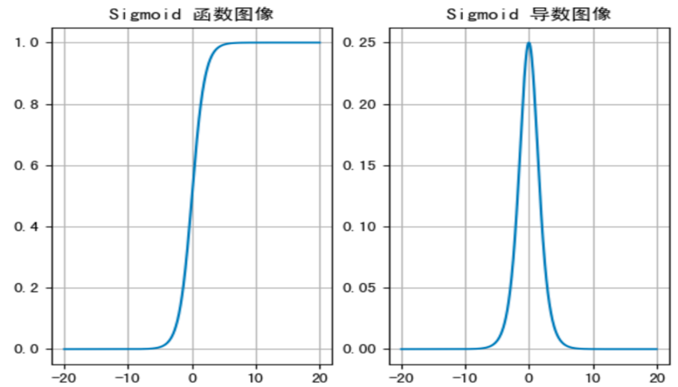

**公式**：

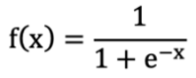

```python
f(x) = 1 / (1 + e^(-x))
```

曲线行为：x 越大输出越接近 1，x 越小（越负）输出越接近 0，x=0 时输出 0.5。

**导数**（反向传播要用）：

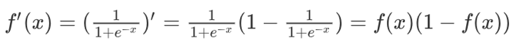

```python
f'(x) = f(x) · (1 - f(x))
```

> **导数公式怎么来的**：设 u = 1 + e^(-x)，f = u⁻¹。
>
> 链式法则：f' = -u⁻² · u' = -u⁻² · (-e^(-x)) = e^(-x)/(1+e^(-x))²。而 f(x) = 1/(1+e^(-x))、1-f(x) = e^(-x)/(1+e^(-x))，两式相乘正好等于上式——所以 f' = f(x)(1-f(x))。

**导数最大值 0.25 的推导**：f' = f(1-f) 是关于 f 的二次函数，在 f=0.5（即 x=0）时取最大：0.5 × 0.5 = **0.25**。所以 Sigmoid 的导数范围是 (0, 0.25]。

**特点**：

- 将任意输入映射到 **(0, 1)** 之间，天然适合表示概率
- 输入在 [-6, 6] 之间输出才有明显差异，[-3, 3] 之间效果较好；输入 < -6 或 > 6 时，无论输入啥激活值都差不多，会丢失信息——比如输入 100 和输入 10000，Sigmoid 的激活值几乎都等于 1，但两者相差 100 倍的信息就丢了
  > **提示**:这个区间不是谁规定的，是算出来的：x=±6 时 f≈0.9975/0.0025，已经贴着 0 和 1（曲线几乎水平 ）；x=±3 时 f≈0.95/0.05，再往外就基本不变了。看曲线/代入数值就能得到这个经验区间
- 导数范围 (0, 0.25]，当输入 < -6 或 > 6 时导数接近 0，网络参数更新极其缓慢甚至无法更新
- **Sigmoid 网络一般在 5 层之内就会梯度消失**——机理：反向传播时梯度要逐层相乘，每层最多乘 0.25，5 层后最多剩 0.25⁵ ≈ 0.001，梯度缩到千分之一，靠前的层几乎学不到东西（这就是"梯度消失"）
- **不以 0 为中心**（输出全为正），导致权重更新方向总是"同涨同跌"、走 Z 字形，收敛变慢
- 一般只用于二分类的输出层（把输出当概率），隐藏层基本不用

### 2.3 Tanh——以 0 为中心的 Sigmoid

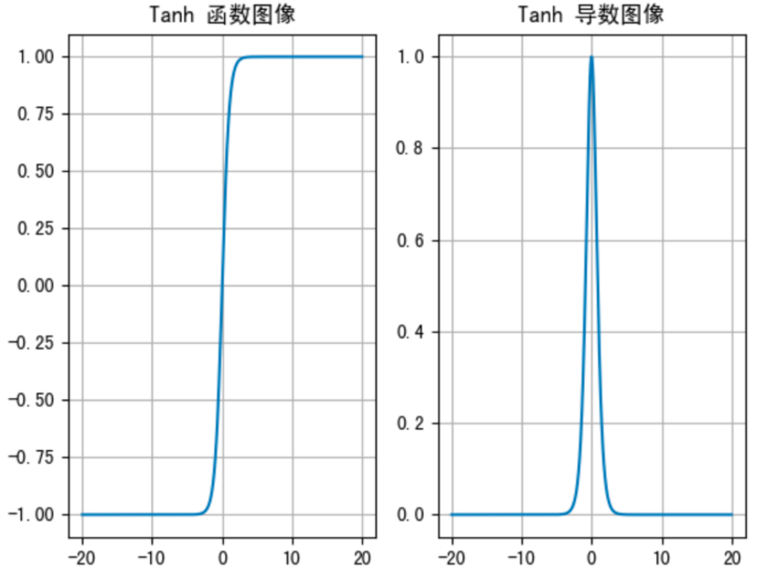

**公式**：

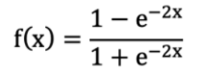

```python
f(x) = (1 - e^(-2x)) / (1 + e^(-2x))
```

> x→+∞ 时 e^(-2x)→0，分子→1、分母→1，f→**1**；
>
> x→-∞ 时 e^(-2x)→+∞，分子≈-e^(-2x)、分母≈e^(-2x)，f→**-1**。
>
> 数值例：x=3 时 e⁻⁶≈0.0025，f=(1-0.0025)/(1+0.0025)≈0.995。

**导数**：

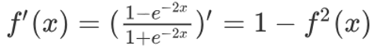

```python
f'(x) = 1 - f²(x)
```

**特点**：

- 将输入映射到 **(-1, 1)** 之间
- **以 0 为中心**，关于原点对称——权重更新方向可以分开，收敛更稳
- 当输入 ≈ < -3 或 > 3 时，输出被"压平"为 -1 或 1
- 导数范围 **(0, 1]**（x=0 时最大 1）；输入 < -3 或 > 3 时导数近似 0
- 与 Sigmoid 相比：以 0 为中心 + 平均梯度更大，**收敛更快、迭代次数更少**
- 但两侧导数同样趋于 0，**深层仍会梯度消失**
- 经验用法：隐藏层用 tanh，输出层（二分类）用 sigmoid

### 2.4 ReLU——最常用的"整流器"

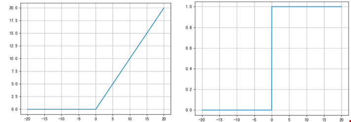

**公式**：

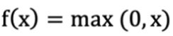

```python
f(x) = max(0, x)
```

行为：小于 0 的值映射为 0，大于 0 的值原样保留。"更加重视正信号、忽略负信号"。

**导数**：

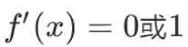

```python
f'(x) = 0  (x < 0)；  1  (x > 0)
```

**特点**：

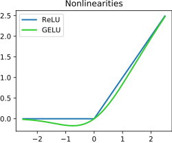

- **运算极其简单**（只有比较和截断），训练效率高
- x > 0 区域导数恒为 1，梯度不衰减，缓解梯度消失；x < 0 区域导数为 0
- 缺点：训练中部分神经元输入落入负区，输出恒 0、梯度恒 0，权重永远无法更新——**"神经元死亡"（Dead ReLU）**
- 目前隐藏层最常用的激活函数

**与 Sigmoid 相比的优势**：

1. Sigmoid 含指数运算，计算量大；ReLU 只做比较，计算量节省很多
2. Sigmoid 反向传播容易梯度消失，无法训练深层网络；ReLU 正区间梯度恒 1
3. ReLU 使一部分神经元输出为 0，网络具有**稀疏性**，减少参数相互依存，缓解过拟合

> **讲这些函数到底有什么用？为什么又讲公式又讲导数？**
>
> 激活函数是每个神经元的"闸门"，决定网络能不能拟合复杂问题；
>
> 而反向传播传梯度靠的就是导数（梯度 = 损失对参数的导数，链条里要乘每个激活函数的导数）。
>
> 所以每学一个激活函数，固定看三件事：**输出范围**（会不会饱和）、**导数范围**（梯度会不会消失）、**计算量**（训练快不快）。公式和它的名字、图像是一一对应的——公式就是函数本身，图像就是把公式画出来，导数是它参与反向传播时的"通行证"。
>
> **什么是“整流器”?**
>  它本来是电子工程里的词，和神经网络没关系 ——ReLU 借用了这个名字。
>
> 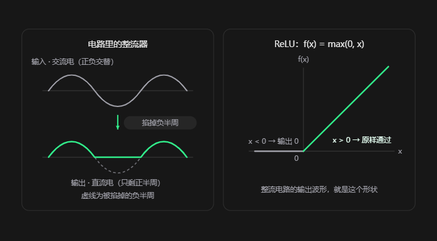
>
> 电路里的整流器 ：家用电是“交流电”，电压正负交替变化（像上图左边的波浪）。但很多电器需要电流只往一个方向走。
>
> “整流”就是**把负的那半周掐掉，只留正半周**——干这活的元件（典型是 二极管 ，只让电流单向通过）就叫 整流器 （Rectifier）。
>
> ReLU 为什么叫“整流线性单元” ：ReLU 全称 R ectified L inear U nit，其中 Rectified 就是“被整流的”。看它的公式：

```python
f(x) = max(0, x)   # 负数 → 归零（掐掉"负半周"）; 正数 → 原样通过（"正半周"直通）
```

> 对比一下，两者做的是同一件事,所以笔记 2.4 节 把它叫“最常用的整流器”——**ReLU 对数据干的活，和整流器对电流干的活一模一样：负的全砍掉，正的放行**。
>
> 小提醒：电路整流器还有“全波整流”（把负半周翻上来而不是掐掉，对应`f(x) = |x|` ），而 ReLU 是“半波整流”式的——只保留、不翻转。课程里记住max(0, x)这一版就够了。

### 2.5 Softmax——多分类的概率分配器

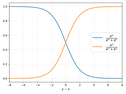

**公式**（对输出向量 z 的第 i 个分量）：

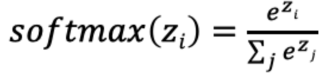

```python
softmax(zᵢ) = e^(zᵢ) / Σⱼ e^(zⱼ)
```

**特点**：

- 用于**多分类**，是 sigmoid 在多分类上的推广
- 把网络输出的原始分数（这种未归一化的分数叫 logits）映射为 **(0,1)** 之间的概率
- **所有输出概率之和为 1**（满足概率性质）
- 取概率最大的节点作为预测类别

**手算示例**（只算两个分量，感受一下）：scores = [0.2, 0.02, ..., 3.75]，e^3.75 ≈ 42.52，全部 e^z 之和 ≈ 57.52，则最后一项概率 = 42.52/57.52 ≈ 0.7392。

```python
import torch

scores = torch.tensor([0.2, 0.02, 0.15, 0.15, 1.3, 0.5, 0.06, 1.1, 0.05, 3.75])
probabilities = torch.softmax(scores, dim=0)
print(probabilities)
# tensor([0.0212, 0.0177, 0.0202, 0.0202, 0.0638, 0.0287, 0.0185, 0.0522, 0.0183, 0.7392])
# 验证: 42.52/57.52≈0.7392, 且全部相加 = 1.0
```

### 2.6 其他常见激活函数

| 名称 | 公式 | 导数 | 输出范围 |
| --- | --- | --- | --- |
| **Identity（恒等）** | f(x) = x | f'(x) = 1 | (-∞, ∞) |
| **Binary step（阶跃）** | f(x) = 0 (x<0), 1 (x≥0) | f'(x) = 0 (x≠0) | {0, 1} |
| **Leaky ReLU** | f(x) = 0.01x (x<0), x (x≥0) | f'(x) = 0.01 (x<0), 1 (x≥0) | (-∞, ∞) |
| **PReLU** | f(α,x) = αx (x<0), x (x≥0) | f'(α,x) = α (x<0), 1 (x≥0) | (-∞, ∞) |
| **ELU** | f(α,x) = α(eˣ-1) (x<0), x (x≥0) | f'(α,x) = f(α,x)+α (x<0), 1 (x≥0) | (-α, ∞) |

> **这几个都是 ReLU 的"改良家族"，思路一致：**
>
> 负区间不直接给 0，留一条小通道，避免"神经元死亡"（Leaky ReLU 留 0.01 倍斜率；PReLU 的 α 可学习；ELU 负区间用平滑曲线）。

### 2.7 激活函数怎么选

**对于隐藏层**：

1. **优先选 ReLU**
2. ReLU 效果不好再试 Leaky ReLU 等改良款
3. 用 ReLU 要注意 **Dead ReLU 问题**，避免过多神经元死亡（如学习率别太大）
4. 少用 sigmoid，可尝试 tanh

**对于输出层**（输出层的激活函数由任务决定，不能随意换）：

| 任务 | 输出层激活函数 |
| --- | --- |
| 二分类 | **sigmoid**（输出一个 0~1 概率） |
| 多分类 | **softmax**（输出多个概率，和为 1） |
| 回归 | **identity**（恒等，输出就是数值本身，不加非线性约束） |

> **为什么隐藏层可以随便挑、输出层却"必须"那样选**
>
> 隐藏层激活函数只是内部"弯头"，怎么拐都行，只要不阻断梯度；输出层直接面对任务——二分类要概率、多分类要"和为 1 的概率分布"、回归要任意实数，只有对应函数能满足这些数学性质。
>
> **记忆法**：隐藏层默认 ReLU，不行换 Leaky；输出层二 sigmoid、多 softmax、回归恒等。

**小结**：

| 问题 | 答案 |
| --- | --- |
| 激活函数的作用？ | 为网络注入非线性因素 |
| 常见激活函数？ | Sigmoid、Tanh、ReLU、Softmax 等 |
| 选择方法？ | 隐藏层 ReLU 优先；输出层：二分类 sigmoid、多分类 softmax、回归恒等 |

### 2.8 动手画：用 PyTorch 画出激活函数及其导数

光看公式不够直观，用 matplotlib 把函数图像和导数图像画出来。

三段代码套路完全一样，只有中间那行换函数、标题换名字（Sigmoid / Tanh / ReLU 各来一遍）：

```python
import torch
import matplotlib.pyplot as plt

plt.rcParams['font.sans-serif'] = ['SimHei']   # 正常显示中文标签
plt.rcParams['axes.unicode_minus'] = False     # 正常显示负号

_, axes = plt.subplots(1, 2)   # 1 行 2 个子图: 左函数图像, 右导数图像

# ---- 左图: 函数图像 ----
x = torch.linspace(-20, 20, 1000)      # 从 -20 到 20 均匀取 1000 个点
y = torch.sigmoid(x)                   # 换 torch.tanh / torch.relu 即画另外两个
axes[0].plot(x, y)
axes[0].grid()
axes[0].set_title('Sigmoid 函数图像')

# ---- 右图: 导数图像 (借助自动微分求导) ----
x = torch.linspace(-20, 20, 1000, requires_grad=True)   # 开启梯度追踪
torch.sigmoid(x).sum().backward()      # sum 后反向传播
axes[1].plot(x.detach(), x.grad)       # 横轴 x 的数值, 纵轴 x.grad (每个点的导数)
axes[1].grid()
axes[1].set_title('Sigmoid 导数图像')

plt.show()
```

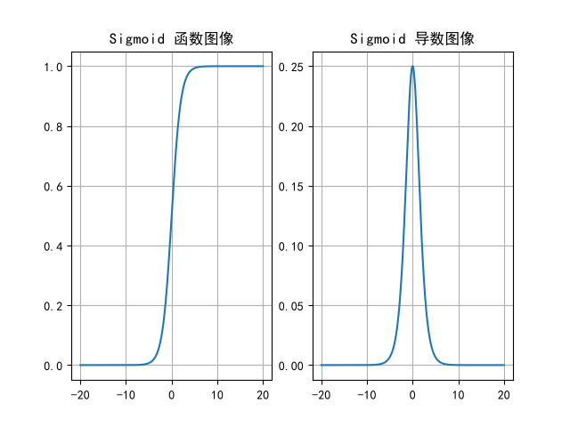

> **右图为什么这样能画出导数**
>
> 对 1000 个点组成的 x 求 sigmoid 后再 `sum()`，反向传播时**每个分量分到的梯度**恰好就是各自的导数（sum 对 xᵢ 的偏导 = f(xᵢ)'）——于是 `x.grad` 里存的就是 1000 个点的导数值，直接 plot 出来就是导数曲线。`x.detach()` 摘掉追踪信息拿纯数值（呼应《02》3.8）。这是"用自动微分验证导数公式"的小技巧，比手推更直观。
>
> **报错提示**：如果运行时遇到 `OMP: Error #15: Initializing libiomp5md.dll, but found libiomp5md.dll already initialized.`，是 OpenMP 运行库冲突，把 anaconda3/Lib/site-packages/torch/lib 目录下的 libiomp5md.dll 文件删掉（或移走）即可。

## 三、参数初始化——训练前的"起跑线"

### 3.1 为什么必须初始化

网络建好后、训练前，参数 w、b 必须先赋初值（初始化）。**偏置 b 一般直接初始化为 0**，重点在权重 w。初始化不当的三大后果：

1. **防止梯度消失或爆炸**：初始权重过大或过小，梯度会在反向传播中逐层指数级放大/缩小（呼应 2.2 的梯度消失机理）
2. **提高收敛速度**：合理的初始化让各层激活值分布适中，梯度高效更新
3. **打破对称性**：这是最核心的一条——

> **什么是对称性问题**：如果所有权重初始化成**相同的值**（全 0、全 1、同一固定值都属于此类），那么同一层里每个神经元：
>
> - 前向：输入相同 → 输出相同
> - 反向：梯度相同 → 更新后依然相同
>
> [Weight Initialization Techniques in Neural Networks | PineconeThis tutorial will discuss the early approaches to weight initialization and the limitations of zero, constant, and random initializations. We’ll then learn better weight initialization strategies based on the number of neurons in each layer, choice of activation functions, and more.https://www.pinecone.io/learn/weight-initialization/](https://www.pinecone.io/learn/weight-initialization/ "Weight Initialization Techniques in Neural Networks | Pinecone")--文章推荐(
>  全 0 初始化导致神经元对称（示意图）)

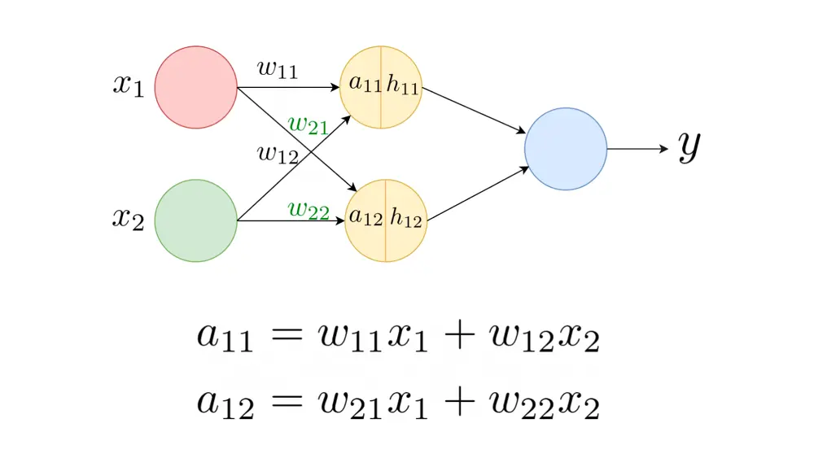

[Weight Initialization Techniques in Neural Networks | Pinecone](https://www.pinecone.io/learn/weight-initialization/ "Weight Initialization Techniques in Neural Networks | Pinecone")从头到尾每个神经元学得一模一样，一层 100 个神经元等价于只有 1 个，网络的表达能力被废掉。所以全 0、全 1、固定值初始化无法打破对称性，权重必须"随机"着初始化。

### 3.2 七种常见初始化方式

先补一个词：**高斯分布 = 正态分布**（同一个东西的两种叫法），形状是钟形曲线，"均值 0、标准差 1"的叫标准正态分布——均值决定钟的中心，标准差决定钟的胖瘦。

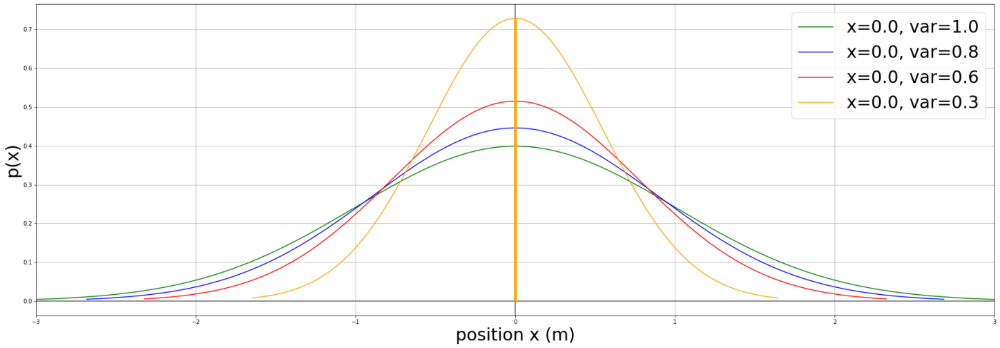

| 初始化方式 | 说明 | 能否打破对称性 |
| --- | --- | --- |
| **均匀分布初始化** | 从区间均匀随机取值，默认 (0, 1)；也可在 (-1/√d, 1/√d) 中取值，d 为该神经元输入数量 | ✅ 随机 |
| **正态分布初始化** | 从均值 0、标准差 1 的高斯分布取样。用**很小的值初始化 w**：值太大前向激活值爆炸、反向梯度爆炸，太小则信号逐层衰减 | ✅ 随机 |
| **全 0 初始化** | 所有权重 = 0 | ❌ |
| **全 1 初始化** | 所有权重 = 1 | ❌ |
| **固定值初始化** | 所有权重 = 某个固定值 | ❌ |
| **Kaiming 初始化** | 按 fan_in 定方差的随机初始化（见 3.3） | ✅ |
| **Xavier 初始化** | 按 fan_in、fan_out 定方差的随机初始化（见 3.4） | ✅ |

> **为什么正态初始化"用很小的值"**：网络是逐层乘权重往前走的，权重普遍大于 1 时信号逐层放大爆炸，普遍太小则逐层缩小消失——"小而不过小"（方差适中）才稳。

每种方式的 PyTorch 代码（日常用得最多的是随机类初始化）：

```python
import torch
import torch.nn as nn

# 统一用一个 Linear(5, 3) 层做载体: 权重形状 (3, 5), 偏置形状 (3,)
linear = nn.Linear(5, 3)

# 1. 均匀分布: 默认区间 [0, 1)
nn.init.uniform_(linear.weight)
# 输出示例: tensor([[0.1075, 0.3925, 0.3451, 0.1606, 0.1494],
#                   [0.8683, 0.8374, 0.9203, 0.4307, 0.2774],
#                   [0.3126, 0.9431, 0.1106, 0.2535, 0.8279]])

# 2. 固定值: 全部填 3
nn.init.constant_(linear.weight, 3)
# 输出示例: tensor([[3., 3., 3., 3., 3.],
#                   [3., 3., 3., 3., 3.],
#                   [3., 3., 3., 3., 3.]])

# 3. 全 0
nn.init.zeros_(linear.weight)
# 输出示例: tensor([[0., 0., 0., 0., 0.],
#                   [0., 0., 0., 0., 0.],
#                   [0., 0., 0., 0., 0.]])

# 4. 全 1
nn.init.ones_(linear.weight)
# 输出示例: tensor([[1., 1., 1., 1., 1.],
#                   [1., 1., 1., 1., 1.],
#                   [1., 1., 1., 1., 1.]])

# 5. 正态分布: 均值 mean=0, 标准差 std=1 (两个参数都可以改, 如 std=0.01)
nn.init.normal_(linear.weight, mean=0, std=1)
# 输出示例: tensor([[-1.5158,  1.5876,  0.7509,  0.1746, -0.2708],
#                   [-2.2757, -0.6781, -0.4770, -0.1687, -1.1589],
#                   [ 0.0452,  0.4518, -1.6076, -1.3884, -0.1519]])
```

**各方式的优缺点与适用场景**（选型时对照）：

| 初始化方式 | 优点 | 缺点 | 适用场景 |
| --- | --- | --- | --- |
| **均匀/正态随机** | 能有效打破对称性 | 范围选得不当可能导致梯度问题 | 浅层网络或低复杂度模型：隐藏层 1-3 层、总层数不超过 5 层 |
| **全 0** | 实现简单 | 无法打破对称性，所有神经元更新方向相同，无法有效训练 | 几乎不用，仅用于偏置项的初始化 |
| **全 1** | 实现简单 | 无法打破对称性；激活值在网络中指数增长，容易梯度爆炸 | 测试或调试（验证前向/反向传播能否跑通）；偶尔把偏置初始化为小正值（如 0.1），很少用 1 |
| **固定值** | 实现简单 | 无法打破对称性；初始权重过大或过小可能导致梯度爆炸或梯度消失 | 测试或调试 |
| **Kaiming** | 适合 ReLU，保持梯度稳定 | 对非 ReLU 激活函数效果一般 | 深度网络（10 层及以上）+ ReLU、Leaky ReLU |
| **Xavier** | 适合 Sigmoid/Tanh，解决梯度消失 | 对 ReLU 等激活函数表现欠佳 | 深度网络（10 层及以上）+ Sigmoid 或 Tanh |

### 3.3 Kaiming 初始化（HE 初始化）

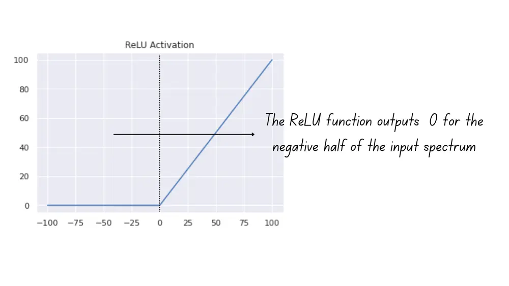

上面 3.2 的"均匀/正态随机"只保证了"随机"，没保证方差合适——方差该多大？Kaiming（何恺明）给出了答案。

**fan_in 是什么**：该层的输入神经元个数（上一层节点数）。`nn.Linear(5, 3)` 的 fan_in=5、fan_out=3（输出神经元个数）。权重矩阵形状是 (fan_out, fan_in)。

| 类型 | 说明 |
| --- | --- |
| **正态分布的 HE 初始化** | 从 N(0, std) 抽样，`std = sqrt(2 / fan_in)` |
| **均匀分布的 HE 初始化** | 从 [-limit, limit] 均匀抽样，`limit = sqrt(6 / fan_in)` |

> std 就是分布的"胖瘦"：std 值越大，w 离均值 0 分布越广（胖钟），算出来的内部状态值容易出现较大的正值或负值；std 值越小，w 越集中在 0 附近（瘦钟），内部状态值就偏小。3.2 正态初始化"用很小的值"、3.4 Xavier 的 std——都是在这根"胖瘦旋钮"上调。

> **2 和 6 是怎么推导出来的**（不展开完整证明）：
>
> 目标是"方差平衡"——让每层输出的方差和输入的方差**相等**，信号不放大也不缩小。对一层 `z = Σ(wᵢ·xᵢ)`（fan_in 项相加），由概率论结论，独立随机变量相乘相加后的方差满足：Var(z) = fan_in × Var(w) × Var(x)。要 Var(z) = Var(x)，就必须 Var(w) = 2/fan_in（分子 2 是因为 ReLU 把一半负数置 0、方差减半，补偿回来要 ×2）。
>
> 而均匀分布 U(-a, a) 的方差是 a²/3，令 a²/3 = 2/fan_in，解得 a = sqrt(6/fan_in)——这就是 6 的来源；换成正态分布，标准差 std = sqrt(2/fan_in)——这就是 2 的来源。6 = 2×3（3 是均匀分布方差的分母），两个公式同根同源。

```python
import torch.nn as nn

linear = nn.Linear(5, 3)
# Kaiming 正态: std = sqrt(2/5) ≈ 0.63
nn.init.kaiming_normal_(linear.weight)
# 输出示例: tensor([[ 1.5046, -0.5497,  0.3034, -0.0672,  1.0932],
#                   [ 1.0974,  0.2554, -1.4905, -0.5190, -0.8871],
#                   [-0.5310, -0.2631,  0.9815, -0.3557, -0.0063]])
# Kaiming 均匀: limit = sqrt(6/5) ≈ 1.10
nn.init.kaiming_uniform_(linear.weight)
```

### 3.4 Xavier 初始化（Glorot 初始化）

| 类型 | 说明 |
| --- | --- |
| **正态分布的 Xavier 初始化** | 从 N(0, std) 抽样，`std = sqrt(2 / (fan_in + fan_out))` |
| **均匀分布的 Xavier 初始化** | 从 [-limit, limit] 均匀抽样，`limit = sqrt(6 / (fan_in + fan_out))` |

> `fan_in`：输入层神经元个数；`fan_out`：输出层神经元个数。`nn.Linear(5, 3)` 这层是 5+3；若两层都是 5 个节点则是 5+5。

**与 Kaiming 的关系**：

- Xavier（Glorot）2010 年在前，Kaiming（何恺明）2015 年在后
- Xavier 的方差公式按"激活函数关于 0 对称（tanh/sigmoid）"推导；但 ReLU 会砍掉一半负值，按 Xavier 方差初始化的 ReLU 网络信号逐层衰减
- 所以 Kaiming 针对 **ReLU** 修正了方差（分子从"含 fan_out 的对称式"改成 2/fan_in）：**Kaiming 是 Xavier 在 ReLU 场景下的改良版**
- [Weight Initialization Simulator — Xavier & He | NovaSolverWeight Initialization Simulator — Xavier & He: Visualize how the activation variance evolves as an input signal forward-propagates through a deep neural netw…https://novasolver.jp/en/tools/weight-initialization.html](https://novasolver.jp/en/tools/weight-initialization.html "Weight Initialization Simulator — Xavier & He | NovaSolver")--
   Xavier vs He 初始化方差演化对比（交互工具）

```python
import torch.nn as nn

linear = nn.Linear(5, 3)
# Xavier 正态: std = sqrt(2/(5+3)) ≈ 0.5
nn.init.xavier_normal_(linear.weight)
# 输出示例: tensor([[-0.5477,  0.1713, -0.2435, -1.2390, -0.2838],
#                   [ 0.0621,  0.6306, -0.0988, -0.1411, -0.2766],
#                   [ 0.4019,  0.0305,  0.3554,  0.0850, -0.3516]])
# Xavier 均匀: limit = sqrt(6/(5+3)) ≈ 0.87
nn.init.xavier_uniform_(linear.weight)
```

### 3.5 完整代码示例（疑问逐条解答）

```python
import torch
import torch.nn as nn

# 案例: 演示参数初始化的 7 种方式
# 初始化的目的: 1.防止梯度消失/爆炸  2.提高收敛速度  3.打破对称性
# 能打破对称性的: 随机/正态/kaiming/xavier;  不能的: 全0/全1/固定值

# 1. 均匀分布随机初始化
def dm01():
    # 1.创建线性层: 输入维度 5, 输出维度 3
    # 为什么要创建 Linear? —— 初始化函数作用在"某一层的权重"上,
    # nn.Linear(5, 3) 就是提供 weight/bias 这两个待初始化的参数载体
    linear = nn.Linear(5, 3)
    # 2.对权重 w 从 [0,1) 均匀分布取值 —— 函数名结尾的下划线表示"就地修改",
    #   直接改 linear.weight 本身, 不产生新张量 (呼应《02》的 zero_/grad.zero_())
    nn.init.uniform_(linear.weight)
    # 3.对偏置 b 也做均匀分布初始化
    nn.init.uniform_(linear.bias)
    print(linear.weight.data)   # 打印纯数值, 不带追踪信息
    print(linear.bias.data)

# 2. 固定值初始化
def dm02():
    linear = nn.Linear(5, 3)
    nn.init.constant_(linear.weight, 3)   # 第二个参数 3 = 填充的固定值
    nn.init.constant_(linear.bias, 3)
    print(linear.weight.data)
    # tensor([[3., 3., 3., 3., 3.],
    #         [3., 3., 3., 3., 3.],
    #         [3., 3., 3., 3., 3.]])
    print(linear.bias.data)      # tensor([3., 3., 3.])

# 3. 全 0 初始化
def dm03():
    linear = nn.Linear(5, 3)
    nn.init.zeros_(linear.weight)
    nn.init.zeros_(linear.bias)
    print(linear.weight.data)    # 3x5 全 0
    print(linear.bias.data)      # tensor([0., 0., 0.])

# 4. 全 1 初始化
def dm04():
    linear = nn.Linear(5, 3)
    nn.init.ones_(linear.weight)
    nn.init.ones_(linear.bias)
    print(linear.weight.data)    # 3x5 全 1
    print(linear.bias.data)      # tensor([1., 1., 1.])

# 5. 正态分布随机初始化
def dm05():
    linear = nn.Linear(5, 3)
    # mean=0, std=1 是默认值, 可以改 (如 std=0.01 就是"很小的值"流派)
    nn.init.normal_(linear.weight, mean=0, std=1)
    print(linear.weight.data)
    # tensor([[-1.5158,  1.5876,  0.7509,  0.1746, -0.2708],
    #         [-2.2757, -0.6781, -0.4770, -0.1687, -1.1589],
    #         [ 0.0452,  0.4518, -1.6076, -1.3884, -0.1519]])

# 6. Kaiming 初始化
def dm06():
    linear = nn.Linear(5, 3)
    nn.init.kaiming_normal_(linear.weight)   # 正态版, std=sqrt(2/5)
    print(linear.weight.data)
    # tensor([[ 1.5046, -0.5497,  0.3034, -0.0672,  1.0932],
    #         [ 1.0974,  0.2554, -1.4905, -0.5190, -0.8871],
    #         [-0.5310, -0.2631,  0.9815, -0.3557, -0.0063]])

# 7. Xavier 初始化
def dm07():
    linear = nn.Linear(5, 3)
    nn.init.xavier_normal_(linear.weight)    # 正态版, std=sqrt(2/8)
    print(linear.weight.data)
    # tensor([[-0.5477,  0.1713, -0.2435, -1.2390, -0.2838],
    #         [ 0.0621,  0.6306, -0.0988, -0.1411, -0.2766],
    #         [ 0.4019,  0.0305,  0.3554,  0.0850, -0.3516]])

if __name__ == '__main__':
    dm07()
```

> **回答疑问**：
>
> | 疑问 | 解答 |
> | --- | --- |
> | 为啥要创建 `nn.Linear(5,3)`？ | 初始化函数不能凭空造参数，只能改"某一层已有的参数"。`nn.Linear(5,3)` 就是提供 weight（3×5）和 bias（3,）两个载体的最小实验对象。以后搭网络时只声明隐藏层和输出层（输入层不写，见第四章） |
> | 为啥函数名带下划线 `_`？ | PyTorch 约定：下划线结尾 = 就地修改（in-place），直接改原张量，不返回新张量 |
> | 打印结果和其他人不一样？ | 正常。随机初始化每次运行、每台机器都不同，只有 shape 恒定。想复现就用 `torch.manual_seed(24)`（呼应《01》伪随机） |
> | `constant_` 里的 3 是啥？ | 第二个参数=要填充的固定值，填 3 就全是 3 |
> | normal_ 的 mean/std 固定吗？ | 不固定，是可选参数；默认 mean=0, std=1 |
> | kaiming/xavier 的 normal 和 uniform 有啥区别？ | 同样的方差目标，两种随机分布实现：normal 按正态（钟形）取值，uniform 在 ±limit 内等概率取值；效果接近，任选其一 |
> | `xavier_normal` 报 FutureWarning？ | 无下划线的 `nn.init.xavier_normal()` 已弃用，一律用带下划线的 `xavier_normal_()` |

### 3.6 初始化怎么选

| 因素 | 选择建议 |
| --- | --- |
| **激活函数** | Sigmoid/Tanh：**Xavier**；ReLU/Leaky ReLU：**Kaiming** |
| **网络深度** | 浅层网络：普通随机初始化即可（隐藏层 1-3 层、总层数 ≤5）；深层网络（10 层及以上）：需要考虑**方差平衡**（Xavier / Kaiming） |

> **什么是方差平衡、为什么深层才需要**
>
> 方差平衡就是 3.3 说的"每层输出方差 = 输入方差"。浅层网络（一两层）信号走一步就到输出，方差放大点缩小点无所谓；深层网络信号要过几十层，每层方差若放大 2 倍，30 层后是 2³⁰ ≈ 10 亿倍——彻底爆炸；每层缩小一半，30 层后剩十亿分之一——彻底消失。所以层数越深，越必须用 Kaiming/Xavier 把每层方差"焊死"在 1 倍附近。
>
> 实践中 PyTorch 各层都有默认初始化（`nn.Linear` 默认 Kaiming uniform），优先选 Kaiming / Xavier，特殊需要再手动改。

## 四、神经网络搭建和参数计算

### 4.1 搭建方法：nn.Module 三步法

在 PyTorch 中定义网络 = **层的堆叠**。写一个类继承 `nn.Module`，实现两个方法：

| 方法 | 说明 |
| --- | --- |
| `__init__` | **魔法方法**（构造器）：创建对象时自动调用。在这里声明网络有哪些层并做初始化 |
| `forward` | 前向传播：描述数据怎么穿过各层。不用手动调用——实例化模型后 `model(数据)` 底层自动调它 |

> **魔法方法回顾**（《Python 基础》知识）
>
> `__xx__` 命名的方法由 Python 自动触发。`__init__` 在 `Model()` 创建时自动执行；`model(my_data)` 能直接"像函数一样调用对象"，靠的是 `nn.Module` 重写的 `__call__`，它内部再调你的 `forward`。所以forward 这个名字不能改，改了 `__call__` 找不到它；而层的属性名（linear1、output）可以随便起。

神经网络搭建流程：

1. 定义一个类，继承 `nn.Module`
2. 在 `__init__` 方法中搭建网络层（并初始化参数）
3. 在 `forward` 方法中完成前向传播

深度学习案例四步骤：**1. 准备数据 → 2. 搭建神经网络 → 3. 模型训练 → 4. 模型测试**。

### 4.2 构建示例：3 → 3 → 2 → 2 的网络

目标网络（ASCII 版结构图，每层下方的 +1 是偏置 b）：

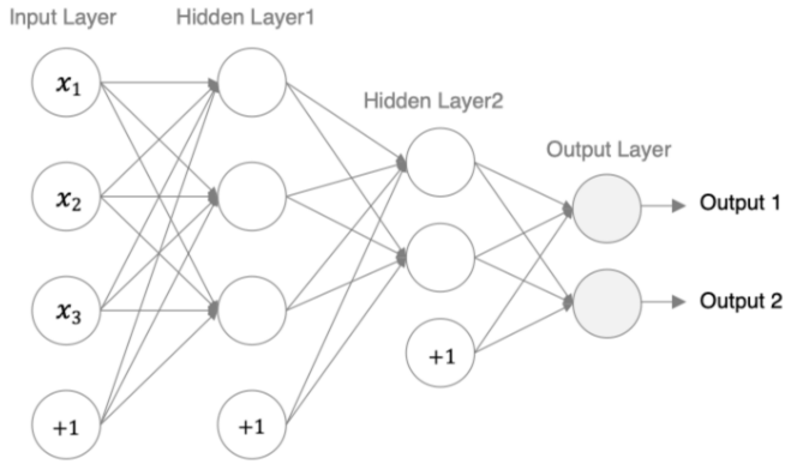

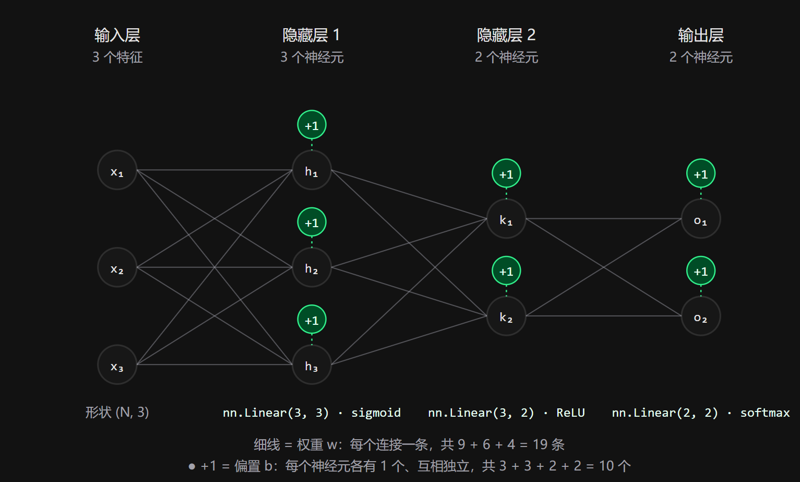

每层怎么填 `nn.Linear(?, ?)`

**in_features = 上一层的输出个数，out_features = 本层神经元个数**：

| 层 | 写法 | 推导 |
| --- | --- | --- |
| 隐藏层1 | `nn.Linear(3, 3)` | 输入 3 特征 → 本层 3 神经元 |
| 隐藏层2 | `nn.Linear(3, 2)` | 上一层输出 3 → 本层 2 神经元 |
| 输出层 | `nn.Linear(2, 2)` | 上一层输出 2 → 本层 2 神经元 |

```python
model = nn.Sequential(
    nn.Linear(3, 3), nn.Sigmoid(),   # 隐藏层1: w 3×3 + b 3 = 12 个参数
    nn.Linear(3, 2), nn.ReLU(),      # 隐藏层2: w 3×2 + b 2 = 8 个参数
    nn.Linear(2, 2)                  # 输出层: w 2×2 + b 2 = 6 个参数
)
# 合计 12 + 8 + 6 = 26，正好是 4.4 节参数量公式 fan_in×fan_out + fan_out 算出的 26
```

```python
import torch
import torch.nn as nn
from torchsummary import summary   # 计算模型参数、查看模型结构; 需安装: pip install torchsummary

# 1.定义类, 继承 nn.Module
class ModelDemo(nn.Module):
    # 2.在 __init__ 中搭建网络层
    def __init__(self):
        # 2.1 初始化父类成员 (必须第一行, 否则拿不到 PyTorch 的注册机制)
        super().__init__()
        # 2.2 搭层: 隐藏层1 + 隐藏层2 + 输出层 (输入层不写!)
        self.linear1 = nn.Linear(3, 3)   # 类名/属性名可随便起, 但 self. 必须带
        self.linear2 = nn.Linear(3, 2)
        self.output = nn.Linear(2, 2)
        # 2.3 参数初始化: 隐藏层1 用 xavier(配 sigmoid), 隐藏层2 用 kaiming(配 relu)
        nn.init.xavier_normal_(self.linear1.weight)
        nn.init.zeros_(self.linear1.bias)          # 偏置初始化为 0
        nn.init.kaiming_normal_(self.linear2.weight, nonlinearity='relu')
        nn.init.zeros_(self.linear2.bias)

    # 3.在 forward 中完成前向传播 (方法名固定, 底层自动调用; x 是传入的数据)
    def forward(self, x):
        # 合并版写法 (以后都用这种): 激活函数套在 linear 外面
        x = torch.sigmoid(self.linear1(x))   # 隐藏层1: 加权和 + sigmoid
        x = torch.relu(self.linear2(x))      # 隐藏层2: 加权和 + relu
        x = torch.softmax(self.output(x), dim=-1)  # 输出层: 加权和 + softmax
        return x

# 模型训练
def train():
    # 1. 创建模型对象
    my_model = ModelDemo()
    print(f'my_model:{my_model}')
    # 2. 准备数据: 5 个样本, 每个 3 特征
    data = torch.randn(size=(5, 3))
    print(f'data:{data}')
    print(f'shape:{data.shape}')
    print(f'data.requires_grad:{data.requires_grad}')   # False —— 数据默认不追踪
    # 3. 调用模型: model(数据) 自动执行 forward
    output = my_model(data)
    print(f'output:{output}')
    print(f'output:{output.shape}')                      # (5, 2)
    print(f'output.requires_grad:{output.requires_grad}')  # True
    # 4. 查看模型结构与参数量
    summary(my_model, input_size=(3,), batch_size=5)
    for name, param in my_model.named_parameters():
        print(f'name:{name}')
        print(f'param:{param} \n')

if __name__ == '__main__':
    train()
```

> **回答疑问**：
>
> | 疑问 | 解答 |
> | --- | --- |
> | `x` 是什么？ | forward 的形参代指"流经网络的当前数据"——第一轮它是最初输入，被每层覆盖后就变成各层的输出，最后是预测值 |
> | `dim=-1` 是什么？ | 沿最后一个维度归一化。对 (5, 2) 的输出，最后一个维度是"每行的 2 个类别"，即**每行内部概率和为 1**——5 个样本各行各自归一，互不干扰 |
> | randn 生成的数为什么都在 ±1 左右？ | `torch.randn` 是标准正态分布（均值 0、标准差 1）：约 68% 的值落在 ±1 内、95% 落在 ±2 内、99.7% 落在 ±3 内。想要大范围数值得自己指定别的分布 |
> | `data.requires_grad=False` 但 `output.requires_grad=True`？ | 数据是"原材料"默认不追踪；但前向经过了带 `requires_grad=True` 参数的层，输出是算出来的（有 grad_fn），自动继承"需要求导"属性——输出将来要参与反向传播 |
> | 激活函数为什么要写在 forward 里？ | `__init__` 只负责"有哪些层"，forward 负责"数据怎么走"——激活是数据流动的一部分 |
> | 分解版 vs 合并版？ | `x = self.linear1(x); x = torch.sigmoid(x)` 与 `x = torch.sigmoid(self.linear1(x))` 等价，以后写合并版 |

**运行输出**（真实运行结果节选，seed 不同数值会变）：

```python
my_model:ModelDemo(
  (linear1): Linear(in_features=3, out_features=3, bias=True)
  (linear2): Linear(in_features=3, out_features=2, bias=True)
  (output): Linear(in_features=2, out_features=2, bias=True)
)
data:tensor([[ 0.7537,  2.2785,  0.4243],
        [-0.0659, -1.5230, -0.0319],
        [ 0.1962,  0.6932,  0.3874],
        [ 0.4632, -0.0971, -0.5434],
        [-1.3895, -0.3431,  0.2274]])
shape:torch.Size([5, 3])
data.requires_grad:False
output:tensor([[0.8833, 0.1167],
        [0.8780, 0.1220],
        [0.8808, 0.1192],
        [0.8750, 0.1250],
        [0.8533, 0.1467]], grad_fn=)
output:torch.Size([5, 2])
output.requires_grad:True
```

看输出：每行两个概率之和都是 1（0.8833+0.1167=1.0）——softmax 在按行归一化；每行第一个概率都偏大，是因为参数随机初始化后模型还没训练，输出带偏向性。

**named_parameters() 查看 w 和 b**：继承 `nn.Module` 搭的网络，参数都被封装好了，怎么查看？用 `模型实例.named_parameters()`，会依次返回每个参数的名字和参数张量：

```python
linear1.weight Parameter containing:
tensor([[ 0.1715, -0.3711,  0.1692],
        [-0.2497, -0.6156, -0.4235],
        [-0.7090, -0.0380,  0.4790]], requires_grad=True)
linear1.bias Parameter containing:
tensor([-0.2320,  0.3431,  0.2771], requires_grad=True)
linear2.weight Parameter containing:
tensor([[-0.5044, -0.7435, -0.6736],
        [ 0.6908, -0.1466, -0.0019]], requires_grad=True)
linear2.bias Parameter containing:
tensor([0.2340, 0.4730], requires_grad=True)
output.weight Parameter containing:
tensor([[ 0.5185,  0.4019],
        [-0.4313, -0.3438]], requires_grad=True)
output.bias Parameter containing:
tensor([ 0.4521, -0.6339], requires_grad=True)
```

能对上 4.4 的参数量公式：linear1.weight 3×5=9 个数 + linear1.bias 3 个数 = 12；三个层 12+8+6=26。名字规则就是 self.属性名.weight / self.属性名.bias。

### 4.3 形状链：报错分析与"最终为什么是 (5,2)"

把 hidden 层写错（`nn.Linear(2, 2)` 当第二层）时，报错：

```python
RuntimeError: mat1 and mat2 shapes cannot be multiplied (5x3 and 2x2)
```

**原因**：每个 `nn.Linear` 本质是**矩阵乘法 `x·Wᵀ + b`**。数据 (5,3) 流到第二层时，W 是 2×2，(5×3) 矩阵乘 (2×2) 矩阵：前一矩阵的列数 3 ≠ 后一矩阵的行数 2，乘不了。

**修复原则**：每一层的 in_features 必须等于上一层的 out_features。形状链一路推下去：

| 步骤 | 运算 | 输出形状 |
| --- | --- | --- |
| 输入数据 | 5 个样本 × 3 特征 | (5, 3) |
| `linear1 = nn.Linear(3, 3)` | (5,3)·(3,3)ᵀ | (5, 3) |
| `linear2 = nn.Linear(3, 2)` | (5,3)·(3,2)ᵀ | (5, 2) |
| `output = nn.Linear(2, 2)` | (5,2)·(2,2)ᵀ | (5, 2) |

> **"最终结果为啥是 (5,2)"**：第一个 5 是样本数（5 个样本各自独立预测，全程不变）；第二个 2 是输出层神经元个数（每个样本得到 2 个类别的概率）。记住：二维输出 = (样本数, 类别数)，中间层的形状怎么变都不影响样本数。

### 4.4 参数量计算

**每一层参数量公式**：参数量 = fan_in × fan_out（w 的个数）+ fan_out（b 的个数）

以示例网络逐层算（对照课件 summary 输出 Total params: 26）：

| 层 | w 个数 | b 个数 | 小计 |
| --- | --- | --- | --- |
| `Linear(3, 3)` | 3×3 = 9 | 3 | **12** |
| `Linear(3, 2)` | 3×2 = 6 | 2 | **8** |
| `Linear(2, 2)` | 2×2 = 4 | 2 | **6** |
| **合计** | 19 | 7 | **26** |

> **面试回答模板**（"如何回答网络参数量计算"）：
>  "每层参数 = 权重 + 偏置。权重个数 = 该层输入特征数 × 输出特征数（即全连接矩阵元素个数），偏置个数 = 输出特征数（每个输出神经元一个）。把每层相加即总参数量。例如 3→3→2→2 的网络：12 + 8 + 6 = 26 个参数。" —— 若追问某一层：只算那一层的 fan_in×fan_out + fan_out 即可。

`summary()` 的输出列对照：`Param #` 就是按上式算的每层参数数；`Output Shape` 是数据流经该层后的形状。

### 4.5 神经网络的优缺点

**优点**：

- 精度高，性能优于其他机器学习方法，某些领域甚至超过人类（自动特征提取，无需人工特征工程——呼应《00-深度学习简介》）
- 可以近似任意的非线性函数（激活函数的功劳，见 2.1）
- 学界业界热捧，框架和库生态丰富（PyTorch、TensorFlow、Keras、HuggingFace 等）

**缺点**：

- **黑箱**：很难解释模型内部怎么工作。现在能解释了吗——有进展（可视化卷积特征、注意力权重分析、SHAP/LIME 等解释工具），但离"完全解释"还很远，可解释性仍是研究前沿
- 训练时间长，需要大量算力（常靠 GPU）
- 网络结构复杂，超参数（层数、宽度、学习率等）需要反复调
- 小数据集上表现不佳，容易过拟合

## 五、损失函数——给模型打分

### 5.1 什么是损失函数

**损失函数衡量模型参数的质量**：比较网络输出与真实输出的差异，差异越大损失越大。训练的目标就是让损失变小（呼应《02》梯度下降：沿损失对参数的梯度反方向更新）。

**损失函数的两大作用**：

1. **评估性能**：反映模型预测结果与目标值的匹配程度
2. **指导优化**：通过梯度下降等算法最小化损失函数，优化模型参数

不同文献叫法不同，都是它：

| 名称 | 英文 |
| --- | --- |
| 损失函数 | loss function |
| 代价函数 | cost function |
| 目标函数 | objective function |
| 误差函数 | error function |

按任务选损失函数（总览，后面逐个展开）：

| 任务 | 损失函数 | PyTorch API |
| --- | --- | --- |
| 多分类 | 多分类交叉熵损失 | `nn.CrossEntropyLoss` |
| 二分类 | 二分类交叉熵损失 | `nn.BCELoss` |
| 回归 | MAE / MSE / Smooth L1 | `nn.L1Loss` / `nn.MSELoss` / `nn.SmoothL1Loss` |

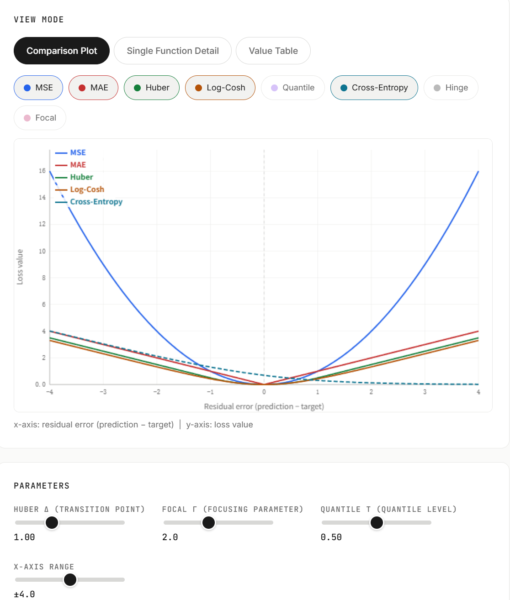

#### [Loss Function Explorer — Compare 8 Functions | ml0x图28https://ml0x.com/tools/loss-function-explorer.html](https://ml0x.com/tools/loss-function-explorer.html "Loss Function Explorer — Compare 8 Functions | ml0x")

--交互式 8 种损失函数对比画布

### 5.2 多分类：交叉熵损失 CrossEntropyLoss

**公式**：

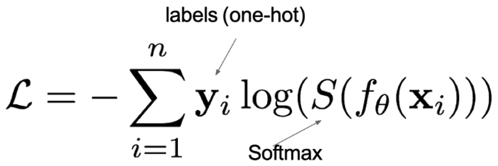

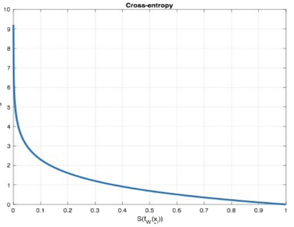

```python
L = -Σᵢ yᵢ · log( S(f(xᵢ)) )
```

符号拆解：

| 符号 | 身份 | 大白话 |
| --- | --- | --- |
| `x` | 样本 | 一条输入数据 |
| `f(x)` | 加权求和的输出分数 | 模型给每个类别打的**原始分**（logits，没归一化） |
| `S` | softmax 激活函数 | 把分数转换成**概率**（和为 1） |
| `y` | 样本的真实概率分布 | 正确答案，如独热编码 [0,1,0] |
| `L` | 损失 | 真实值与预测值差异的度量 |
| `i` | 遍历所有类别（对类别求和，不是对样本；多样本时再取平均） | 把每个类别的贡献加起来 |

[Softmax & Cross-Entropyhttps://nipunbatra.github.io/interactive-articles/softmax-cross-entropy/](https://nipunbatra.github.io/interactive-articles/softmax-cross-entropy/ "Softmax & Cross-Entropy")

--Softmax + Cross-Entropy 三类交互

**计算三步**：

1. 模型输出分数 f(x)（logits）
2. softmax 把分数变成概率 S(f(x))
3. 取真实类别对应的概率，算 -log(概率)，就是损失

**图示例子**（三分类，模型经 softmax 输出概率 [0.1, 0.7, 0.2]，真实类别是第 2 类）：

```python
类别:        猫     狗     鸟
模型概率:   0.10   0.70   0.20
真实标签:    0      1      0     ← 独热编码, 狗=1
             │      │      │
逐项相乘:   0×log0.10  1×log0.70  0×log0.20   ← 只有真实类别"活着"
             └──────┴──────┘
损失 L = -(0·log0.10 + 1·log0.70 + 0·log0.20) = -log(0.7) ≈ 0.357
```

**公式本质**：交叉熵公式看起来吓人，其实只有一句话——**损失 = -log(模型给真实类别的那个概率)**。那一大串 Σ yᵢ·log(...) 只是"用数学语言挑出真实类别"：独热编码只有真实类别的 yᵢ=1，其他全是 0，乘完求和自动只剩真实类别那一项（上面图示已演示）。多分类、二分类的交叉熵都是这一个逻辑。

> **从概率角度理解**：损失 = 最小化"正确类别的预测概率"的负对数。预测正确类别概率越接近 1，-log(概率) 越接近 0（loss=-log(1)=0 最小）；越接近 0，损失越趋近无穷大。模型只有"把正确的说对"才能降损失。

**PyTorch 实现**：

```python
import torch
import torch.nn as nn

# 演示多分类交叉熵损失
def dm01():
    # 1.真实值: 两种写法都行 ——
    #    写法A(独热编码): y_true = torch.tensor([[0, 1, 0], [1, 0, 0]], dtype=torch.float)
    #      独热形式是概率分布, 必须是浮点型
    #    写法B(类别索引): 直接写类别编号, 必须是 int64 —— 主流写法
    y_true = torch.tensor([0, 1])
    # 2.预测值: 模型输出的 logits (未 softmax 的原始分数)
    y_pred = torch.tensor([[0.1, 0.8, 0.1], [0.7, 0.2, 0.1]], requires_grad=True, dtype=torch.float)
    # 3.实例化交叉熵损失 (reduction 默认 'mean': 多样本损失取平均;
    #   reduction='sum' 时返回总损失, 不除以样本数)
    criterion = nn.CrossEntropyLoss()
    # 4.计算损失 —— criterion 是"损失对象", 调用它就像调函数:
    #   nn.Module 重写了 __call__ 魔法方法, criterion(预测, 真实) 自动执行计算
    loss = criterion(y_pred, y_true)
    print(f'损失值:{loss}')

if __name__ == '__main__':
    dm01()
# 损失值:1.3288381099700928
```

**手算核对**（示例输出，按公式推得）：

- 样本1 logits [0.1, 0.8, 0.1]，真实类别 0：softmax 概率 p₀ = e^0.1/(e^0.1+e^0.8+e^0.1) ≈ 1.1052/4.4359 ≈ 0.2492，loss₁ = -ln(0.2492) ≈ 1.389
- 样本2 logits [0.7, 0.2, 0.1]，真实类别 1：p₁ = e^0.2/(e^0.7+e^0.2+e^0.1) ≈ 1.2214/4.3404 ≈ 0.2814，loss₂ = -ln(0.2814) ≈ 1.268
- 平均：(1.389 + 1.268) / 2 ≈ **1.3288** ✓ 与运行结果一致

> **重点：`nn.CrossEntropyLoss() = softmax + 损失计算`（二合一封装）**。所以：
>
> 1. 传给它的预测值是 logits（原始分数），不是概率, 它内部先做 softmax
> 2. 用了这个损失函数，输出层就不用再写 softmax 激活（写了等于 softmax 两次，效果变差）
> 3. 真实值用类别索引（如 [0, 1]），不用手动独热
> 4. 为什么运用 logits 不直接运用概率：先 softmax 再取 log，概率极小时（如 0.0001）log 值会数值不稳定；PyTorch 内部用 log_softmax 一步算完，数值更稳

### 5.3 二分类：BCELoss

二分类用 **sigmoid**，损失函数换成**二分类交叉熵**：

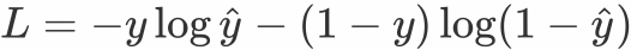

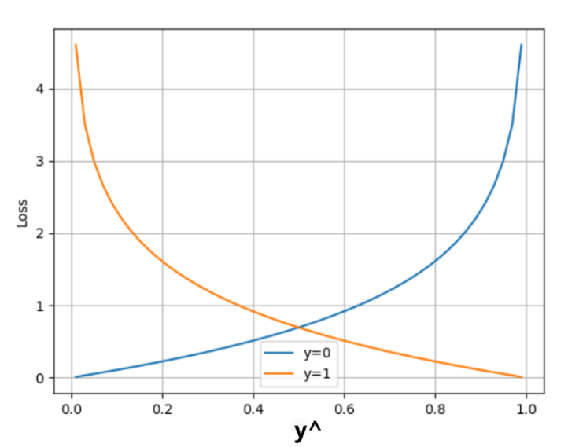

```python
L = -y·log(ŷ) - (1-y)·log(1-ŷ)
```

其中：`y` 真实标签（0 或 1）、`ŷ` 预测概率（sigmoid 之后的输出）、`L` 损失。

> **公式里为什么没有 sigmoid(**
>  上一个公式有 softmax 这个没有**)**：**公式里的 ŷ 已定义为 sigmoid 之后的概率**。softmax 被 CrossEntropyLoss 打包了，而 sigmoid 没被打包进 BCELoss——用 BCELoss 前必须手动过一遍 sigmoid。
>
> **CrossEntropyLoss = softmax + 损失；BCELoss = 只算损失，sigmoid 自己加**。

**为什么"y=0 或 y=1 时，公式要么算前半、要么算后半"**：把 y 代进去看:

- y=1：L = -log(ŷ)，只剩前半: 惩罚"正确类(1)的概率给低了"
- y=0：L = -log(1-ŷ)，只剩后半: 惩罚"错误类(1)的概率给高了"

作用：不管真实标签是 0 还是 1，公式都自动聚焦到**真实类别对应的预测概率**，只惩罚"说错的那部分"。

**场景：预测"这次考试是否通过"，模型输出的概率是 ŷ**

| 场景 | 真实 y | 模型说 ŷ | 代公式计算 | 损失 L | 感觉 |
| --- | --- | --- | --- | --- | --- |
| 猜对了还很自信 | 1 | 0.95 | -log(0.95) | ≈ 0.05 | 损失几乎为零，表现好 |
| 猜对了但没把握 | 1 | 0.60 | -log(0.60) | ≈ 0.51 | 还行，但不够自信 |
| 完全猜反了 | 0 | 0.95 | -log(1-0.95) = -log(0.05) | ≈ 3.00 | 巨高，模型严重错误 |

规律：模型给真实类别的概率越高，损失越小；越低，损失越大, log 单调递减的特性天然就是"惩罚说错、奖励说对"。对照 5.2 的一句话本质：二分类和多分类的交叉熵是同一个逻辑，公式里 y· 和 (1-y)· 两项只是"挑出真实类别"的工具。

**PyTorch 实现**：

```python
import torch
import torch.nn as nn

# 演示二分类交叉熵损失
def dm01():
    # 1.真实值: 0 或 1
    y_true = torch.tensor([0, 1, 0], dtype=torch.float)
    # 2.预测值: 必须是 sigmoid 之后的概率 (0~1)
    y_pred = torch.tensor([0.6901, 0.9845, 0.2311], dtype=torch.float)
    # 3.实例化损失对象 —— 不能写 nn.BCELoss(y_pred, y_true)!
    #   BCELoss 是"类", 直接传参是"创建对象"的语法错误;
    #   正确姿势: 先实例化 criterion = nn.BCELoss(), 再 criterion(预测, 真实)
    criterion = nn.BCELoss()
    # 4.计算损失 —— .detach() 摘掉追踪(预测值带 requires_grad, 直接转 numpy 报错),
    #   .numpy() 转成数组只看数值 (呼应《02》3.8 detach)
    loss = criterion(y_pred, y_true).detach().numpy()
    print(f'损失值:{loss}')

if __name__ == '__main__':
    dm01()
# 损失值:0.4832
```

**手算核对**（示例输出，按公式推得）：

- 样本1 y=0, ŷ=0.6901：L₁ = -log(1-0.6901) = -log(0.3099) ≈ 1.1712
- 样本2 y=1, ŷ=0.9845：L₂ = -log(0.9845) ≈ 0.0156
- 样本3 y=0, ŷ=0.2311：L₃ = -log(1-0.2311) = -log(0.7689) ≈ 0.2629
- 平均：(1.1712 + 0.0156 + 0.2629) / 3 ≈ **0.4832** ✓

### 5.4 回归损失一：MAE（L1 Loss）

**Mean Absolute Error（MAE）** 也称 **L1 Loss**，以绝对误差为距离：

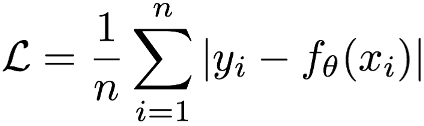

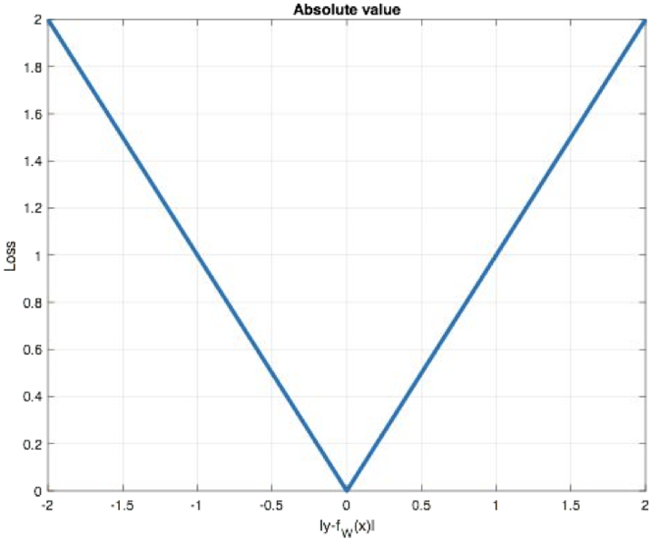

```python
L = (1/n) · Σᵢ |yᵢ - f(xᵢ)|
```

即"误差绝对值之和 ÷ 样本总数"。

**特点**：

1. 作为正则项使用时具有**稀疏性**——L1 正则会把许多权重压成正好 0
2. 最大问题：梯度在零点不平滑（|x| 在 x=0 处不可导），优化时可能跳过极小值
3. 适用场景：回归问题中存在**异常值或噪声数据**时——误差线性计账，不像平方那样放大，对离群点不敏感

**PyTorch 实现**：

```python
import torch
import torch.nn as nn

# 演示 MAE 损失
def dm01():
    y_true = torch.tensor([2.0, 2.0, 2.0], dtype=torch.float)   # 真实值
    y_pred = torch.tensor([1.0, 1.0, 1.9], requires_grad=True)  # 预测值
    criterion = nn.L1Loss()
    loss = criterion(y_pred, y_true).detach().numpy()
    print(f'损失值:{loss}')

if __name__ == '__main__':
    dm01()
# 损失值:0.699999988079071
```

**手算核对**：|2-1| + |2-1| + |2-1.9| = 1 + 1 + 0.1 = 2.1，除以样本数 3 → **0.7** ✓

### 5.5 回归损失二：MSE（L2 Loss）

**Mean Squared Error（MSE）** 也称 **L2 loss**，以误差平方为距离（即欧氏距离的平方）：

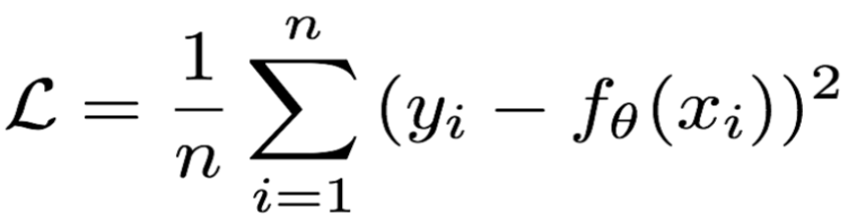

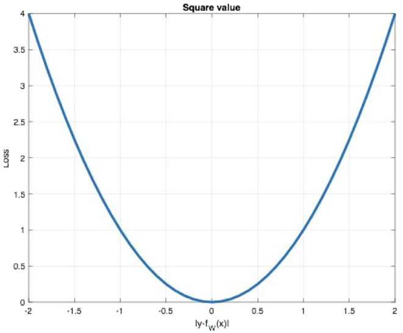

```python
L = (1/n) · Σᵢ (yᵢ - f(xᵢ))²
```

即"误差平方之和 ÷ 样本总数"。

> 什么是欧氏距离？：
>
> - L2 = 欧氏距离（Euclidean）：两点间**直线距离**，√(Δx²+Δy²)
> - L1 = 曼哈顿距离（Manhattan，也叫出租车距离）：网格街道上拐弯走的距离，|Δx|+|Δy|
> - 另外，"L1/L2 loss"与"L1/L2 **正则**"名字相同但用途不同：MSELoss 只是损失，不做正则；L2 正则（权重衰减）是训练时另外加的惩罚项。L1 正则把权重压成正好 0（稀疏），L2 正则把权重压到接近 0 但不等于 0
>
> **MSE "更关注异常点"**：平方放大了大误差——差 10 的样本贡献 100，差 2 的只贡献 4；大误差（异常点）在损失里权重被放大，训练会优先纠正它。

**特点**：

1. 也常作为正则项
2. 当预测值与目标值相差很大时，平方放大 → 梯度容易爆炸
   - 梯度爆炸：网络层之间的梯度（值大于 1.0）重复相乘，指数级增长——和 2.2 的梯度消失（值小于 1.0 重复相乘，指数级缩小）是一枚硬币的两面
3. 适用场景：大多数**标准回归问题**，如房价预测、温度预测等

**PyTorch 实现**：

```python
import torch
import torch.nn as nn

# 演示 MSE 损失 (同一组数据, 只换损失函数)
def dm02():
    y_true = torch.tensor([2.0, 2.0, 2.0], dtype=torch.float)
    y_pred = torch.tensor([1.0, 1.0, 1.9], requires_grad=True)
    criterion = nn.MSELoss()
    loss = criterion(y_pred, y_true).detach().numpy()
    print(f'损失值:{loss}')

if __name__ == '__main__':
    dm02()
# 损失值:0.6700000166893005
```

**手算核对**：1² + 1² + 0.1² = 1 + 1 + 0.01 = 2.01，除以 3 → **0.67** ✓

### 5.6 回归损失三：Smooth L1

**Smooth L1 = 光滑化的 L1**，分段函数（x = 预测值 - 真实值）：

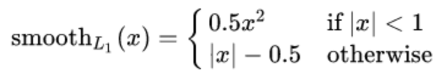

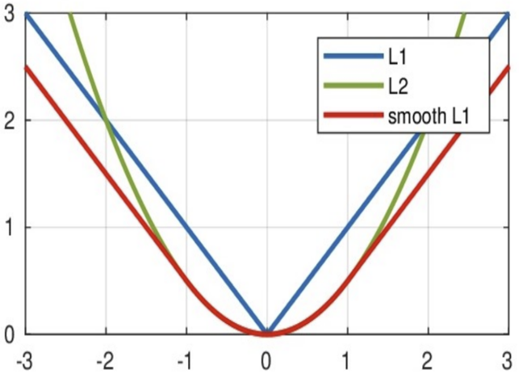

```python
smooth_L1(x) = 0.5·x²        当 |x| < 1
               |x| - 0.5      其他
```

**特点**：

1. 误差小（|x|<1）的段落用 **L2**（0.5x²）——解决了 L1 在 0 点不平滑、可能错过最小值的问题
2. 误差大（|x|≥1）的段落用 **L1**（线性增长）——解决了 L2 平方放大、离群点梯度爆炸的问题

**PyTorch 实现**（同一组数据三连对比）：

```python
import torch
import torch.nn as nn

# 演示 Smooth L1 损失
def dm03():
    y_true = torch.tensor([2.0, 2.0, 2.0], dtype=torch.float)
    y_pred = torch.tensor([1.0, 1.0, 1.9], requires_grad=True)
    criterion = nn.SmoothL1Loss()
    loss = criterion(y_pred, y_true).detach().numpy()
    print(f'损失值:{loss}')

if __name__ == '__main__':
    dm03()
# 损失值:0.33500000834465027
```

**手算核对**：差值 x = [-1, -1, -0.1]。前两个 |x|=1 不小于 1，走 L1 段：|-1|-0.5 = 0.5（×2 = 1.0）；第三个 |x|=0.1<1 走 L2 段：0.5×0.01 = 0.005。合计 1.005，除以 3 → **0.335** ✓

> **三个损失为什么差别这么大、谁"最差"**：
>
> 同一组误差 [1, 1, 0.1]，
>
> MAE 线性计账 = 0.7；
>
> MSE 平方计账 = 0.67；
>
> Smooth L1 大误差走 L1、小误差打折 = 0.335。
>
> 损失数值大小只在"同一种损失函数内部"可比，跨函数比较没有意义——不能说 0.335 的模型就比 0.7 的好，因为"尺子"都不一样。没有谁最差，只有和任务匹不匹配（离群点多 → Smooth L1 稳；要强调大误差 → MSE）。
>
> 课程后续以分类任务为主，多分类交叉熵是最常用的默认选择；回归任务则按需在 L1/MSE/SmoothL1 里挑。

### 5.7 小结

| 任务类型 | 损失函数 | PyTorch API | 要点 |
| --- | --- | --- | --- |
| **多分类** | 交叉熵损失 | `nn.CrossEntropyLoss` | softmax + 损失二合一，输入 logits + 类别索引，输出层不用再 softmax |
| **二分类** | 二分类交叉熵 | `nn.BCELoss` | 公式不含 sigmoid，要先手动 sigmoid，输入 0~1 概率 |
| **回归** | MAE（L1） | `nn.L1Loss` | 绝对误差，0 点不可导，对离群点稳 |
| **回归** | MSE（L2） | `nn.MSELoss` | 平方误差，放大异常点，大误差梯度易爆炸 |
| **回归** | Smooth L1 | `nn.SmoothL1Loss` | 小误差用 L2、大误差用 L1，两者优点结合 |
